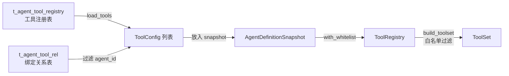

# Agent 智能体系统功能文档

> **文档最后更新**：2026-04-28
> **适用仓库**：`nucleus-rs`
> **目标读者**：Rust 开发人员、Agent 模块维护者
> **当前阶段**：Phase 7（治理与生产能力）已完成，架构精简重构已完成，Registry 同形装配范式已落地

---

## 一、系统定位

`nucleus-rs` 的 Agent 系统是一套**配置驱动、结构化动作协议优先**的智能体运行时平台，已完成从最小可用基座到多 Agent 协作与生产治理的完整建设。

| 层面                                   | 状态                  |
| -------------------------------------- | --------------------- |
| 运行时基座（`agent-base`）             | ✅ 已完成             |
| 平台装配层（`agent-platform`）         | ✅ 已完成             |
| 服务入口层（`agent-service`）          | ✅ 已完成（基础接口） |
| 知识与记忆接入                         | ✅ 已完成             |
| Rules / Skills / MCP / Commands / 子智能体 | ✅ 已完成         |
| 多 Agent 调度（FanOut / Delegate / DelegateSubAgentTool） | ✅ 已完成 |
| 运行记录与工具审计                     | ✅ 已完成             |
| 架构精简重构                           | ✅ 已完成             |
| Registry 同形装配范式                  | ✅ 已完成             |
| 生产化（Metrics / Tracing / 版本治理） | ⏳ 计划中             |

---

## 二、核心架构

### 模块分层

```text
┌──────────────────────────────────────────────────────┐
│              service-hub/agent-service（服务入口层）   │
│  Controller / Router / DTO / Service / DAO            │
├──────────────────────────────────────────────────────┤
│              crates/core/agent-platform（平台装配层）  │
│  provider / resolver / memory / knowledge             │
│  scheduler / observability                            │
├──────────────────────────────────────────────────────┤
│              crates/core/agent-base（运行时基座层）    │
│  types / runtime / planner / tools / mcp              │
│  memory / scheduler / event / observability           │
├──────────────────────────────────────────────────────┤
│              依赖层                                    │
│  rag-core / job-engine / entity / migration / rig-core│
└──────────────────────────────────────────────────────┘
```

### 模块依赖关系

```text
agent-service
  └── agent-platform
        ├── agent-base
        ├── rag-core（知识检索）
        ├── job-engine（异步任务）
        ├── database / entity / migration
        └── rig-core（LLM 推理 + 工具系统，必选依赖）
```

### 运行时执行流程

```text
Client Request
  → Load AgentDefinitionSnapshot（DB + .codebuddy 双源融合）
  → AgentRuntime::builder(snapshot, model, publisher, services)
      .build().await                          ← 自动初始化工具 + MCP
  → AgentRuntime::run()
      ├── RunRecorder.create()（记录运行开始）
      ├── MemoryRetriever.recall()（召回历史记忆）
      ├── 组装 System Context（Prompt + Rules + Skills + Session + Memory）
      ├── [循环] ModelAdapter::completion(request)
      │     ├── CallTool → ToolSet.call() + ToolAuditLogger.log()
      │     ├── QueryKnowledge → AgentKnowledgeAdapter（rag-core）
      │     ├── RecallMemory → MemoryRetriever
      │     ├── DelegateSubAgent → SubAgentScheduler.delegate()
      │     ├── FanOutSubAgents → SubAgentScheduler.delegate_fan_out()（并发限制 8）
      │     └── Finalize → 产出最终回答
      ├── MemoryWriter.write()（写入流水记忆）
      └── RunRecorder.finish()（记录运行结束）
```

### 关键设计原则

- **动作层结构化，展示层自然语言**：所有可执行动作通过 `function calling` 或受 `JSON Schema` 约束的结构化协议触发，禁止解析自由文本驱动工具调用
- **`agent-base` 不依赖数据库**：只消费统一快照（`AgentDefinitionSnapshot`）与抽象 Provider
- **Builder 模式统一构建**：所有运行时构建通过 `AgentRuntime::builder(...).build().await`，`build()` 自动初始化工具和 MCP 连接
- **配置驱动工具可用性**：工具的可用性完全由 `snapshot.tool_configs`（来自 `t_agent_tool_registry` + `t_agent_tool_rel`）决定，采用"候选池 + 白名单"两层模式
- **`.codebuddy` 自动发现**：运行前自动探测工作区，存在则参与装配，不存在则忽略
- **Noop 默认实现**：所有可选组件（记忆、审计、调度器）均有 Noop 实现，通过 `RuntimeServices::noop()` 一键构建

---

## 三、功能状态清单

### 3.1 运行时基座（`agent-base`）

| 功能                                                                  | 状态                       |
| --------------------------------------------------------------------- | -------------------------- |
| `AgentDefinitionSnapshot` 领域模型                                    | ✅ 已实现                  |
| `AgentRuntime` + `AgentRuntimeBuilder`（Builder 模式）                | ✅ 已实现                  |
| `ModelAdapter` trait（类型擦除的 CompletionModel）                    | ✅ 已实现                  |
| `RuntimeServices`（运行时服务聚合）                                   | ✅ 已实现                  |
| `ToolRegistry`（候选池 + 白名单筛选）                                 | ✅ 已实现                  |
| `RuleRegistry`（本地扫描 + 动态注入）                                 | ✅ 已实现                  |
| `SkillRegistry`（本地扫描 + 白名单）                                  | ✅ 已实现                  |
| `McpRegistry`（配置注册 → 延迟连接）                                  | ✅ 已实现                  |
| `CommandRegistry`（本地扫描 + 动态注入）                              | ✅ 已实现                  |
| `SubAgentRegistry`（本地扫描 + 动态注入 + 循环/深度控制）             | ✅ 已实现                  |
| `DelegateSubAgentTool`（子智能体作为 function calling 工具）          | ✅ 已实现                  |
| `AgentEventPublisher`（流式事件推送）                                 | ✅ 已实现                  |
| `AgentMemoryRetriever` / `AgentMemoryWriter` trait                    | ✅ 已实现                  |
| `AgentKnowledgeRetriever` trait                                       | ✅ 已实现                  |
| `SubAgentScheduler` trait（旧路径，保留兼容）                         | ✅ 已实现                  |
| `AgentRunRecorder` / `AgentToolAuditLogger` trait                     | ✅ 已实现（Phase 7）       |
| 内置工具（`read_file` / `list_dir` / `run_command` / `search_files`） | ✅ 已实现                  |
| MCP 工具支持（`rig-core/rmcp`）                                       | ✅ 已实现（`mcp` feature） |
| MCP 内省工具（`list_mcp_services` / `list_mcp_service_tools`）        | ✅ 已实现（`mcp` feature） |
| `McpRegistry` 延迟连接（配置注册 → 按需连接）                         | ✅ 已实现                  |
| 所有组件 Noop 实现                                                    | ✅ 已实现                  |

### 3.2 平台装配层（`agent-platform`）

| 功能                                               | 状态                 |
| -------------------------------------------------- | -------------------- |
| `AgentDefinitionProvider` trait                    | ✅ 已实现            |
| `DbAgentDefinitionProvider`（数据仓储，瘦身后仅做数据查询） | ✅ 已实现     |
| `AgentRuntimeResolver`（快照 → 运行时）            | ✅ 已实现            |
| `DbAgentMemoryWriter` / `DbAgentMemoryRetriever`   | ✅ 已实现（Phase 4） |
| `AgentKnowledgeAdapter`（接入 `rag-core`）         | ✅ 已实现（Phase 4） |
| `PlatformSubAgentScheduler`（子智能体调度，保留兼容） | ✅ 已实现（Phase 6） |
| `DbAgentRunRecorder` / `DbAgentToolAuditLogger`    | ✅ 已实现（Phase 7） |
| Rules / Skills 数据库加载                          | ✅ 已实现（Phase 5） |
| MCP 服务绑定加载                                   | ✅ 已实现（Phase 5） |
| 子智能体绑定加载                                   | ✅ 已实现（Phase 5） |
| `LocalCodeBuddyProvider` / `CompositeAgentDefinitionProvider` | ⛔ 已移除（由各 Registry 自扫描本地资源替代） |
| 运行时缓存（Snapshot / Model / Skill / Rule）      | ❌ 未实现            |

### 3.3 配置来源与融合

| 功能                                                                        | 状态      |
| --------------------------------------------------------------------------- | --------- |
| 数据库主配置源                                                              | ✅ 已实现 |
| `.codebuddy` 本地配置源（`agents/` / `rules/` / `skills/` / `sub-agents/`） | ✅ 已实现 |
| 本地优先（`local_first`）融合策略                                           | ✅ 已实现 |
| 仅数据库（`db_only`）模式                                                   | ✅ 已实现 |
| 合并模式（`merged`）：本地为主，数据库补充                                  | ✅ 已实现 |
| 请求级临时覆盖                                                              | ⏳ 计划中 |
| 配置变更主动失效缓存                                                        | ❌ 未实现 |

### 3.4 知识与记忆

| 功能                                     | 状态                          |
| ---------------------------------------- | ----------------------------- |
| `QueryKnowledge` 动作（接入 `rag-core`） | ✅ 已实现                     |
| 多知识库并发检索 + 结果合并              | ✅ 已实现                     |
| 流水记忆写入（`t_agent_memory_stream`）  | ✅ 已实现                     |
| 流水记忆召回（按重要性 + 时间排序）      | ✅ 已实现                     |
| 精炼记忆表（`t_agent_memory_distilled`） | ✅ 已实现（表结构就绪）       |
| 精炼记忆蒸馏任务（LLM 总结 + 向量化）    | ❌ 未实现（Phase 7 后续）     |
| 记忆语义向量召回（升级版）               | ❌ 未实现（当前为数据库排序） |
| 记忆 TTL 清理策略                        | ❌ 未实现                     |

### 3.5 Rules / Skills / MCP

| 功能                                                                      | 状态                           |
| ------------------------------------------------------------------------- | ------------------------------ |
| Rules 数据库注册与绑定（`t_agent_rule_registry` / `t_agent_rule_rel`）    | ✅ 已实现                      |
| Rules 注入 System Prompt（按优先级排序）                                  | ✅ 已实现                      |
| Skills 数据库注册与绑定（`t_agent_skill_registry` / `t_agent_skill_rel`） | ✅ 已实现                      |
| Skills 摘要注入（`inject_mode=0`）                                        | ✅ 已实现                      |
| Skills 完整内容注入（`inject_mode=1`）                                    | ✅ 已实现                      |
| MCP 服务绑定（`t_agent_mcp_service_rel`）                                 | ✅ 已实现（表结构 + 快照加载） |
| MCP 延迟连接（`from_configs` 同步 → `connect_all` 异步）                  | ✅ 已实现                      |
| MCP 内省工具（LLM 可查询已连接服务和工具）                                | ✅ 已实现                      |
| MCP 工具实际调用（`rig-core/rmcp`）                                       | ✅ 已实现（`mcp` feature）     |
| `.codebuddy/rules/` 本地规则加载                                          | ✅ 已实现                      |
| `.codebuddy/skills/` 本地技能加载                                         | ✅ 已实现                      |
| `.codebuddy/sub-agents/` 本地子智能体描述加载                             | ✅ 已实现                      |

### 3.6 多 Agent 调度

当前存在两条子智能体调用路径，**新路径基于 `DelegateSubAgentTool`**（LLM function calling），**旧路径基于 `PlannerDecision::DelegateSubAgent` + `SubAgentScheduler`**，两条路径暂时共存。

| 功能                                                         | 状态                 |
| ------------------------------------------------------------ | -------------------- |
| `DelegateSubAgentTool`（子智能体作为 function calling 工具） | ✅ 已实现（新路径）  |
| `DelegateSubAgent` 动作（Planner 决策，单次委派）            | ✅ 已实现（旧路径）  |
| `FanOutSubAgents` 动作（Planner 决策，并发扇出）             | ✅ 已实现            |
| `PlatformSubAgentScheduler`（通过 Provider 加载子智能体）    | ✅ 已实现            |
| `SubAgentRegistry`（本地 agents 扫描 + 动态注入 + 合并）     | ✅ 已实现            |
| 循环检测（`AgentResolveContext.visited` 父链路追踪）         | ✅ 已实现            |
| 递归深度控制（`max_depth`，默认 3，`max_delegation_depth` 自动递减） | ✅ 已实现     |
| FanOut 并发数限制（信号量，默认 8）                          | ✅ 已实现（Phase 7） |
| 子智能体别名匹配（`alias` → `AgentRef`）                     | ✅ 已实现            |
| 单个子智能体失败不影响其他                                   | ✅ 已实现            |
| 子智能体上下文策略（`Isolated` / `InheritCurrentTurn` / `InheritSession`） | ⚬ 类型已定义，`InheritSession` 审计待完善 |
| 子智能体事件透传（`ForwardingEventPublisher`）               | ⚬ 字段预留，待实现   |
| Planner Route 智能路由调度                                   | ❌ 未实现            |
| 子智能体历史成功率反馈                                       | ❌ 未实现            |

### 3.7 流式事件

| 功能                                                       | 状态      |
| ---------------------------------------------------------- | --------- |
| `AgentStreamEvent` 统一事件模型                            | ✅ 已实现 |
| HTTP SSE 流式输出                                          | ✅ 已实现 |
| 工具调用事件（`tool_call_started` / `tool_call_finished`） | ✅ 已实现 |
| 步骤事件（`step_started` / `reasoning_delta`）             | ✅ 已实现 |
| 运行开始 / 结束事件（`run_started` / `run_finished`）      | ✅ 已实现 |
| gRPC streaming                                             | ❌ 未实现 |

### 3.8 治理与可观测性

| 功能                                               | 状态                 |
| -------------------------------------------------- | -------------------- |
| 运行记录持久化（`t_agent_run_record`，两阶段写入） | ✅ 已实现（Phase 7） |
| 工具调用审计日志（`t_agent_tool_audit_log`）       | ✅ 已实现（Phase 7） |
| 非阻断设计（写入失败不影响主流程）                 | ✅ 已实现            |
| 结构化日志输出                                     | ✅ 已实现            |
| Metrics 指标采集                                   | ❌ 未实现            |
| OpenTelemetry 全链路追踪                           | ❌ 未实现            |
| 配置版本发布 / 回滚                                | ❌ 未实现            |
| 运行回放（Replay）                                 | ❌ 未实现            |
| 成本统计                                           | ❌ 未实现            |

### 3.9 HTTP 接口（`agent-service`）

| 接口组                       | 状态      | 说明         |
| ---------------------------- | --------- | ------------ |
| `/agent` CRUD                | ✅ 已实现 | 智能体管理   |
| `/agent/{id}/run`            | ✅ 已实现 | 同步运行     |
| `/agent/{id}/run/stream`     | ✅ 已实现 | SSE 流式运行 |
| `/agent/{id}/debug/run`      | ✅ 已实现 | 调试运行     |
| `/agent/{id}/publish`        | ⏳ 计划中 | 版本发布     |
| `/agent/{id}/rollback`       | ⏳ 计划中 | 版本回滚     |
| `/agent/{id}/versions`       | ⏳ 计划中 | 版本列表     |
| `/agent/run/{run_id}`        | ⏳ 计划中 | 运行详情查询 |
| `/agent/run/{run_id}/replay` | ❌ 未实现 | 运行回放     |

---

## 四、数据库表结构

### Agent 核心表

| 表名                    | 说明                               | 状态 |
| ----------------------- | ---------------------------------- | ---- |
| `t_agent_config`        | 智能体主表（基础定义）             | ✅   |
| `t_agent_version`       | 版本表（配置快照）                 | ✅   |
| `t_agent_llm_model`     | LLM 模型定义表                     | ✅   |
| `t_agent_model_binding` | 模型绑定表（温度 / max_tokens 等） | ✅   |
| `t_agent_tool_registry` | 工具注册表                         | ✅   |
| `t_agent_tool_rel`      | 智能体工具绑定关系表               | ✅   |

### 知识 / 记忆表

| 表名                       | 说明                                   | 状态 |
| -------------------------- | -------------------------------------- | ---- |
| `t_agent_memory_stream`    | 流水记忆表（短期记忆）                 | ✅   |
| `t_agent_memory_distilled` | 精炼记忆表（长期记忆，蒸馏任务待实现） | ✅   |

### Rules / Skills / MCP / 子智能体表

| 表名                      | 说明                 | 状态 |
| ------------------------- | -------------------- | ---- |
| `t_agent_rule_registry`   | 规则注册表           | ✅   |
| `t_agent_rule_rel`        | 智能体规则绑定关系表 | ✅   |
| `t_agent_skill_registry`  | 技能注册表           | ✅   |
| `t_agent_skill_rel`       | 智能体技能绑定关系表 | ✅   |
| `t_agent_mcp_service_rel` | MCP 服务绑定关系表   | ✅   |
| `t_agent_sub_agent_rel`   | 子智能体绑定关系表   | ✅   |

### 治理表

| 表名                     | 说明                     | 状态 |
| ------------------------ | ------------------------ | ---- |
| `t_agent_run_record`     | 运行记录表（两阶段写入） | ✅   |
| `t_agent_tool_audit_log` | 工具调用审计日志表       | ✅   |

> **注意**：`t_agent_workspace` 和 `t_agent_workspace_rel` 已在架构精简中移除，工作区安全策略改由沙箱方案替代。

---

## 五、关键配置

### `.codebuddy` 目录约定

每个 Agent 以独立目录形式组织，子智能体以递归嵌套的方式放在 `agents/` 子目录下：

```text
.codebuddy/
└── agents/
    ├── main/
    │   ├── AGENT.md        # Markdown + YAML frontmatter，正文即 system prompt
    │   ├── rules/          # 本地规则（RuleRegistry 扫描）
    │   │   ├── 01-safety.md
    │   │   └── 02-format.md
    │   ├── skills/         # 本地技能包（SkillRegistry 扫描）
    │   │   └── code-review.md
    │   ├── mcp/            # MCP manifest（McpRegistry 扫描）
    │   │   └── my-service.json
    │   ├── commands/       # 命令模板（CommandRegistry 扫描）
    │   │   ├── gen-doc.md
    │   │   └── gen-test.md
    │   └── agents/         # 子智能体目录（SubAgentRegistry 递归解析）
    │       └── reviewer/
    │           └── AGENT.md
    └── reviewer/
        └── AGENT.md
```

约定：

- `AGENT.md`：Markdown + YAML frontmatter，frontmatter 描述元信息，正文为 system prompt
- `rules/`：本地规则，由 `RuleRegistry` 扫描
- `skills/`：本地技能包，由 `SkillRegistry` 扫描
- `mcp/*.json`：MCP manifest，由 `McpRegistry` 扫描
- `commands/*.md`：命令模板（frontmatter + 提示词正文），由 `CommandRegistry` 扫描
- `agents/<child>/`：子智能体目录，由 `SubAgentRegistry` 递归解析

### 配置来源优先级

```text
请求级临时覆盖（⏳ 计划中）
  > 本地 .codebuddy 项目级配置
    > 持久化数据库配置
      > 平台默认配置
```

### 双源融合冲突策略

| 资源类型     | 默认策略                                         |
| ------------ | ------------------------------------------------ |
| Agent 主定义 | 持久化配置优先，本地补充未定义字段               |
| Rules        | 本地规则优先追加，高优先级可覆盖同名规则         |
| Skills       | 同 `skill_code` 下，本地版本优先（项目内增强）   |
| Sub-Agents   | 本地可新增项目私有子智能体，平台定义保留默认能力 |
| Tools / MCP  | 平台配置优先，避免本地绕过安全策略               |

### Registry 同形装配范式

`agent-base` 中所有能力装配均遵循**统一的 Registry 装配契约**：Registry 即装配中枢，负责**本地目录扫描**（内置于 Registry）与**动态配置注入**（由 Builder 路由），并在 `build()` 阶段合并输出。

**设计原则**：

- **Registry 即装配中枢**：本地扫描内置、动态配置通过方法注入、Registry 自完成合并
- **装配完成直接产出 `AgentRuntime`**：不引入 `AgentBlueprint / AssemblySpec / CapabilityBundle / CompositeProvider` 等中间抽象层
- **Provider 退化为数据仓储**：仅按 `agent_id` 查出各关联表的原始记录
- **`snapshot` 保持轻量**：只承载身份与模型元数据

**Builder 两层 API**：底层注入已装配的 Registry 对象，便捷 API 传配置由 Builder 内部路由到 Registry，两层可叠加：

```rust
impl AgentRuntimeBuilder {
    // ===== 底层 API：注入已装配的 Registry 对象 =====
    pub fn with_tool_registry(self, registry: ToolRegistry) -> Self;
    pub fn with_mcp_registry(self, registry: McpRegistry) -> Self;
    pub fn with_rule_registry(self, registry: RuleRegistry) -> Self;
    pub fn with_skill_registry(self, registry: SkillRegistry) -> Self;
    pub fn with_command_registry(self, registry: CommandRegistry) -> Self;
    pub fn with_sub_agent_registry(self, registry: SubAgentRegistry) -> Self;

    // ===== 便捷 API：传配置 =====
    pub fn with_rule_configs(self, configs: Vec<RuleConfig>) -> Self;
    pub fn with_skill_whitelist(self, skill_codes: Vec<String>) -> Self;
    pub fn with_tool_whitelist(self, tool_codes: Vec<String>) -> Self;
    pub fn with_mcp_configs(self, configs: Vec<McpServiceConfig>) -> Self;
    pub fn with_sub_agent_configs(self, configs: Vec<SubAgentConfig>) -> Self;
    pub fn with_command_configs(self, configs: Vec<CommandConfig>) -> Self;

    // ===== 通用配置 =====
    pub fn with_local_scan(self, enabled: bool) -> Self;
    pub fn with_max_turns(self, max_turns: u32) -> Self;

    pub async fn build(self) -> Result<AgentRuntime>;
}
```

**叠加策略**：

| 能力     | 便捷 API 与 Registry 同时使用时的行为 |
| -------- | ------------------------------------- |
| Rule     | 便捷 API 的配置通过 `add_rules()` **追加**   |
| Skill    | 便捷 API 的白名单**覆盖** Registry 的白名单   |
| Tool     | 便捷 API 的白名单**覆盖** Registry 的白名单   |
| MCP      | 便捷 API 的配置**追加**到 pending 队列        |
| Command  | 便捷 API 的配置通过 `add_commands()` **追加** |
| SubAgent | 便捷 API 的配置通过 `add_sub_agents()` **追加** |

**合并策略**：所有 Registry 统一采用「动态配置 ⊕ 本地扫描结果」的合并，按能力主键去重，**动态配置优先**。空集合或关闭开关时自然降级。

**主键约定**：

| 能力        | 主键           |
| ----------- | -------------- |
| rule        | `name`         |
| skill       | `skill_code`   |
| tool        | `tool_code`    |
| mcp service | `service_name` |
| sub_agent   | `alias`        |
| command     | `command_code` |

### 工具系统

工具系统采用 **"候选池 + 白名单筛选"** 的两层模式，工具的可用性完全由数据库配置驱动。



| 白名单场景                      | 行为                                   |
| ------------------------------- | -------------------------------------- |
| 未调用 `with_whitelist()`       | 候选池中所有工具全部包含（仅用于测试） |
| `with_whitelist(&[])` 空列表    | **不返回任何工具**                     |
| `with_whitelist(&configs)` 非空 | 严格按 `tool_code` 过滤候选池          |

### 内置工具清单

| 工具代码       | 说明         | 备注             |
| -------------- | ------------ | ---------------- |
| `read_file`    | 读取文件内容 | 支持按行范围读取 |
| `list_dir`     | 列出目录内容 | —                |
| `search_files` | 搜索文件     | —                |
| `run_command`  | 执行终端命令 | 高风险           |

> **注意**：所有内置工具同样需要在 `t_agent_tool_registry` 中注册，并通过 `t_agent_tool_rel` 绑定到智能体后才会生效。

### MCP 工具

| 类型                     | 说明                                                                             |
| ------------------------ | -------------------------------------------------------------------------------- |
| `McpRegistry`            | MCP 连接注册表，支持延迟连接（`from_configs` 同步注册 → `connect_all` 异步连接） |
| `list_mcp_services`      | 内省工具：查询已连接的 MCP 服务列表（自动注入，无需配置）                        |
| `list_mcp_service_tools` | 内省工具：查询指定 MCP 服务的可用工具（自动注入，无需配置）                      |

### Commands 模块

Commands 是一种面向开发场景的**指令式交互能力**，与 Skill 的核心区别：

- **Skill**：模型自主调用，注入 System Prompt，LLM 按需触发
- **Command**：用户 / 宿主显式触发，一条明确指令执行特定任务

典型场景：

- 用一条指令触发 AI 执行特定任务（如：生成文档、生成单测）
- 减少自然语言反复描述成本（如：预设好重构提示词的指令）
- 让 AI 行为更稳定、可预期、可复用（如：openspec、speckit 等固定流程）

**核心类型**：

```rust
/// 命令来源
pub enum CommandSource {
    /// 从本地文件系统加载
    Local,
    /// 在运行时动态注入
    Injected,
}

/// 命令配置
pub struct CommandConfig {
    /// 命令唯一编码（= 本地文件名不含扩展名，或数据库 command_code）
    pub command_code: String,
    /// 命令展示名（来自 COMMAND.md frontmatter `name`）
    pub name: String,
    /// 命令描述（来自 COMMAND.md frontmatter `description`）
    pub description: String,
    /// 命令提示词正文（frontmatter 之后的 Markdown 正文）
    pub content: String,
    /// 命令来源
    pub source: CommandSource,
    /// 来源提示（文件路径或数据库标识）
    pub source_hint: Option<String>,
}
```

**CommandRegistry 接口**（与其他 Registry 同形）：

```rust
impl CommandRegistry {
    pub fn new(commands_root: impl Into<PathBuf>) -> Self;
    pub fn with_local_scan(self, enable: bool) -> Self;
    pub fn add_command(&mut self, command: CommandConfig);
    pub fn add_commands(&mut self, commands: Vec<CommandConfig>);
    pub async fn scan(&mut self) -> Result<(), Error>;
    pub fn build_command_configs(&self) -> Vec<CommandConfig>;
}
```

本地命令文件示例（`commands/gen-doc.md`）：

```md
---
name: 生成文档
description: 为指定模块生成 API 文档
---

请为以下模块生成完整的 API 文档...
```

**触发机制**：触发放在宿主层，`CommandRegistry` 只负责加载与注册，命令实际分发由 `agent-platform` 会话层处理，**不进入 `AgentRuntime` 主推理循环**。`AgentRuntime` 持有 `command_configs: Vec<CommandConfig>`，宿主层可查询已注册命令列表来实现匹配与分发。

### SubAgent 模块

`crates/core/agent-base/src/sub_agent/` 模块组织：

```text
sub_agent/
├── mod.rs              # 模块声明与重导出（无逻辑）
├── types.rs            # AgentRef / SubAgentContextPolicy / SubAgentConfig
├── registry.rs         # SubAgentRegistry：本地扫描 + 动态注入 + 合并
├── resolver.rs         # 根据 AgentRef 解析子智能体 + 循环检测
├── runtime_factory.rs  # 根据解析结果产出子 AgentRuntime
├── context.rs          # 上下文继承策略执行
└── tools/
    └── delegate_sub_agent.rs  # DelegateSubAgentTool
```

**核心类型**：

```rust
/// 子智能体引用
pub enum AgentRef {
    Local { agent_code: String },
    Online { agent_id: i64 },
}

/// 子智能体上下文继承策略
pub enum SubAgentContextPolicy {
    /// 完全隔离：子运行时无父上下文
    Isolated,
    /// 继承当前轮次：复用父上下文中的当前轮次消息
    InheritCurrentTurn,
    /// 继承会话：共享会话记忆（必须带审计：delegation trace / parent run id / memory write source）
    InheritSession,
}

/// 子智能体配置
pub struct SubAgentConfig {
    pub alias: String,
    pub target: AgentRef,
    pub context_policy: SubAgentContextPolicy,
    pub max_depth_override: Option<u32>,
    // ... 其他字段：tools / skills / system_prompt 等
}
```

**循环与深度控制**：

- `AgentResolveContext.visited` 维护父链路
- 每解析一个子 Agent 压入 `"local:<code>"` 或 `"online:<id>"`，重复即拒绝
- `depth` 累加，超过 `max_depth` 即拒绝

### DelegateSubAgentTool（子智能体委托新路径）

`DelegateSubAgentTool` 将子智能体包装为 `rig::Tool`（工具名 `delegate_sub_agent`），注入到父智能体的 `ToolSet` 中，LLM 通过 function calling 选择并调用子智能体。

**核心设计**：

- **单工具多子智能体**：一个 `DelegateSubAgentTool` 实例服务所有已注册的子智能体
- **LLM 选择**：通过 `sub_agent_name` 参数指定目标子智能体
- **完整运行时**：每次调用创建独立的子 `AgentRuntime`（无状态共享）
- **能力声明**：子智能体的 `tools` / `skills` 等字段作为白名单传递给子运行时

**类型**：

| 类型                     | 说明                                                       |
| ------------------------ | ---------------------------------------------------------- |
| `DelegateSubAgentTool`   | 实现 `rig::tool::Tool`，注册到 ToolSet                     |
| `DelegateSubAgentArgs`   | 工具输入：`sub_agent_name` + `task`                        |
| `DelegateSubAgentOutput` | 工具输出：`sub_agent_name` + `success` + `answer` / `error` |

**调用链路对比**：

旧路径（Planner 决策分支）：

```text
LLM → PlannerDecision::DelegateSubAgent
  → AgentRuntime.run_loop()
    → SubAgentScheduler.delegate()
      → PlatformSubAgentScheduler.build_sub_agent_runtime()
        → AgentRuntime::builder().build()
          → runtime.run()
```

新路径（Tool function calling）：

```text
LLM → function_call("delegate_sub_agent", {sub_agent_name, task})
  → DelegateSubAgentTool.call()
    → build_child_runtime()
      → AgentRuntime::builder()
          .with_tool_whitelist(config.tools)
          .with_skill_whitelist(config.skills)
          .build()
    → runtime.run()
```

新路径更简洁，不需要 Scheduler 抽象层，直接在 `agent-base` 内部完成。两条路径暂时共存，旧路径后续可逐步废弃。

**当前限制**：

1. **事件转发**：子智能体当前使用 `NoopEventPublisher`，`publisher` 字段已预留用于后续接入 `ForwardingEventPublisher` 实现事件透传
2. **Rules / MCP 解析**：子智能体的 `rules` 和 `mcp_tools` 字段目前仅作为名称列表，尚未解析为实际的 `RuleConfig` / `McpServiceConfig`
3. **模型继承**：子智能体默认继承父智能体的 model；若 `SubAgentConfig.model` 有值，会写入 snapshot 的 `model_config.model_code`，实际切换需上层支持
4. **递归深度**：`max_depth` 从父智能体的 `max_delegation_depth` 获取，子智能体的 `max_delegation_depth` 自动减 1

---

## 六、核心类型参考

### `AgentDefinitionSnapshot`

```rust
pub struct AgentDefinitionSnapshot {
    pub definition: AgentDefinition,       // 基础信息（id, name, system_prompt 等）
    pub model_config: ModelBindingConfig,  // 模型 + 推理参数
    pub tool_configs: Vec<ToolConfig>,     // 工具白名单（来自 t_agent_tool_registry + t_agent_tool_rel）
    pub rules: Vec<TextContent>,           // 规则列表（注入 system prompt）
    pub skills: Vec<TextContent>,          // 技能列表（注入 system prompt）
    pub mcp_services: Vec<McpServiceConfig>,  // MCP 服务绑定
    pub sub_agents: Vec<SubAgentConfig>,      // 子智能体绑定
    pub metadata: SnapshotMetadata,           // 元数据（agent_id, source_origin, generated_at）
}
```

### `RuntimeServices`

```rust
#[derive(Clone)]
pub struct RuntimeServices {
    pub memory_writer: Arc<dyn AgentMemoryWriter>,
    pub memory_retriever: Arc<dyn AgentMemoryRetriever>,
    pub knowledge_retriever: Arc<dyn AgentKnowledgeRetriever>,
    pub sub_agent_scheduler: Arc<dyn SubAgentScheduler>,
    pub run_recorder: Arc<dyn AgentRunRecorder>,
    pub tool_audit_logger: Arc<dyn AgentToolAuditLogger>,
}

// 全部 Noop 默认值
RuntimeServices::noop()   // 等价于 Default::default()
```

### `ModelAdapter`

```rust
/// 类型擦除的 CompletionModel，用户无需手动实现
/// blanket impl: 任何 rig CompletionModel 自动实现 ModelAdapter
#[async_trait]
pub trait ModelAdapter: Send + Sync + 'static {
    async fn completion(
        &self,
        request: CompletionRequest,
    ) -> AgentResult<CompletionResponse<()>>;
}
```

### `PlannerDecision`（结构化动作协议）

| 动作                                                                     | 说明                 |
| ------------------------------------------------------------------------ | -------------------- |
| `CallTool { tool_code, call_id, arguments_json }`                        | 调用工具             |
| `QueryKnowledge { kb_ids, query, top_k }`                                | 检索知识库           |
| `RecallMemory { query, top_k }`                                          | 召回历史记忆         |
| `DelegateSubAgent { sub_agent_code, delegation_id, task, context_json }` | 委派子智能体         |
| `FanOutSubAgents { delegations }`                                        | 并发扇出多个子智能体 |
| `UpdatePlan { plan }`                                                    | 更新执行计划         |
| `Finalize { answer }`                                                    | 产出最终回答         |

### `AgentStreamEvent`（事件流协议）

| 事件                                       | 说明                    |
| ------------------------------------------ | ----------------------- |
| `run_started`                              | 运行开始                |
| `step_started`                             | 推理步骤开始            |
| `reasoning_delta`                          | 推理 token 流           |
| `tool_call_started` / `tool_call_finished` | 工具调用开始 / 结束     |
| `rag_started` / `rag_finished`             | 知识检索开始 / 结束     |
| `sub_agent_started` / `sub_agent_finished` | 子智能体委派开始 / 结束 |
| `answer_delta`                             | 最终回答 token 流       |
| `warning` / `error`                        | 警告 / 错误             |
| `run_finished`                             | 运行结束                |

### `ToolRegistry`

```rust
// 候选池 + 白名单两层模式
let toolset = ToolRegistry::new()
    .add_tool(ReadFileTool)        // 注册到候选池
    .add_tool(ListDirTool)
    .with_whitelist(&configs)       // 从 ToolConfig 提取 tool_code 构建白名单
    .build_toolset();               // 按白名单筛选

// 合并外部注册表
let extra = ToolRegistry::new().add_tool(CalculatorTool);
let mut main = ToolRegistry::new().add_tool(ReadFileTool).with_whitelist(&configs);
main.merge(extra);  // 外部候选工具仍受白名单约束
```

### `McpRegistry`

```rust
// 延迟连接模式（推荐）
let mut registry = McpRegistry::from_configs(&configs);  // 同步，仅注册配置
registry.connect_all().await?;                            // 异步，批量连接
let toolset = registry.build_toolset().await;             // 包含远端工具 + 内省工具

// 一步到位（向后兼容）
let registry = McpRegistry::from_configs_connected(&configs).await?;

// 按需连接单个服务
registry.connect_service("my-service").await?;
```

---

## 七、使用示例

### 示例 1：最简智能体（测试场景）

```rust
use std::sync::Arc;
use agent_base::{AgentRuntime, RuntimeServices, NoopEventPublisher};
use agent_base::model::ModelAdapter;

let model: Arc<dyn ModelAdapter> = Arc::new(openai_model);

let runtime = AgentRuntime::builder(
    snapshot,
    model,
    Arc::new(NoopEventPublisher),
    RuntimeServices::noop(),
)
.build()
.await?;

let answer = runtime.run("session-1", "你好", 12345).await?;
```

### 示例 2：注入额外自定义工具

```rust
use agent_base::{AgentRuntime, RuntimeServices};
use agent_base::tools::ToolRegistry;

// 自定义工具也需要在 snapshot.tool_configs 中有对应的 tool_code
let extra = ToolRegistry::new().add_tool(CalculatorTool);

let runtime = AgentRuntime::builder(snapshot, model, publisher, services)
    .with_tool_registry(extra)   // 合并到候选池，仍受白名单约束
    .with_max_turns(20)
    .build()
    .await?;
```

### 示例 3：通过 Resolver 装配（平台层）

```rust
use agent_platform::AgentRuntimeResolver;

let resolver = AgentRuntimeResolver::with_model(model);
let runtime = resolver.resolve(snapshot, services).await?;
// MCP 连接已自动建立并注入

let answer = runtime.run("session-1", "你好", user_id).await?;
```

### 示例 4：带完整平台能力的智能体

```rust
use agent_base::{AgentRuntime, RuntimeServices};

let services = RuntimeServices {
    memory_writer: Arc::new(db_memory_writer),
    memory_retriever: Arc::new(db_memory_retriever),
    knowledge_retriever: Arc::new(knowledge_adapter),
    sub_agent_scheduler: Arc::new(platform_scheduler),
    run_recorder: Arc::new(db_run_recorder),
    tool_audit_logger: Arc::new(db_tool_audit_logger),
};

let runtime = AgentRuntime::builder(snapshot, model, publisher, services)
    .build()
    .await?;

let answer = runtime.run("session-1", "分析这段代码", user_id).await?;
```

### 示例 5：通过便捷 API 注入子智能体（DelegateSubAgentTool 新路径）

```rust
use agent_base::{AgentRuntime, RuntimeServices, NoopEventPublisher};
use agent_base::types::sub_agent::{SubAgentConfig, SubAgentSource};

let sub_agents = vec![SubAgentConfig {
    name: "code-reviewer".to_string(),
    description: "Reviews code for quality".to_string(),
    tools: vec!["read_file".to_string()],
    system_prompt: "You are a code review expert.".to_string(),
    source: SubAgentSource::Injected,
    ..Default::default()
}];

let runtime = AgentRuntime::builder(snapshot, model, publisher, services)
    .with_sub_agent_configs(sub_agents)
    .build()
    .await?;
// LLM 现在可以调用 delegate_sub_agent(sub_agent_name="code-reviewer", task="...")
```

### 示例 6：通过本地扫描加载子智能体

```rust
let runtime = AgentRuntime::builder(snapshot, model, publisher, services)
    .with_local_scan(true)  // 扫描 .codebuddy/agents/ 目录
    .build()
    .await?;
// 所有子智能体自动注册为 delegate_sub_agent 工具
```

### 示例 7：通过底层 API 注入预配置的 SubAgentRegistry

```rust
use agent_base::sub_agent::SubAgentRegistry;

let mut registry = SubAgentRegistry::new(".codebuddy/agents")
    .with_local_scan(true);
registry.scan().await?;
registry.add_sub_agents(db_sub_agents);

let runtime = AgentRuntime::builder(snapshot, model, publisher, services)
    .with_sub_agent_registry(registry)
    .build()
    .await?;
```

---

## 八、架构演进记录

### 已完成的重构（2026-04-17 ~ 2026-04-28）

| 重构项                          | 变更内容                                                                                 | 影响                                       |
| ------------------------------- | ---------------------------------------------------------------------------------------- | ------------------------------------------ |
| **AgentPlanner 移除**           | `AgentPlanner` trait → `ModelAdapter` trait（blanket impl 自动适配 rig CompletionModel） | 用户无需实现 Planner，直接传入 model       |
| **RuntimeServices 聚合**        | 6 个可选依赖聚合为 `RuntimeServices` 结构体，`noop()` 一键默认                           | 构造签名从 6+ 参数简化为 1 个              |
| **executor 模块删除**           | `AgentActionDispatcher`、`AgentToolSet` 类型别名移除，逻辑内联到 `AgentRuntime`          | 减少概念数量                               |
| **Builder 模式统一**            | `new()` / `from_snapshot()` 移除，统一为 `builder(...).build().await`                    | `build()` 自动初始化工具 + MCP             |
| **ToolRegistry 白名单**         | 取消内置工具特殊通道，统一"候选池 + 白名单"两层模式                                      | 工具可用性完全由数据库配置驱动             |
| **WorkspacePolicy 移除**        | `WorkspaceGuard`、`WorkspaceRuntimePolicy`、`t_agent_workspace` 表全部删除               | 安全边界改由沙箱方案替代                   |
| **McpRegistry 延迟连接**        | `from_configs` 改为同步（仅注册），新增 `connect_all` / `connect_service`                | 支持按需连接，避免构造时阻塞               |
| **MCP 内省工具**                | 新增 `list_mcp_services` / `list_mcp_service_tools`，`build_toolset()` 自动注入          | LLM 可动态查询 MCP 服务能力                |
| **ToolDefinition → ToolConfig** | 类型重命名，避免与 `rig::completion::ToolDefinition` 混淆                                | `snapshot.tools` → `snapshot.tool_configs` |
| **Registry 同形装配范式**       | `RuleRegistry` / `SkillRegistry` / `ToolRegistry` / `McpRegistry` / `CommandRegistry` / `SubAgentRegistry` 统一契约 | 本地扫描内置 + 动态配置注入 + Builder 两层 API |
| **Commands 模块新增**           | 新增 `CommandConfig` / `CommandRegistry` / `CommandManifest`，触发放在宿主层             | 指令式交互能力，与 Skill 分离              |
| **SubAgent 模块重构**           | 新增 `sub_agent/` 独立模块（types / registry / resolver / runtime_factory / context）；`AgentRef` + `SubAgentContextPolicy` 统一建模 | 本地 agents 目录递归解析，循环 + 深度控制 |
| **DelegateSubAgentTool**        | 子智能体包装为 `rig::Tool`（`delegate_sub_agent`），LLM 通过 function calling 触发       | 新路径与旧 Scheduler 路径共存，更简洁       |
| **Provider 瘦身**               | 删除 `CompositeAgentDefinitionProvider` 和 `LocalCodeBuddyProvider`，`DbAgentDefinitionProvider` 瘦身为数据仓储 | 本地加载由各 Registry 自扫描，不再集中在 Provider |

---

## 九、迭代里程碑

| 阶段                            | 核心内容                                                        | 状态      |
| ------------------------------- | --------------------------------------------------------------- | --------- |
| Phase 0（方案冻结）             | 抽象边界、核心 trait 草案、数据库 ER 草图                       | ✅ 完成   |
| Phase 1（最小可用运行时）       | `agent-base` 基座、结构化动作协议、SSE 输出                     | ✅ 完成   |
| Phase 2（平台装配）             | `agent-platform`、DB 配置装配、`.codebuddy` 融合、快照生成      | ✅ 完成   |
| Phase 3（服务入口）             | `agent-service`、API 路由、SSE 流式运行、调试运行               | ✅ 完成   |
| Phase 4（知识与记忆）           | `rag-core` 适配、流水记忆读写、精炼记忆表就绪                   | ✅ 完成   |
| Phase 5（Rules / Skills / MCP） | 规则 / 技能装配、MCP 绑定、子智能体绑定、本地资源协同           | ✅ 完成   |
| Phase 6（多 Agent 调度）        | `SubAgentScheduler`、Delegate / FanOut、递归深度控制            | ✅ 完成   |
| Phase 7（治理与生产能力）       | Run Record、Tool Audit Log、FanOut 并发限制                     | ✅ 完成   |
| 架构精简重构                    | Planner 移除、Builder 统一、ToolRegistry 白名单、Workspace 移除 | ✅ 完成   |
| Registry 同形装配范式           | 6 大 Registry 统一契约、Commands 模块、SubAgent 模块、DelegateSubAgentTool、Provider 瘦身 | ✅ 完成   |
| Phase 8（生产化）               | Metrics / Tracing / 版本治理 / 记忆蒸馏 / 运行回放              | ⏳ 计划中 |

---

## 十、后续开发优先级

### P0 — 立即推进

- 记忆蒸馏任务（LLM 总结 + 向量化，通过 `job-engine` 异步执行）
- 记忆语义向量召回（升级当前的数据库排序召回）
- 运行记录查询接口（`GET /agent/run/{run_id}`）

### P1 — 紧随其后

- 配置版本发布 / 回滚接口（`POST /agent/{id}/publish` / `rollback`）
- 运行时快照缓存（`AgentSnapshotCache` / `SkillContentCache`）
- 请求级临时覆盖（`temperature` / `max_tokens` 等）
- 记忆 TTL 清理策略

### P2 — 生产化增强

- Metrics 指标采集（运行耗时 / 工具调用次数 / token 消耗）
- OpenTelemetry 全链路追踪
- 运行回放（Replay）能力
- 成本统计
- 沙箱化执行环境（Docker / Firecracker）

### P3 — 平台化建设

- Planner Route 智能路由调度（基于能力标签 + 历史成功率）
- 管理控制台（Agent / 版本 / 运行记录管理界面）
- 自动化评测集与质量评分
- 跨集群分布式多 Agent 协同

---

## 十一、架构边界说明

- **`agent-base` 不依赖数据库**：只消费 `AgentDefinitionSnapshot` 和抽象 Provider，可脱离数据库单独使用（测试 / 离线 / 嵌入式场景）
- **`rig-core` 是必选依赖**：工具系统（`rig::ToolSet` / `rig::Tool`）和 LLM 推理（`ModelAdapter`）均基于 `rig-core`
- **`rag-core` 负责知识检索**：Agent 通过 `AgentKnowledgeAdapter` 适配层接入，不直接依赖 `rag-service`
- **`job-engine` 负责异步任务**：记忆蒸馏、配置预热、会话归档等后台任务通过 `job-engine` 执行
- **多轮会话管理不属于 Agent 层职责**：Agent 是无状态的单次运行流程，多轮对话由上层应用层管理，Agent 层仅通过 `session_id` 关联记忆
- **安全边界由沙箱实现**：已移除应用层 `WorkspaceGuard` 路径校验，真正的安全边界应通过 Docker/Firecracker 沙箱实现
- **SQLite 仅适合开发 / 测试**：生产环境建议使用 PostgreSQL + pgvector（支持记忆向量语义召回）
