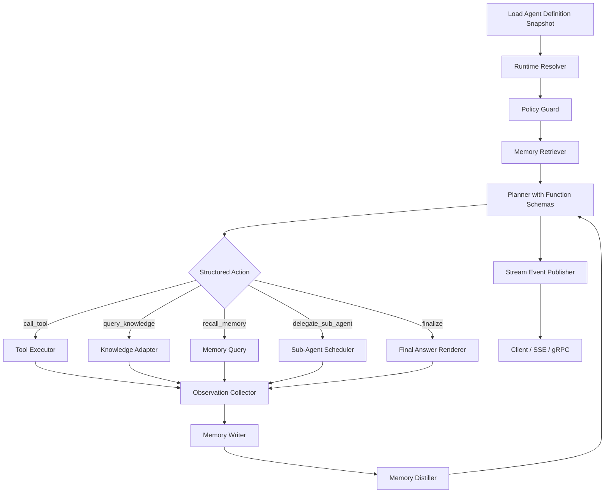

# 智能体基座开发文档

## 基座开发文档

### 1. 功能说明

本文档面向当前 `nucleus-rs` 仓库，规划一套**可在具体项目中快速引入智能体能力**的智能体基座。

目标不是做一个“只能跑单轮问答”的简单封装，而是建设一个具备以下特征的平台化 Agent Foundation：

- **配置驱动**：智能体定义、模型绑定、能力开关、工作区约束、版本信息支持持久化配置与 `.codebuddy` 本地资源协同装配
- **动态装配**：调用时自动探测工作区中的 `.codebuddy` 资源；存在则参与 `Prompt`、`RAG`、`MCP`、`Rules`、`Skills`、`Tools`、子智能体和模型参数的装配，不存在则自动忽略
- **安全执行**：所有工具执行均受工作区和路径白名单约束，避免误删本地数据
- **流式推理**：支持 token 级流式输出、事件流、工具调用事件和调试事件
- **平台可观测**：具备日志、Tracing、指标、Hooks、回放、配置回滚等生产能力
- **渐进扩展**：新增 `agent-runtime` 作为智能体基座库，优先复用仓库现有 `rag-core` / `job-engine` / `service-hub`，并仅在知识库能力接入层按需引入 `rig-core`

结合当前仓库现状，建议定位为：

- **`agent-runtime` 负责 Agent Runtime、Planner、Executor、Policy、Streaming 等基座能力**
- **`rig-core` 仅负责知识库 / Embedding / Vector Store 相关能力的可选接入**
- **`nucleus-rs` 负责平台配置、治理、服务编排、数据隔离、审计与安全边界**

---

### 2. 现状分析

#### 2.1 当前仓库已经具备的基础

从当前代码基线来看，仓库已经有若干能力可以直接复用，而不必从零重做。

##### 2.1.1 已有 RAG 核心能力

当前仓库已经具备较成熟的 RAG 基线：

- [lib.rs](/home/one/code/nucleus-rs/crates/core/rag-core/src/lib.rs)
- [ingest.rs](/home/one/code/nucleus-rs/crates/core/rag-core/src/pipeline/ingest.rs)
- [rag_query.rs](/home/one/code/nucleus-rs/service-hub/rag-service/src/service/rag_query.rs)
- [source.rs](/home/one/code/nucleus-rs/service-hub/rag-service/src/service/source.rs)
- [mod.rs](/home/one/code/nucleus-rs/service-hub/rag-service/src/service/mod.rs)

已具备：

- 知识库管理
- 来源导入与异步摄入
- 解析、切块、向量化、检索
- 同步问答与流式问答
- Reranker / Query Rewriter 抽象
- 工厂模式装配运行时组件

这意味着未来 Agent 的 `Knowledge / RAG` 能力，**优先不应该直接由 `rig-core` 重做**，而是应通过适配层把现有 `rag-core` 接入 Agent Runtime。

##### 2.1.2 已有任务执行与后台运行能力

仓库已有任务执行基础：

- [lib.rs](/home/one/code/nucleus-rs/crates/core/job-engine/src/lib.rs)
- [mod.rs](/home/one/code/nucleus-rs/crates/core/job-engine/src/runner/mod.rs)
- [traits.rs](/home/one/code/nucleus-rs/crates/core/job-engine/src/runner/traits.rs)

已具备：

- `BuiltinRunner`
- `BashRunner`
- `PythonRunner`
- 动态任务注册与调度

这对 Agent 平台很重要，因为：

- 异步补偿任务
- 离线评测任务
- 配置发布后预热任务
- 会话归档与清理任务
- 工具调用审计补偿任务

都可以直接复用该任务底座，而不必额外引入独立调度框架。

##### 2.1.3 资源配置采用数据库 + `.codebuddy` 双源模式

你当前的新约束已经变为：

- **新增一个独立的 Agent 基座库**
- **`rig-core` 仅作为知识库能力接入组件引入**
- **兼容支持从 `.codebuddy` 读取 `rules / agents / skills / sub-agents` 等内容**
- **运行时自动探测工作区中的 `.codebuddy` 目录**
- **存在 `.codebuddy` 时参与配置装配，不存在时自动忽略**

因此，仓库当前存在的 `.codebuddy/skills/`、`.codebuddy/rules/`、`.codebuddy/agents/` 等本地资源形态，不应被简单视为历史遗留，而应升级为平台正式支持的一类配置源。

平台运行态建议采用：

- **持久化配置作为主配置源**：负责版本治理、权限控制、审计、发布、灰度、回滚
- **`.codebuddy` 作为本地补充源**：负责项目级扩展、本地开发和快速注入
- **运行时自动选择装配策略**：
  - 存在 `.codebuddy`：融合持久化配置与本地资源
  - 不存在 `.codebuddy`：仅使用持久化配置或显式输入快照

这样做的主要收益是：

- 既保留平台化治理能力，也保留项目本地快速接入能力
- 适合离线开发、私有化场景和弱联网环境
- 更适合具体项目在仓库内沉淀专属 `skills / rules / agents`
- 便于在线平台与项目本地资源协同演进
- 更符合编码型 Agent 的真实使用场景

#### 2.2 `rig-core` 能力边界

在新方向下，`rig-core` 不再承担 Agent Runtime 内核职责，而是仅作为**知识库能力接入组件**进行评估和引入。

从其 crate 能力边界来看，`rig-core` 中真正与当前目标强相关的是：

- `embeddings`
- `pipeline`
- `vector_store`
- 部分 provider 集成能力

因此可以得出以下判断：

##### 2.2.1 `rig-core` 适合直接复用的部分

- **Embedding 抽象**：统一不同向量模型的接入
- **Vector Store 抽象**：为未来统一向量存储适配提供参考或实现基础
- **Knowledge Pipeline 相关能力**：可用于补强知识接入层
- **Provider 级能力**：在知识向量化或检索链路中按需复用

##### 2.2.2 `rig-core` 不承担的职责

以下职责应明确放在新增的 `agent-runtime` 与平台层，而不是继续交给 `rig-core`：

- Agent Runtime
- Planner / Executor / Reactor
- Tool Runtime
- Streaming Event 协议
- 数据库存储与版本管理
- 租户隔离与组织权限
- 工作区路径约束
- Rules / Skills / Agents 的数据库读取与装配
- MCP 服务注册中心
- 审计日志、调用回放、成本计量
- 发布、灰度、回滚、审批
- Hooks / 事件总线 / 平台运维

因此建议架构结论修正为：

> **以 `agent-runtime` 为 Agent Runtime Kernel，以 `rig-core` 为 Knowledge Integration Adapter，以 `nucleus-rs` 平台层承载治理与编排。**

---

### 3. 基座总体目标与边界

#### 3.1 基座目标

智能体基座需要解决的不是“如何调用一次模型”，而是下面 5 类问题：

- **如何描述一个智能体**：数据库模型与版本结构
- **如何动态构建一个智能体**：运行时装配器
- **如何安全运行一个智能体**：工具权限与工作区约束
- **如何持续观测一个智能体**：日志、指标、调试、回放
- **如何演进一个智能体**：发布、灰度、回滚、版本治理

#### 3.2 基座边界

建议本期智能体基座聚焦以下边界：

- 提供单 Agent + Multi-Agent 的通用运行时
- 提供基于快照与 Provider 的配置装配能力
- 提供统一流式事件输出协议
- 提供与现有 RAG / Job / Axum / SeaORM 的整合
- 提供平台级治理能力

本期**不建议一开始就重度建设**：

- 复杂 GUI 编排器
- 图形化 DAG 编辑器
- 跨集群分布式协同执行
- 长时记忆大规模自动蒸馏
- A2A / AG-UI 完整协议生态

这些能力可以在底座稳定后逐步演进。

---

### 4. 智能体核心能力分析

#### 4.1 一个智能体需要哪些核心能力

建议把智能体核心能力拆为 8 个能力域。

##### 4.1.1 Identity：身份与目标

用于定义“这个智能体是谁”。

包含：

- 智能体名称
- 智能体描述
- Prompt / System Prompt
- 欢迎语
- 使用场景标签
- 默认输出风格

##### 4.1.2 Model：模型与推理参数

用于定义“这个智能体用什么模型思考”。

包含：

- 关联模型
- temperature
- top_p
- max_tokens
- context_window
- reasoning / tool_use / json_mode 开关
- 原生 `function calling` 支持能力
- 结构化输出约束能力
- fallback model

##### 4.1.3 Knowledge：知识接入能力

用于定义“这个智能体从哪里取知识”。

包含：

- 多知识库绑定
- 检索策略
- TopK / rerank / token budget
- query rewrite 开关
- citation 开关
- 知识库优先级

##### 4.1.4 Action：行动与工具能力

用于定义“这个智能体能做什么动作”。

包含：

- MCP 服务
- 内置 Tools
- 平台工具
- Shell / 文件 / Web / HTTP 等工具
- 允许 / 禁止工具清单
- 工具调用预算与并发约束

##### 4.1.5 Policy：规则与约束能力

用于定义“这个智能体如何被约束”。

包含：

- Rules
- 安全策略
- 输出审查策略
- 工作区约束
- 路径白名单
- 工具禁用策略
- 脱敏策略

##### 4.1.6 Skill：可复用任务增强能力

用于定义“这个智能体在特定任务上如何增强表现”。

包含：

- 数据库存储的 skill 定义与内容
- skill 启用顺序
- skill 版本
- skill 依赖资源引用
- skill 场景标签

##### 4.1.7 Delegation：协作与子智能体能力

用于定义“这个智能体什么时候把任务交给别人”。

包含：

- 子智能体列表
- 调用策略
- 分发规则
- 聚合规则
- 是否允许递归委派
- 子智能体最大深度

##### 4.1.8 Session & Memory：上下文与记忆能力

用于定义“这个智能体如何承接多轮上下文，并把短期经验持续沉淀为长期能力”。

建议参考 `openclaw` 的记忆思路，把记忆拆成两层：

- **流水记忆（Stream / Episodic Memory）**：保存原始交互、工具结果、检索结果、委派结果和关键事件
- **精炼记忆（Distilled / Semantic Memory）**：保存从流水记忆中提炼出的事实、偏好、约束、经验、工作结论和可复用策略

包含：

- 会话上下文
- 历史消息
- 中间推理事件
- 用户记忆
- 会话摘要
- 流水记忆
- 精炼记忆
- 记忆向量索引
- 记忆蒸馏任务
- 可回放执行轨迹

这里建议所有记忆统一持久化到数据库，并把向量检索能力作为记忆层的检索增强能力，而不是单独分散到别的系统里。

#### 4.2 核心能力优先级建议

建议按以下优先级建设：

- **P0**：Identity / Model / Action / Policy / Streaming
- **P1**：Knowledge / Skill / Session
- **P2**：Delegation / Evaluation / Long-term Memory

原因：

- 没有模型、工具、规则和流式响应，就不能称为“可用智能体”
- RAG 和 Skill 能显著增强可用性，但可以在统一运行时后接入
- 子智能体、多 Agent 协作、长期记忆属于更高阶能力

---

### 5. AI 自主决策架构设计

#### 5.1 推荐的总体架构

针对你的需求，建议采用：

- **Planner-Executor-Reactor-Memory 四层协同架构**
- 外加 **Policy Guard**、**Runtime Resolver** 与 **Sub-Agent Scheduler**

这里需要明确一个关键判断：**运行时循环层不建议做成“纯 ReAct”，而应做成“分层状态机 + ReAct 风格微循环”。**

也就是说：

- **宏观控制层**：使用显式状态机/编排循环，负责计划、预算、调度、记忆读写、停止条件
- **微观推理层**：在单步决策内保留 `Thought -> Action -> Observation` 的 ReAct 风格

这样既能保留 ReAct 的灵活性，也能满足平台化场景对安全、回放、调度和可观测的要求。

整体建议链路：



#### 5.2 为什么不建议只做纯 ReAct

纯 ReAct 架构的优点是简单，但在平台场景下会遇到问题：

- 工具权限难以统一收口
- 观测点分散
- 配置到运行时映射不清晰
- 子智能体与 RAG 常被拼装成特例
- 记忆读写往往只能隐含在 Prompt 中，难以治理
- 难做可回放、可评测与可调试

因此建议演进为：

- **Runtime Resolver**：先按快照构建能力边界
- **Planner**：负责思考、计划与动作选择
- **Executor**：负责执行工具 / 检索 / 委派
- **Reactor**：负责把 Observation 回灌给模型继续推理
- **Memory Layer**：负责记忆召回、写回、蒸馏与长期沉淀
- **Policy Guard**：执行前后统一做安全校验
- **Sub-Agent Scheduler**：负责多智能体选择、并发与聚合

从这类项目的典型实现思路来看，可以抽象出以下共性：

- **`learn-claude-code` 风格**：更强调编码任务中的小步迭代、工具调用、工作区安全和事件化输出，本质是带约束的工具推理循环
- **`claw-code` 风格**：更强调把“调用子智能体”视为结构化动作或虚拟工具，而不是只靠 Prompt 隐式决定
- **`openclaw` 风格**：更强调记忆体系，把运行过程中的流水信息与提炼后的长期知识分层管理，并在规划前做召回、在回合后做蒸馏

所以更适合本项目的方案是：**外层不是纯 ReAct，而是一个带调度与记忆管理的状态机；内层每一步仍可使用 ReAct 风格决策。**

#### 5.3 推荐的自主决策循环

建议使用如下循环：

1. 加载 `AgentDefinitionSnapshot`
2. 构建运行时能力集
3. 恢复 Session 状态与最近窗口
4. 从记忆层召回：
   - 最近流水记忆
   - 精炼记忆
   - 向量语义相关记忆
5. 组装系统上下文（Prompt + Rules + Skills + Session + Memory）
6. Planner 在已注册函数 Schema 上输出本轮**结构化调用决策**：
   - `call_tool`
   - `query_knowledge`
   - `recall_memory`
   - `delegate_sub_agent`
   - `fan_out_sub_agents`
   - `update_plan`
   - `finalize`
7. 所有可执行动作必须通过原生 `function calling` 或受 `JSON Schema` 约束的结构化输出来触发，禁止通过解析自由文本来自动调用工具、RAG、记忆或子智能体
8. `Sub-Agent Scheduler` 根据任务类型、能力标签、预算和置信度决定是否委派与如何调度
9. Executor 按函数名、参数与策略校验执行动作
10. 收集 Observation
11. 将本轮消息、工具结果、检索结果、委派结果写入流水记忆
12. 在回合结束、达到阈值或后台异步任务触发时，对流水记忆做摘要和事实提炼，写入精炼记忆
13. 判断是否继续循环
14. 仅当 Planner 发出 `finalize` 时产出最终面向用户的自然语言回答或失败结果
15. 将事件持续流式推送给客户端

补充约束建议：

- **自由文本只用于最终用户可见回答，不用于运行时动作调度**
- **若模型支持原生 `function calling`，则优先作为唯一动作协议**
- **若模型不支持原生 `function calling`，则退化为受 `JSON Schema` 约束的结构化输出，而不是自由文本解析**
- **`RAG`、记忆召回、子智能体委派都应统一视为虚拟函数或虚拟工具**

这种循环的关键不是“是否使用 ReAct 词汇”，而是：**是否把动作协议、记忆召回、调度策略和停止条件显式建模。**

#### 5.4 关于多智能体调度与智能调度

如果要支持多智能体调度，建议不要让主 Agent 仅凭一段 Prompt 自由决定，而是增加显式调度层。

建议引入：

- `SubAgentRegistry`：维护子智能体能力标签、工具边界、成本和适用场景
- `SubAgentScheduler`：负责选择、并发、重试、聚合和预算控制
- `DelegationPolicy`：控制是否允许委派、最大深度、最大并发数、最大 token 成本

推荐支持 3 类调度模式：

- **Explicit**：主 Agent 明确调用某个子 Agent
- **Planner Route**：Planner 先产出结构化任务，再由调度器选择最合适的子 Agent
- **Parallel Fan-out**：针对复杂任务并发调用多个子 Agent，再聚合结果

“智能调度”建议综合以下信号：

- 任务类型
- 能力标签命中情况
- 工具 / 技能可用性
- 工作区约束
- 预算余量
- 历史成功率
- 相关记忆命中度
- 结果置信度

这样多智能体调度就不是“让模型随便选”，而是**模型决策 + 平台调度策略**的组合。

#### 5.5 更适合本项目的架构命名建议

建议在当前仓库中采用以下模块抽象：

- `AgentDefinitionProvider`：从数据库、本地 `.codebuddy` 或内存对象提供智能体定义
- `AgentDefinitionResolver`：把多源定义整理为统一快照
- `AgentRuntimeResolver`：解析模型、工具、MCP、RAG、Skills、Rules、Workspace
- `AgentPolicyGuard`：执行安全和权限校验
- `AgentPlanner`：输出下一步动作
- `AgentExecutor`：执行动作
- `SubAgentScheduler`：执行多智能体选择、并发和结果聚合
- `AgentMemoryRetriever`：负责记忆召回
- `AgentMemoryWriter`：负责流水记忆写入
- `AgentMemoryDistiller`：负责摘要、事实提炼与长期记忆沉淀
- `ObservationReducer`：整理工具结果 / 子 Agent 结果 / 检索结果
- `AgentEventPublisher`：流式推送事件
- `AgentRunRecorder`：记录审计日志和回放数据

---

### 6. 智能体配置模型设计

#### 6.1 配置设计原则

数据库设计建议遵循以下原则：

- **主实体稳定，关联能力可扩展**
- **配置版本化，不覆盖历史**
- **启用态与草稿态分离**
- **能力配置和资源配置分表**
- **运行时快照落库，保证可回放**

#### 6.2 推荐的数据模型

建议至少设计以下表。

##### 6.2.1 智能体主表 `t_agent`

基础定义表。

核心字段建议：

- `id`
- `code`
- `name`
- `description`
- `welcome_message`
- `status`
- `owner_type`
- `owner_id`
- `current_version_id`
- `source_mode`
- `created_by`
- `updated_by`
- `created_at`
- `updated_at`
- `deleted_at`

说明：

- `source_mode` 用于标识该 Agent 默认采用 `db`、`local` 或 `hybrid` 装配模式

##### 6.2.2 智能体版本表 `t_agent_version`

用于保存一次完整配置快照。

核心字段建议：

- `id`
- `agent_id`
- `version_no`
- `version_name`
- `prompt_template`
- `system_prompt`
- `release_status`
- `is_published`
- `change_log`
- `config_snapshot_json`
- `created_by`
- `created_at`

说明：

- `config_snapshot_json` 用于保存运行时完整快照，回滚非常方便
- 即使配置拆分到多张表，也建议保留一份聚合快照

##### 6.2.3 模型定义表 `t_agent_llm_model`

保存平台级模型元数据。

核心字段建议：

- `id`
- `provider`
- `model_code`
- `model_name`
- `base_url`
- `api_key`
- `capabilities_json`
- `context_window`
- `supports_streaming`
- `supports_tools`
- `supports_reasoning`
- `supports_function_calling`
- `supports_structured_output`
- `status`

##### 6.2.4 智能体模型绑定表 `t_agent_model_binding`

用于绑定具体 Agent 版本与模型参数。

核心字段建议：

- `id`
- `agent_version_id`
- `model_id`
- `temperature`
- `top_p`
- `max_tokens`
- `timeout_ms`
- `max_turns`
- `fallback_model_id`
- `json_mode`
- `tool_choice_mode`
- `planner_protocol`
- `planner_finish_policy`

##### 6.2.5 智能体知识库绑定表 `t_agent_kb_rel`

支持多知识库绑定。

核心字段建议：

- `id`
- `agent_version_id`
- `kb_id`
- `priority`
- `enabled`
- `retrieve_top_k`
- `rerank_top_n`
- `min_score`
- `token_budget`
- `rewrite_enabled`
- `citation_enabled`
- `retrieval_mode`

##### 6.2.6 MCP 服务表 `t_agent_mcp_service_rel`

绑定 Agent 与可用 MCP 服务。

核心字段建议：

- `id`
- `agent_version_id`
- `mcp_server_code`
- `transport_type`
- `endpoint`
- `auth_config_json`
- `tool_whitelist_json`
- `enabled`
- `timeout_ms`

##### 6.2.7 Rules 注册表 `t_agent_rule_registry`

用于管理规则正文与规则元数据，并支持数据库内容与本地 `.codebuddy` 资源建立统一映射。

核心字段建议：

- `id`
- `rule_code`
- `name`
- `description`
- `rule_type`
- `content_type`
- `content`
- `scope_type`
- `status`
- `version`
- `checksum`
- `tags_json`

说明：

- `content` 存储规则正文
- `scope_type` 用于标识平台级、租户级、Agent 级等作用域
- `checksum` 用于保证规则版本内容一致性

##### 6.2.8 Rules 绑定表 `t_agent_rule_rel`

核心字段建议：

- `id`
- `agent_version_id`
- `rule_id`
- `priority`
- `enabled`
- `inject_mode`
- `source_origin`

##### 6.2.9 Skills 注册表 `t_agent_skill_registry`

用于管理 Skill 的元数据与运行时装配信息，并支持数据库内容与本地 `.codebuddy` 资源建立统一映射。

核心字段建议：

- `id`
- `skill_code`
- `name`
- `description`
- `status`
- `version`
- `content_type`
- `entry_content`
- `config_json`
- `resource_refs_json`
- `local_path`
- `source_origin`
- `checksum`
- `tags_json`

说明：

- `entry_content` 用于存储 Skill 的主指令内容
- `resource_refs_json` 用于引用附件、脚本、示例或外部资源
- `local_path` 用于记录与 `.codebuddy` 资源的映射路径
- `source_origin` 用于标识来源为 `db`、`local` 或 `merged`
- `checksum` 用于保证版本内容一致性

##### 6.2.10 智能体 Skills 绑定表 `t_agent_skill_rel`

核心字段建议：

- `id`
- `agent_version_id`
- `skill_id`
- `priority`
- `enabled`
- `load_mode`
- `inject_mode`
- `source_origin`

##### 6.2.11 Tools 注册表 `t_agent_tool_registry`

用于平台内建工具与受控工具定义。

核心字段建议：

- `id`
- `tool_code`
- `name`
- `source_type`
- `handler_ref`
- `schema_json`
- `risk_level`
- `requires_workspace`
- `status`

##### 6.2.12 智能体 Tools 绑定表 `t_agent_tool_rel`

核心字段建议：

- `id`
- `agent_version_id`
- `tool_id`
- `enabled`
- `priority`
- `custom_config_json`
- `timeout_ms`
- `concurrency_limit`

##### 6.2.13 子智能体关系表 `t_agent_sub_agent_rel`

核心字段建议：

- `id`
- `agent_version_id`
- `sub_agent_id`
- `delegate_mode`
- `priority`
- `enabled`
- `max_depth`
- `source_origin`

##### 6.2.14 工作区表 `t_agent_workspace`

核心字段建议：

- `id`
- `workspace_code`
- `name`
- `root_path`
- `allowed_paths_json`
- `blocked_paths_json`
- `shell`
- `os_type`
- `status`

##### 6.2.15 智能体工作区绑定表 `t_agent_workspace_rel`

核心字段建议：

- `id`
- `agent_version_id`
- `workspace_id`
- `is_default`
- `tool_exec_root`
- `file_access_mode`
- `terminal_access_enabled`

##### 6.2.16 会话流水记忆表 `t_agent_memory_stream`

用于保存智能体运行中的原始流水记忆，偏向可回放、可追溯和短中期召回。

核心字段建议：

- `id`
- `agent_id`
- `agent_version_id`
- `session_id`
- `run_id`
- `memory_type`
- `role`
- `content`
- `content_json`
- `summary`
- `tool_name`
- `tool_call_id`
- `kb_id`
- `sub_agent_id`
- `importance_score`
- `created_at`
- `expires_at`
- `embedding_id`

说明：

- `memory_type` 可区分 `message`、`tool_result`、`rag_result`、`sub_agent_result`、`plan_step`、`reflection`
- `content` 存储可直接召回的原始文本
- `content_json` 存储结构化上下文，如工具输入输出、检索片段元数据等
- `importance_score` 用于控制后续蒸馏与召回优先级
- `expires_at` 支持短期流水记忆的 TTL 管理
- `embedding_id` 用于关联向量索引记录

##### 6.2.17 精炼记忆表 `t_agent_memory_distilled`

用于保存从流水记忆中提炼出的长期记忆，偏向稳定事实、偏好、约束、经验和可复用工作结论。

核心字段建议：

- `id`
- `agent_id`
- `agent_version_id`
- `session_scope`
- `memory_category`
- `title`
- `content`
- `content_json`
- `source_refs_json`
- `confidence`
- `importance_score`
- `valid_from`
- `valid_until`
- `status`
- `embedding_id`
- `created_at`
- `updated_at`

说明：

- `memory_category` 可区分 `fact`、`preference`、`constraint`、`project_context`、`work_pattern`、`lesson_learned`
- `source_refs_json` 用于记录来自哪些 `run_id` / `stream_memory_id`
- `confidence` 用于表示该记忆是否足够稳定可复用
- 精炼记忆不只是摘要，更应该是经过筛选后的“有价值结论”

##### 6.2.18 记忆向量索引表 `t_agent_memory_embedding`

用于统一管理记忆层与向量检索之间的关联。

核心字段建议：

- `id`
- `memory_source_type`
- `memory_source_id`
- `embedding_model`
- `vector_store_ref`
- `chunk_text`
- `chunk_index`
- `metadata_json`
- `created_at`

说明：

- `memory_source_type` 可区分 `stream` 或 `distilled`
- 该表可映射到现有 `rag-core` 的向量化能力，避免重复建设另一套 embedding 管线

#### 6.3 关于 Skills 的设计建议

在新的目标下，Skill 需要同时支持**持久化配置加载**与**`.codebuddy` 本地加载**。

建议答案是：**Skill 采用双源装配模式，数据库负责平台治理，本地资源负责项目级增强与离线运行。**

##### 推荐模式：DB + Local 双源装配

- **数据库负责**：
  - skill 是否注册
  - 是否启用
  - 适用于哪些 Agent
  - 排序 / 优先级
  - 版本 / checksum
  - 主体内容
  - 资源引用关系
  - 是否灰度
- **`.codebuddy` 本地资源负责**：
  - 项目内 skill 包
  - 本地脚本资源
  - 本地 references
  - 离线开发时的运行内容
- **对象存储 / 附件系统 / 制品仓库负责**：
  - 大文件附件
  - 图片、PDF、模板等扩展资源

##### 这样做的原因

- 可同时获得平台治理能力与项目级灵活性
- 工作区存在本地资源时可直接使用仓库内沉淀的 skill 资源
- 更适合编码型 Agent 在真实项目目录中工作
- 便于将 `.codebuddy` 资源逐步纳入平台管理
- 更适合多团队并行演进 Agent 配置

##### 推荐的数据表达方式

建议把 Skill 拆成两部分：

1. **结构化元数据**
2. **主体内容 + 外部资源引用 / 本地路径引用**

示例：

```yaml
code: service-hub-generator
name: Service Hub Generator
version: 1.0.0
content_type: markdown
entry_content: |
  你是一个 service hub 生成助手。
  你需要根据输入生成 service、dto、repository 等代码。
resource_refs:
  - type: script
    name: template_bundle
    uri: oss://agent-assets/skills/service-hub-generator/templates.zip
  - type: local_reference
    name: workspace_example
    uri: .codebuddy/skills/service-hub-generator/references/example.md
local_path: .codebuddy/skills/service-hub-generator
source_origin: merged
checksum: xxx
scenes:
  - crud
  - service_generation
```

##### 推荐的运行流程

1. 平台读取数据库中的 `t_agent_skill_registry`
2. 同时扫描工作区内 `.codebuddy/skills`
3. 根据 `t_agent_skill_rel`、本地清单与装配上下文生成启用清单
4. 若存在持久化配置与本地资源，则按冲突策略融合 Skill
5. 若仅存在本地资源，则直接使用本地 Skill
6. 将最终 Skill Runtime 注入当前 Agent

##### 关于本地资源的定位

`.codebuddy` 下的本地 `skill / rule / agent / sub-agent` 资源应作为**正式支持的配置源之一**，而不是仅作为迁移输入。

推荐定位如下：

- 工作区存在本地资源时的重要配置源
- 项目本地扩展能力源
- 持久化配置之外的补充配置源
- 平台配置导入来源

#### 6.4 历史本地资源与持久化配置协同建议

既然新的运行态支持持久化配置与本地资源协同，就建议补一条明确的协同链路。

##### 推荐协同顺序

1. 读取持久化配置中的 Agent 版本定义
2. 自动扫描 `.codebuddy` 下的 `rules / skills / agents / sub-agents`
3. 按优先级策略进行融合
4. 生成本次运行使用的 `AgentDefinitionSnapshot`
5. 进入运行时装配与执行流程

##### 协同策略建议

- 本地 `rule` 文件可映射或导入到 `t_agent_rule_registry`
- 本地 `skill` 主体内容可映射或导入到 `t_agent_skill_registry.entry_content`
- 本地 `skill` 附件可保留本地路径，也可迁移到对象存储
- 本地 `agent` / `sub-agent` 声明可映射或导入到 `t_agent`、`t_agent_version` 和各类绑定表

##### 协同工具建议

建议增加独立任务或加载器：

- `agent_local_source_loader`
- `agent_import_rules_job`
- `agent_import_skills_job`
- `agent_import_agents_job`

这些任务可以复用当前仓库的 `job-engine` 异步执行。

---

### 7. 运行时装配设计

#### 7.1 核心目标

调用智能体时，系统要完成以下步骤：

1. 从外部配置源获得统一的 `AgentDefinitionSnapshot`
2. 如果工作区存在 `.codebuddy`，则自动扫描并纳入本地资源
3. 加载模型配置
4. 加载 Prompt / Rules / Skills
5. 加载 RAG 知识库绑定
6. 加载 MCP 服务绑定
7. 加载 Tools
8. 加载工作区与安全策略
9. 按优先级融合配置并生成一个完整的 `AgentRuntime`

这里的关键点是：**`AgentRuntime` 不直接关心配置来自数据库、本地文件还是内存对象，它只消费统一快照。**

#### 7.2 推荐的运行时对象结构

建议定义一个聚合运行时结构：

```text
AgentRuntime
├── definition
├── model_runtime
├── prompt_runtime
├── rule_runtime
├── skill_runtime
├── knowledge_runtime
├── tool_runtime
├── mcp_runtime
├── workspace_runtime
├── sub_agent_runtime
└── policy_runtime
```

同时建议定义一个独立输入对象：

```text
AgentDefinitionSnapshot
├── definition
├── model_config
├── rules
├── skills
├── knowledge_bindings
├── tools
├── mcp_services
├── workspace_policy
├── sub_agents
└── metadata
```

`agent-runtime` 只依赖 `AgentDefinitionSnapshot`，不依赖数据库查询细节。

#### 7.3 关键装配器与 Provider 抽象

建议新增以下抽象：

- `AgentDefinitionProvider`
- `DbAgentDefinitionProvider`
- `LocalCodeBuddyProvider`
- `CompositeAgentDefinitionProvider`
- `AgentDefinitionResolver`
- `AgentModelResolver`
- `AgentKnowledgeResolver`
- `AgentToolResolver`
- `AgentMcpResolver`
- `AgentSkillResolver`
- `AgentWorkspaceResolver`
- `AgentSubAgentResolver`
- `AgentRuntimeResolver`

其中：

- `AgentDefinitionProvider` 负责从某一种来源提供定义数据
- `CompositeAgentDefinitionProvider` 负责把数据库与 `.codebuddy` 等多源结果收敛起来
- `AgentDefinitionResolver` 负责把原始定义整理成统一 `AgentDefinitionSnapshot`
- `AgentRuntimeResolver` 负责汇总并构建 `AgentRuntime`

#### 7.4 是否让运行时深度绑定数据库

这里建议的答案是：**不要让 `agent-runtime` 与数据库深度绑定。**

更推荐的分层方式是：

- **`agent-runtime`**：只负责编排、推理、决策循环、工具执行抽象、事件流、策略校验
- **`agent-platform`**：负责数据库查询、本地 `.codebuddy` 扫描、版本装配、配置合并、快照生成、审计持久化
- **`agent-service`**：负责 API、鉴权、请求编排与对外输出

也就是说：

- 运行时**不直接查表**
- 运行时**不感知 SeaORM / SQL / Repository 细节**
- 运行时只接收已经解析好的 `AgentDefinitionSnapshot` 或 `AgentRuntimeSpec`

这样设计的好处是：

- `agent-runtime` 更通用，可以脱离数据库单独使用
- 可以很容易支持数据库、本地文件、测试数据、内存对象等多种输入来源
- 更适合做单元测试、回放、离线调试和嵌入式使用
- 平台治理能力仍然可以保留在 `agent-platform`
- 后续如果替换数据库或接入远端配置中心，运行时几乎不需要改动

#### 7.5 配置读取与合并策略

建议采用四层优先级：

1. **请求级临时覆盖**
2. **本地 `.codebuddy` 项目级配置**
3. **持久化配置快照 / 数据库配置**
4. **平台默认配置**

例如：

- 请求显式指定 `temperature=0.2`
- 否则使用 `.codebuddy` 中的项目级配置
- 否则使用持久化配置中的 `t_agent_model_binding.temperature`
- 否则使用平台 provider 默认值

双源冲突建议默认如下：

- **Agent 主定义**：持久化配置优先，本地补充未定义字段
- **Rules**：本地规则优先追加，高优先级规则可覆盖同名规则
- **Skills**：同 `skill_code` 下，本地版本优先用于项目内增强
- **Sub-Agents**：本地可新增项目私有子智能体，平台定义保留默认能力
- **Workspace**：平台策略负责全局边界，本地只能缩权，不能放权
- **Tools / MCP**：平台配置优先，避免本地绕过安全策略

建议同时提供可配置的冲突策略枚举：

- `persisted_first`
- `local_first`
- `merge_append`
- `strict_persisted`

#### 7.6 `.codebuddy` 自动发现策略

这里不建议把显式运行模式作为核心业务概念暴露给用户。

更合适的方式是：

- 运行前先检查工作区根目录下是否存在 `.codebuddy`
- **如果存在**：自动扫描 `rules / skills / agents / sub-agents` 等本地资源并参与装配
- **如果不存在**：直接忽略本地源，继续使用持久化配置或显式传入快照

这样对使用方更自然，也更符合“项目里有本地资源就自动增强，没有就按默认配置运行”的预期。

#### 7.7 运行时缓存建议

运行时构建会频繁读取持久化配置与本地资源，因此建议引入缓存：

- `AgentSnapshotCache`
- `ModelConfigCache`
- `SkillContentCache`
- `RuleContentCache`
- `WorkspacePolicyCache`
- `McpConnectionCache`
- `LocalCodeBuddyIndexCache`

缓存失效策略建议：

- 配置发布时主动失效
- 本地 `.codebuddy` 文件变更时主动失效
- 定时拉平校验
- 支持按 `agent_id` 精准清除

---

### 8. 记忆层设计

#### 8.1 为什么记忆层不能只等于历史上下文

如果记忆层只等于“把最近聊天记录重新塞回 Prompt”，智能体虽然能保持短期连续性，但不会真正变得更聪明。

更完整的记忆体系应至少解决 3 件事：

- **记住发生过什么**：保留原始交互、工具结果、检索结果和委派结果
- **记住哪些信息长期有价值**：把事实、偏好、约束、经验和项目背景沉淀下来
- **在需要时准确找回**：根据当前问题召回最相关的记忆，而不是机械拼接整段历史

因此建议参考 `openclaw` 的思路，把记忆层建设为“流水记忆 + 精炼记忆 + 检索 + 蒸馏”四件套。

#### 8.2 推荐的记忆分层

##### 8.2.1 流水记忆

流水记忆用于保存运行过程中的原始信息，包括：

- 用户消息
- 模型阶段性结论
- 工具调用输入输出
- RAG 检索摘要
- 子智能体返回结果
- 错误与恢复过程
- 关键计划步骤

它的特点是：

- 信息原始
- 粒度细
- 更适合回放与短期召回
- 可能有时效性

##### 8.2.2 精炼记忆

精炼记忆用于保存从流水记忆中提炼出来的稳定知识，包括：

- 用户偏好
- 项目约束
- 常见问题结论
- 代码库结构认知
- 工作模式经验
- 反复验证过的事实
- 失败教训与修复策略

它的特点是：

- 信息密度高
- 更稳定
- 更适合长期复用
- 更适合在规划前作为高价值上下文注入

#### 8.3 记忆层是否可以复用 RAG 能力

建议答案是：**可以，而且应该复用。**

原因是：

- 记忆本质上也是一类可检索知识
- 流水记忆和精炼记忆都需要语义召回
- 当前仓库已经有 `rag-core` 的切块、向量化和检索能力
- 统一复用可减少重复建设

但要注意边界：

- **RAG 能力负责“怎么检索”**
- **记忆层负责“存什么、何时写、何时提炼、何时召回”**

也就是说，记忆层可以复用 `rag-core` 做 embedding / vector retrieval，但记忆本身仍应由 `agent-runtime` / `agent-platform` 统一管理。

#### 8.4 推荐的记忆读写流程

建议运行时按以下方式处理记忆：

1. 进入一轮决策前，先根据当前问题、会话、工作区和 Agent 标签召回相关记忆
2. 优先注入精炼记忆，其次注入最近流水记忆摘要
3. 当本轮执行完成后，把消息、Observation、工具结果、检索结果写入流水记忆
4. 当满足阈值时，触发精炼任务：
   - 回合结束
   - 运行结束
   - 达到 token / 轮次阈值
   - 后台定时任务触发
5. 精炼任务将流水记忆提炼成稳定结论，并写入精炼记忆
6. 必要时更新对应向量索引

#### 8.5 推荐的记忆提炼原则

精炼记忆不应只是机械摘要，更应该筛选“未来仍值得被再次使用的信息”。

建议优先提炼：

- 长期稳定的用户偏好
- 项目结构与约束
- 可复用的代码或任务经验
- 明确验证过的事实
- 失败案例与修复策略

建议避免直接提炼：

- 一次性噪声信息
- 未经验证的猜测
- 敏感信息
- 仅对当前回合有效的临时推理

#### 8.6 推荐的记忆运行时抽象

建议新增以下抽象：

- `AgentMemoryRetriever`
- `AgentMemoryWriter`
- `AgentMemoryDistiller`
- `MemoryRecallPolicy`
- `MemoryRetentionPolicy`
- `MemoryDistillationJob`

职责建议如下：

- `AgentMemoryRetriever`：根据 query、session、agent、workspace 召回相关记忆
- `AgentMemoryWriter`：写入流水记忆与运行元数据
- `AgentMemoryDistiller`：把流水记忆提炼成精炼记忆
- `MemoryRecallPolicy`：定义召回优先级、注入上限、过滤规则
- `MemoryRetentionPolicy`：定义 TTL、归档与清理策略
- `MemoryDistillationJob`：通过 `job-engine` 异步执行长耗时提炼流程

#### 8.7 数据库存储原则

你已经明确要求记忆层全部存储到数据库，这个方向是合理的。

建议采用：

- **数据库作为记忆主存储**：保证审计、回放、治理和权限控制
- **向量索引作为检索加速层**：可由数据库内向量能力或外挂向量存储实现
- **运行时只读写抽象记忆接口**：不要把底层存储细节泄漏到 Planner / Executor

这样设计后：

- 流水记忆可审计、可回放
- 精炼记忆可管理、可修订、可过期
- 检索能力可持续复用 `rag-core`
- 记忆层不会沦为“只会堆聊天记录”的简单历史缓冲区

---

### 9. RAG 能力接入方案

#### 9.1 优先复用现有 `rag-core`，`rig-core` 仅作为知识能力接入参考与扩展

当前仓库已有完整 RAG 体系，因此 Agent 的知识能力建议优先通过现有 `rag-core` 接入，而不是重新建设另一套知识系统。

在此基础上，`rig-core` 的引入范围限定在：

- Embedding 抽象
- Vector Store 抽象
- 知识管线增强
- 部分 provider 适配能力

建议在 `agent-runtime` 内新增：

- `AgentKnowledgeAdapter`
- `AgentRagQueryService`
- `AgentKnowledgeRuntime`
- `RigKnowledgeAdapter`

这样可以把知识检索能力直接纳入 `agent-runtime` 的统一运行时抽象中，整体结构也更简单。

#### 9.2 多知识库加载策略

建议支持以下三种模式：

- **Merge**：多个知识库同时检索后统一融合
- **Route**：由 Planner/Classifier 先路由到某一个知识库
- **Priority Fallback**：优先主知识库，召回不足时回退次级知识库

默认建议先实现：

- `merge`
- `priority_fallback`

#### 9.3 多知识库结果融合

建议复用当前已有的混合检索思想，并增加：

- 知识库来源标签
- kb 级权重
- citation 中回传 `kb_id`
- 调试模式下返回每个 KB 的召回明细

#### 9.4 RAG 与 Agent 的边界

建议边界如下：

- `rag-core`：负责检索与问答知识流水线
- `agent-runtime`：决定何时发起知识检索、是否检索、检索哪些知识库

也就是说：

- **RAG 不负责决策**
- **Agent 负责决策何时用 RAG**

---

### 10. MCP、Rules、Skills、Tools 设计

#### 10.1 MCP 服务设计

MCP 更适合作为“工具能力来源”，建议平台提供统一注册中心。

建议流程：

1. 平台配置 MCP Server 元数据
2. Agent 版本绑定允许的 MCP 服务
3. 运行时建立连接或复用连接池
4. 只暴露白名单工具给当前 Agent
5. 工具调用前后打审计与 tracing

#### 10.2 Rules 设计

Rules 应作为高优先级约束上下文，优先于普通 Prompt。

建议分层：

- 平台系统规则
- 租户规则
- 智能体规则
- 请求级补充规则

运行时拼接顺序建议：

```text
System Policy
→ Workspace Policy
→ Agent Rules
→ Skills
→ Prompt Template
→ Session Context
→ User Input
```

#### 10.3 Skills 设计

Skill 不是单纯“提示词片段”，而是**任务增强资源包**。

建议 Skill 运行时包含：

- manifest
- 主入口文档
- 参考资料
- 示例代码
- 加载策略
- 匹配场景

Skill 注入方式建议：

- 全量注入：用于小型 skill
- 延迟注入：由 Planner 判定任务命中后加载
- 摘要注入：只把 skill 摘要注入上下文，需要时再展开资源

默认建议：

- **大多数 skill 使用“摘要注入 + 按需展开”**

原因：

- 避免上下文窗口浪费
- 降低 token 成本
- 更适合多 skill 场景

#### 10.4 Tools 设计

工具建议分为四层：

- **平台内建工具**：文件、搜索、命令、HTTP、数据库查询等
- **业务工具**：项目特有服务能力
- **MCP 工具**：外部能力
- **虚拟工具**：RAG 查询、子 Agent 调用、Workflow 调用

特别建议：

- 把 `RAG` 也视为一个可选“虚拟工具”
- 把“调用子智能体”也视为一个可选“虚拟工具”

这样 Planner 的动作集合更统一。

---

### 11. 子智能体与多 Agent 能力

#### 11.1 为什么需要子智能体

当一个 Agent 同时承担：

- 检索
- 编码
- 文档总结
- 测试分析
- SQL 生成

时，Prompt 和工具能力会很快变得混乱。

因此建议支持子智能体，把复杂系统拆成：

- 主编排 Agent
- 检索 Agent
- 编码 Agent
- 审查 Agent
- 数据分析 Agent

#### 11.2 子智能体的委派模式

建议支持 3 种委派模式：

- **Explicit Tool Call**：主 Agent 明确调用某个子 Agent
- **Planner Route**：Planner 自动选择子 Agent
- **Parallel Fan-out**：并发调用多个子 Agent，再聚合结果

一期建议先做：

- `explicit`
- `planner_route`

#### 11.3 防止多 Agent 失控

必须增加以下限制：

- 最大递归深度
- 最大总步数
- 最大并发子 Agent 数
- 最大 token 成本
- 最大工具调用次数

---

### 12. 工作区与安全设计

#### 12.1 为什么工作区必须是一等公民

你的需求里专门提到：

> 规范工具的执行路径，用于配置工具的执行路径，防止误删本地数据。

这是非常关键的能力，建议做成平台级强约束，而不是某个工具自己约定。

#### 12.2 建议的安全边界模型

每次运行 Agent 时，都要绑定一个 `WorkspaceRuntimePolicy`。

建议包含：

- `root_path`
- `allowed_paths`
- `blocked_paths`
- `read_only_paths`
- `command_working_directory`
- `shell_type`
- `network_access_policy`
- `terminal_enabled`
- `file_write_enabled`
- `delete_enabled`

#### 12.3 工具调用前的路径校验

所有文件类和命令类工具统一经过 `WorkspaceGuard`：

- 文件路径必须在允许目录内
- 禁止跳出 root path
- 禁止触碰 blocked path
- 删除命令需要显式权限
- shell 工具必须强制指定 `commandWorkingDirectory`

#### 12.4 建议增加的保护策略

- 高风险工具二次确认开关
- 非生产工作区默认只读
- 删除/覆盖写入前自动记录快照
- 敏感目录默认不可访问
- 审计日志记录原始命令与目标路径

---

### 13. 流式推理设计

#### 13.1 为什么必须做事件化流式输出

如果只返回最终回答，平台会丢失大量关键价值：

- 用户无法理解智能体在做什么
- 平台无法调试错误点
- 工具调用不可观察
- 无法做回放与评测

因此建议输出**事件流**，而不是只输出 token 流。

#### 13.2 推荐的事件模型

建议统一使用 `AgentStreamEvent`：

- `run_started`
- `step_started`
- `reasoning_delta`
- `planner_function_call_started`
- `planner_function_call_finished`
- `function_validation_failed`
- `tool_selected`
- `tool_call_started`
- `tool_call_finished`
- `rag_started`
- `rag_finished`
- `sub_agent_started`
- `sub_agent_finished`
- `answer_delta`
- `warning`
- `error`
- `run_finished`

#### 13.3 输出通道建议

建议优先支持：

- HTTP SSE
- gRPC streaming

其中：

- 控制台前端优先走 SSE
- 内部服务编排或高吞吐场景可走 gRPC streaming

#### 13.4 与 `agent-runtime` / `rig-core` 的关系

在新的职责划分下：

- `agent-runtime` 负责统一的 Agent 事件流协议与运行时事件发布
- `rig-core` 不负责通用 Agent Streaming Runtime，仅在知识链路需要时提供可复用能力

因此建议：

- 底层统一事件流由 `agent-runtime` 定义
- 平台层输出高阶 `AgentStreamEvent`
- 知识链路中的流式检索或知识问答结果，可通过 `RigKnowledgeAdapter` 适配进统一事件流

---

### 14. 平台扩展能力：监控、Hooks、治理

#### 14.1 平台需要哪些监控手段

至少建议建设 4 类可观测能力。

##### 13.1.1 运行日志

记录：

- run_id
- session_id
- agent_id
- version_id
- model_id
- tool 调用明细
- MCP 调用明细
- RAG 检索参数
- token 消耗
- 耗时
- 错误堆栈

##### 13.1.2 Tracing

建议为以下 span 建模：

- `agent.run`
- `agent.plan`
- `agent.tool_call`
- `agent.rag_query`
- `agent.sub_agent`
- `agent.model_completion`
- `agent.stream_publish`

##### 13.1.3 Metrics

建议指标：

- 请求量
- 平均耗时 / P95 / P99
- 工具调用次数
- 工具失败率
- 模型错误率
- RAG 召回命中数
- 平均 token 输入/输出
- 单次运行成本估算
- 子 Agent 委派次数

##### 13.1.4 回放与调试

建议保留：

- 运行时配置快照
- 输入消息
- 每一步 observation
- 工具输入输出
- 检索结果摘要
- 最终响应

这会极大提升问题排查效率。

#### 14.2 Hooks 能力设计

建议提供统一 Hooks 机制，在关键节点开放扩展。

建议事件点：

- before_run
- after_run
- before_model_call
- after_model_call
- before_tool_call
- after_tool_call
- before_rag_query
- after_rag_query
- on_error

典型用途：

- 审计
- 计费
- 敏感词检查
- 结果脱敏
- 自定义埋点
- 外部通知

#### 14.3 生产基础与数据治理

建议重点建设以下能力：

- 配置发布审批
- 版本冻结
- 运行快照落库
- 工具调用审计
- 成本统计
- 失败重试
- 敏感数据脱敏
- TTL 清理策略
- 会话归档

---

### 15. 配置版本管理与回滚设计

#### 14.1 为什么必须版本化

智能体平台最大风险之一是：

- Prompt 变了
- 工具变了
- 模型温度改了
- 知识库绑定变了
- skill 启用清单变了

结果最终“回答为什么变了”无法追踪。

所以必须把版本管理设计为一等能力。

#### 14.2 推荐的版本流转

建议状态机：

- `draft`
- `testing`
- `published`
- `archived`
- `rollback_target`

#### 14.3 发布策略

建议支持：

- 直接发布
- 灰度发布
- 指定租户发布
- 指定工作区发布

#### 14.4 回滚策略

建议至少支持两种回滚：

- **配置回滚**：把当前版本切回历史 `t_agent_version`
- **运行回滚**：按照历史 `config_snapshot_json` 重放一次运行

#### 14.5 版本差异展示

平台 UI 或调试接口建议能看到差异：

- Prompt diff
- Tool diff
- Skill diff
- Rule diff
- Model param diff
- KB binding diff

---

### 16. 模块拆分建议

#### 15.1 推荐新增 crate / service 模块

建议按“基座内核 + 平台装配 + 服务入口”拆分。

##### 15.1.1 基座层

建议新增：

- `crates/core/agent-runtime`

职责：

- Agent 领域模型
- Runtime 抽象
- Planner / Executor / Reactor / Policy Guard trait
- Stream event model
- Session / Memory 基础对象
- Tool Runtime 抽象
- Sub-Agent Runtime 抽象
- Knowledge Runtime 抽象
- 适配 `rag-core`
- 可选适配 `rig-core`
- 对外提供 `AgentKnowledgeAdapter`

##### 15.1.2 平台装配层

建议新增：

- `crates/core/agent-platform`

职责：

- DB 配置装配
- 版本管理
- Skill / Rule / Agent / Workspace / MCP 解析
- 安全策略
- 审计和运行记录
- 配置快照与回放数据生成

##### 15.1.3 服务层

建议新增：

- `service-hub/agent-service`

职责：

- HTTP / SSE / gRPC API
- Agent CRUD
- 版本发布
- 调试运行
- 会话接口
- 运行回放接口

#### 15.2 与现有模块的关系

建议依赖关系如下：

```text
agent-service
  └── agent-platform
        ├── agent-runtime
        ├── job-engine
        ├── database / entity / migration
        ├── rag-core
        └── rig-core (optional)
```

#### 15.3 与当前 `rag-service` 的关系

建议不要把 Agent 全塞到 `rag-service`，因为：

- Agent 不只是知识问答
- Agent 会管理工具、模型、规则、工作区、子智能体
- 如果继续塞进 `rag-service`，边界会越来越混乱

更合理的做法是：

- `rag-service` 继续专注知识库服务
- `agent-service` 调用 `rag-service` 或直接调用 `rag-core` 适配层

---

### 17. 开发阶段规划

#### 17.1 Phase 1：最小可用智能体基座

目标：先让 Agent 可以跑起来。

##### 任务

- [ ] 新建 `agent-runtime`
- [ ] 新建 `agent-platform`
- [ ] 新建 Agent 主表 / 版本表 / 模型表 / 绑定表
- [ ] 支持单 Agent 定义快照读取
- [ ] 支持 Prompt + Model + Tools + Workspace 装配
- [ ] 支持自动发现 `.codebuddy`
- [ ] 支持基础 Session 与最近窗口记忆
- [ ] 支持 SSE 流式输出
- [ ] 支持基础运行日志

##### 验收标准

- 可以通过 Provider 加载一个 Agent 快照并运行
- 支持工具调用
- 支持基础记忆读写
- 支持流式输出最终回答
- 工作区约束生效

#### 17.2 Phase 2：知识、技能与记忆接入

目标：让 Agent 具备实际业务价值。

任务:

- [ ] 在 `agent-runtime` 中补齐知识运行时抽象
- [ ] 接入多知识库绑定
- [ ] 适配现有 `rag-core`
- [ ] 可选引入 `rig-core` 作为知识接入增强能力
- [ ] 接入 skill Provider 装配
- [ ] 接入 rules 分层加载
- [ ] 接入 agents / sub-agents 多源装配
- [ ] 接入记忆向量检索
- [ ] 新增 `t_agent_memory_stream` / `t_agent_memory_distilled` / `t_agent_memory_embedding`
- [ ] 接入 `AgentMemoryRetriever` / `AgentMemoryWriter`
- [ ] 接入 MCP 服务绑定
- [ ] 增加运行时缓存

 验收标准:

- Agent 能按配置使用多 KB 检索
- Agent 能按启用列表装载 skills
- Agent 能装载 rules 与 sub-agents
- Agent 能召回流水记忆与精炼记忆
- Agent 能调用 MCP 服务

#### 17.3 Phase 3：平台治理、记忆蒸馏与调试

目标：让系统可进生产。

任务:

- [ ] run record / replay
- [ ] tracing / metrics
- [ ] hooks
- [ ] 版本发布与回滚
- [ ] 成本统计
- [ ] 错误重试与补偿任务
- [ ] 记忆蒸馏任务与异步总结
- [ ] 记忆修订 / 过期 / TTL 清理策略

 验收标准:

- 关键链路可追踪
- 配置可发布、可回滚
- 工具调用和模型调用可审计
- 精炼记忆可生成、可管理、可过期

#### 17.4 Phase 4：多 Agent、智能调度与评测

目标：让平台具备高级编排能力。

任务:

- [ ] 子智能体委派
- [ ] Planner route
- [ ] Parallel fan-out
- [ ] 调度策略评分与历史成功率反馈
- [ ] 评测集与回归测试
- [ ] Prompt/Skill/Tool/Memory 调试页
- [ ] 自动化质量评分

验收标准:

- 主 Agent 可委派子 Agent
- 支持多子 Agent 并发调度与结果聚合
- 配置变更可通过评测集回归

---

### 18. 关键接口与流程建议

#### 18.1 核心接口建议

建议平台至少提供以下 API：

- `POST /agent`：创建智能体
- `PUT /agent/{id}`：更新草稿
- `POST /agent/{id}/publish`：发布版本
- `POST /agent/{id}/rollback`：回滚版本
- `GET /agent/{id}/versions`：版本列表
- `POST /agent/run`：同步运行
- `POST /agent/run/stream`：流式运行
- `POST /agent/debug/run`：调试运行
- `GET /agent/run/{run_id}`：查看运行详情
- `GET /agent/run/{run_id}/replay`：获取回放数据

#### 18.2 运行流程建议

```text
Client Request
→ Load Agent Definition Snapshot
→ Resolve Runtime
→ Recall Memory
→ Build System Context
→ Register Function Schemas
→ Start Stream
→ Planner Structured Call Loop
→ Tool / RAG / Memory / MCP / Sub-Agent Execute
→ Observation Reduce
→ Write Stream Memory
→ Distill Memory If Needed
→ Finalize
→ Persist Run Record
→ Emit Finished Event
```

---

### 19. 与当前仓库的兼容性说明

#### 19.1 兼容当前技术栈

本文方案默认兼容当前仓库主技术栈：

- `Tokio`
- `Axum`
- `SeaORM`
- `tonic`
- `rag-core`
- `job-engine`

#### 19.2 与现有 RAG 体系兼容

优先复用以下现有能力：

- [lib.rs](/home/one/code/nucleus-rs/crates/core/rag-core/src/lib.rs)
- [ingest.rs](/home/one/code/nucleus-rs/crates/core/rag-core/src/pipeline/ingest.rs)
- [source.rs](/home/one/code/nucleus-rs/service-hub/rag-service/src/service/source.rs)
- [rag_query.rs](/home/one/code/nucleus-rs/service-hub/rag-service/src/service/rag_query.rs)

#### 19.3 与历史本地资源结构的兼容策略

当前仓库中的本地 `skills / rules / agents` 结构可以保留，并在新方案中升级为正式支持的本地配置源。

建议行为是：

- 运行前自动探测工作区中的 `.codebuddy`
- 若存在，则把 `skills / rules / agents / sub-agents` 纳入装配流程
- 若不存在，则自动忽略本地源

这使得平台既可以统一做版本治理、权限控制、灰度发布和回滚，也可以支持项目本地扩展、离线调试与轻量嵌入式使用。

#### 19.4 与 `rig-core` 的兼容策略

建议采用“知识适配器模式”接入，而不是把 `rig-core` 放在 Agent Runtime 核心路径。

即：

- 现有 `rag-core` 保持核心知识能力地位
- `agent-runtime` 同时负责 agent runtime kernel 与知识能力桥接
- `rig-core` 仅在知识接入层按需复用

这样职责更清晰，也更利于后续替换或扩展知识底座。

#### 19.5 与数据库记忆层的兼容策略

建议把记忆层建设为数据库主存储，并复用现有 RAG 能力做向量化与检索增强。

即：

- 流水记忆与精炼记忆统一落数据库
- 记忆检索可复用 `rag-core` 的 embedding / retrieval 能力
- 记忆蒸馏可通过 `job-engine` 异步执行

这样可以在不打破现有技术栈的前提下，把记忆层纳入统一治理和运行时抽象。

---

### 20. 新增内容

本文提出了以下新增设计：

- 基于 `agent-runtime` 的 Agent Runtime Kernel 方案
- `agent-runtime` / `agent-platform` / `agent-service` 的模块拆分建议
- 智能体数据库模型设计
- 数据库主存储的双层记忆设计（流水记忆 + 精炼记忆）
- 多知识库 / MCP / Rules / Skills / Tools / Workspace / Sub-Agent 的持久化配置协同装配方案
- Planner-Executor-Reactor-Memory + Scheduler 决策架构
- 统一流式事件模型
- 平台级监控、Hooks、回放、治理与版本回滚方案
- `rig-core` 仅作为知识能力增强组件的接入边界

---

### 21. 修改内容

本次为规划文档完善，**未直接修改现有 Rust 代码**。

但从架构建议上，后续开发应优先复用并围绕以下现有模块演进：

- [lib.rs](/home/one/code/nucleus-rs/crates/core/rag-core/src/lib.rs)
- [source.rs](/home/one/code/nucleus-rs/service-hub/rag-service/src/service/source.rs)
- [mod.rs](/home/one/code/nucleus-rs/crates/core/job-engine/src/runner/mod.rs)

同时建议新增：

- `crates/core/agent-runtime`
- `crates/core/agent-platform`
- `service-hub/agent-service`

---

### 22. 注意事项

- **不要一开始把所有能力塞进一个 service**：建议单独建设 `agent-service`
- **不要让 `rig-core` 承担通用 Agent Runtime 角色**：它只参与知识能力接入
- **不要让 `agent-runtime` 直接耦合数据库或本地文件实现**：运行时只消费统一快照与抽象 Provider
- **不要绕过工作区约束直接执行工具**：安全边界必须统一收口
- **不要让 RAG 决策与 Agent 决策混在一起**：RAG 是能力，Agent 才是决策者
- **不要只做 token 流**：平台必须支持步骤事件流
- **不要覆盖式更新配置**：必须保留版本与快照

---

### 23. 使用示例

#### 示例 1：代码助手智能体

**场景**：为某个代码仓库快速启用编码型智能体。

配置示例：

```yaml
agent:
  code: code-assistant
  name: 代码助手
  description: 面向 Rust 项目的编码智能体
  welcome_message: 我可以帮助你分析、修改和生成 Rust 代码
model_config:
  model: qwen-coder-plus
  temperature: 0.2
  max_tokens: 8192
knowledge:
  kb_ids: [101, 102]
  retrieval_mode: merge
skills:
  - skill_code: service-hub-generator
  - skill_code: migration-entity-generator
rules:
  - rule_code: rust-coding-standards
workspace:
  root_path: /home/one/code/nucleus-rs
  terminal_access_enabled: true
  file_write_enabled: true
```

说明：

- 该场景适合研发协作和代码生成
- `skills` 与 `rules` 可由数据库与 `.codebuddy` 共同装配
- 同时挂载多个知识库提升项目理解能力

#### 示例 2：知识问答智能体

**场景**：为业务系统快速提供带知识库问答能力的客服/内部助理。

配置示例：

```yaml
agent:
  code: knowledge-assistant
  name: 知识助理
model_config:
  model: qwen-plus
  temperature: 0.4
knowledge:
  kb_ids: [201, 202, 203]
  retrieval_mode: priority_fallback
  retrieve_top_k: 12
  rerank_top_n: 6
  citation_enabled: true
tools: []
workspace:
  terminal_access_enabled: false
  file_write_enabled: false
```

说明：

- 该场景突出知识检索，不需要开放高风险工具
- 更适合生产环境的低风险问答服务
- 可以优先复用当前 `rag-core`，并在需要时通过 `rig-core` 增强知识接入层

#### 示例 3：多 Agent 项目交付助手

**场景**：主 Agent 负责任务拆解，子 Agent 负责检索、编码和审查。

配置示例：

```yaml
agent:
  code: project-delivery-orchestrator
  name: 项目交付助手
model_config:
  model: glm-4.7
  temperature: 0.3
sub_agents:
  - agent_code: code-assistant
  - agent_code: knowledge-assistant
  - agent_code: reviewer-agent
tools:
  - terminal
  - read_file
  - search_files
workspace:
  root_path: /srv/workspaces/project-a
  allowed_paths:
    - /srv/workspaces/project-a
  blocked_paths:
    - /srv/workspaces/project-a/.git
  terminal_access_enabled: true
```

说明：

- 主 Agent 只做规划和委派
- 子智能体定义和关系可从数据库与 `.codebuddy` 双源读取
- 更适合中大型复杂任务

---

### 24. 兼容性说明

- 本方案适配当前仓库结构与技术栈，不要求推翻现有 `rag-core` / `rag-service`
- 本方案可以先以新增模块方式落地，不影响现有业务服务
- 本方案对 `rig-core` 采用受限引入策略，仅用于知识能力增强，不进入通用 Agent Runtime 主路径
- 本方案兼容 `.codebuddy` 下的 `skills / rules / agents / sub-agents` 本地资源
- 本方案兼容数据库主存储的记忆层，并可复用 `rag-core` 做记忆检索增强
- 本方案建议将 Agent 域所有核心表统一命名为 `t_agent_xx`
- 若未来引入更多模型供应商、数据库向量能力或远程 MCP 平台，当前设计也具备扩展空间

---

### 25. 推荐结论

如果要在当前仓库里建设一个**可快速引入到具体项目中的智能体基座**，推荐路线调整为：

- **新增 `agent-runtime` 作为智能体运行时基座库，并内聚知识与记忆运行时能力**
- **以现有 `rag-core` 作为主知识能力与记忆检索增强内核**
- **将 `rig-core` 限定为知识能力增强接入组件**
- **以新增 `agent-platform` 作为配置解析、安全治理、版本管理、快照生成、记忆持久化和运行时装配层**
- **以新增 `agent-service` 作为外部 API 与调试入口**
- **运行前自动探测 `.codebuddy`；存在则参与装配，不存在则忽略**

其中最关键的 5 个设计决定是：

- **`skills / rules / agents / sub-agents` 支持持久化配置与 `.codebuddy` 本地资源协同加载**
- **`agent-runtime` 不与数据库深度绑定，只消费统一快照与抽象 Provider，并通过记忆抽象接口访问记忆层**
- **Agent 域相关表统一命名为 `t_agent_xx`，记忆层统一落数据库**
- **运行时采用 Planner-Executor-Reactor-Memory + Scheduler 架构，并将工作区安全、流式事件模型和多智能体调度作为一等能力建设**
- **所有可执行动作统一通过 `function calling` 或受 `JSON Schema` 约束的结构化协议触发，禁止依赖解析自由文本来驱动工具、RAG、记忆或子智能体调用**

进一步收束为一句话就是：**动作层结构化，展示层自然语言。**

这条路线既能最大化复用当前仓库资产，也能兼顾平台治理、项目本地扩展、离线开发、轻量嵌入式使用、记忆沉淀与后续多 Agent 演进能力。
