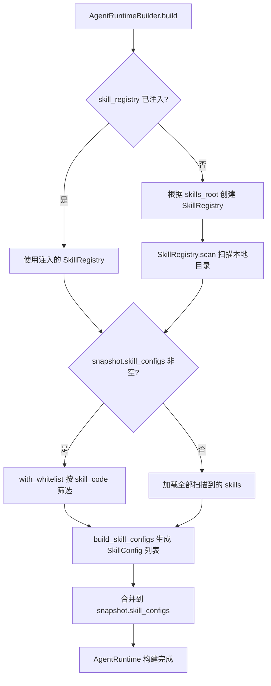

# Skill 系统重构：从 DB 文本存储到本地目录包 + DB 索引表

## 功能说明

将 Skill 系统从"数据库存储完整内容"重构为"本地目录包 + 数据库索引表"模式。

核心理念：**DB 只回答"这个 agent 启用了哪些 skill？"，其他一切都从本地文件系统获取。**

Skill 以目录包形式存在于本地 `skills/` 目录下，每个 skill 是一个子目录，包含 `SKILL.md` 文件（YAML frontmatter + Markdown 正文）。运行时通过 `SkillRegistry` 扫描本地目录，解析 `SKILL.md`，按白名单筛选后注入到 `AgentRuntime` 的 system prompt 中。

## 新增内容

### 1. `SkillManifest` — SKILL.md 解析器

**文件**: `crates/core/agent-base/src/skills/manifest.rs`

解析 SKILL.md 的 YAML frontmatter（`name`、`description`），提供 `parse()` 和 `body()` 方法。

```rust
use agent_base::skills::SkillManifest;

let raw = "---\nname: my-skill\ndescription: A skill\n---\n\nSkill content here.";
let manifest = SkillManifest::parse(raw);
assert_eq!(manifest.name, "my-skill");
assert_eq!(manifest.body(), "Skill content here.");
```

### 2. `SkillRegistry` — 本地 skills 目录扫描器

**文件**: `crates/core/agent-base/src/skills/registry.rs`

扫描指定目录下的所有 skill 子目录，解析 `SKILL.md`，支持白名单筛选。

```rust
use agent_base::skills::SkillRegistry;

let registry = SkillRegistry::new(".codebuddy/skills")
    .scan()
    .await?;

// 按白名单筛选
let configs = registry
    .with_whitelist(&skill_configs)
    .build_skill_configs();
```

### 3. `SkillConfig` — 技能配置结构体

**文件**: `crates/core/agent-base/src/types.rs`

```rust
pub struct SkillConfig {
    pub skill_code: String,     // 技能唯一编码（= 本地目录名）
    pub name: String,           // 技能名称（来自 SKILL.md frontmatter）
    pub description: String,    // 技能描述
    pub content: String,        // SKILL.md 正文内容
    pub source_hint: Option<String>,  // 来源提示
}
```

### 4. `SkillSourceType` 枚举

**文件**: `service-hub/agent-service/src/enums/skill_rel.rs`

```rust
pub enum SkillSourceType {
    Builtin = 0,        // 内置
    AgentInstalled = 1, // 智能体自动安装
    UserManual = 2,     // 用户手动放入
}
```

### 5. `AgentRuntimeBuilder` 新增 skills 加载能力

**文件**: `crates/core/agent-base/src/runtime/builder.rs`

- `with_skills_root(path)` — 设置 skills 根目录（默认 `.codebuddy/skills`）
- `with_skill_registry(registry)` — 注入预构建的 SkillRegistry
- `build()` 时自动扫描本地 skills 目录并合并到 snapshot

## 修改内容

### 数据库层

| 变更 | 说明 |
|---|---|
| **删除** `t_agent_skill_registry` 表 | 移除 entity + migration |
| **重构** `t_agent_skill_rel` 表 | 移除 `skill_id`、`inject_mode`；新增 `skill_code`、`source_type`、`updated_at` |

### agent-base

| 文件 | 变更 |
|---|---|
| `types.rs` | 新增 `SkillConfig`；`AgentDefinitionSnapshot.skills` → `skill_configs` |
| `runtime/builder.rs` | 新增 `skills_root`、`skill_registry` 字段和 `load_skills()` 方法 |
| `runtime/agent_runtime.rs` | 新增 `build_skill_section()` 方法，适配 `SkillConfig` |
| `lib.rs` | 新增 `pub mod skills;`，导出 `DEFAULT_SKILLS_DIR` |

### agent-platform

| 文件 | 变更 |
|---|---|
| `db_provider.rs` | `load_skills()` 返回 `Vec<SkillConfig>`（仅 skill_code 索引） |
| `local_provider.rs` | 使用 `SkillRegistry` 扫描 skills 目录包 |
| `composite.rs` | skills 合并逻辑适配 `skill_configs` 字段 |

### agent-service

| 文件 | 变更 |
|---|---|
| `agent_run.rs` | 注释说明 skills 由 builder 自动加载 |
| `enums/skill_rel.rs` | 新增 `SkillSourceType` 枚举 |

## 注意事项

1. **不向后兼容**：`AgentDefinitionSnapshot.skills` 字段已重命名为 `skill_configs`，类型从 `Vec<TextContent>` 改为 `Vec<SkillConfig>`
2. **数据库迁移**：需要执行迁移删除 `t_agent_skill_registry` 表，重建 `t_agent_skill_rel` 表
3. **Skills 根目录可配置**：默认为 `.codebuddy/skills`，可通过 `with_skills_root()` 自定义
4. **DB 只存索引**：`t_agent_skill_rel` 只存 `skill_code`，不存 skill 内容，内容从本地目录加载

## 使用示例

### 示例 1：默认加载（自动扫描 .codebuddy/skills）

```rust
let runtime = AgentRuntime::builder(snapshot, model, publisher, services)
    .build()
    .await?;
// build() 自动从 .codebuddy/skills 扫描并加载 skills
```

### 示例 2：自定义 skills 目录

```rust
let runtime = AgentRuntime::builder(snapshot, model, publisher, services)
    .with_skills_root("/opt/my-agent/skills")
    .build()
    .await?;
```

### 示例 3：注入预构建的 SkillRegistry

```rust
let registry = SkillRegistry::new("/custom/skills")
    .scan()
    .await?;

let runtime = AgentRuntime::builder(snapshot, model, publisher, services)
    .with_skill_registry(registry)
    .build()
    .await?;
```

## 兼容性说明

- **不向后兼容**：所有引用 `snapshot.skills` 的代码需改为 `snapshot.skill_configs`
- **不向后兼容**：`TextContent` 类型的 skill 需改为 `SkillConfig` 类型
- **数据库不兼容**：`t_agent_skill_registry` 表已删除，`t_agent_skill_rel` 表结构已变更

## 架构流程


