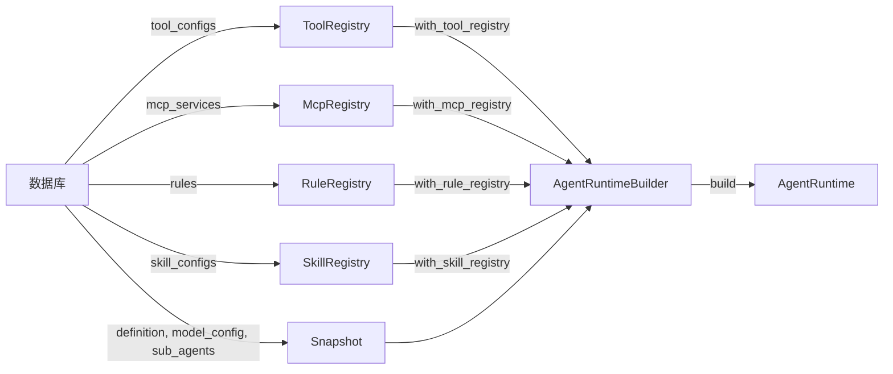

# AgentDefinitionSnapshot 职责纯化 — 子系统外部初始化

## 功能说明

将 `rules`、`skill_configs`、`tool_configs`、`mcp_services` 四个子系统参数
从 `AgentDefinitionSnapshot` 中彻底移除，改由各自的 Registry 在外部完成初始化，
通过 `AgentRuntimeBuilder` 的 `with_*_registry()` 方法注入。

**核心原则**：`snapshot` 只描述"Agent 是谁、用什么模型"；
子系统的装配由调用方显式完成，builder 仅负责组装。

### 改造前

```text
AgentDefinitionSnapshot
├── definition         ← 运行时只读元数据
├── model_config      ← 运行时只读元数据
├── tool_configs       ← ❌ 初始化参数（builder 内部消费）
├── rules              ← ❌ 混合角色：既是输入，又被 builder 回写
├── skill_configs      ← ❌ 混合角色：既是输入，又被 builder 回写
├── mcp_services       ← ❌ 初始化参数（builder 内部消费）
├── sub_agents         ← 运行时只读元数据
└── metadata           ← 运行时只读元数据
```

### 改造后

```text
AgentDefinitionSnapshot          AgentRuntime
├── definition                   ├── snapshot (只读元数据)
├── model_config                ├── rule_configs  ← 由 RuleRegistry 装配
├── sub_agents                   ├── skill_configs ← 由 SkillRegistry 装配
└── metadata                     ├── toolset       ← 由 ToolRegistry + McpRegistry 装配
                                 ├── model
                                 └── ...
```

### 数据流



## 新增内容

### `AgentRuntime` 新增字段

| 字段 | 类型 | 说明 |
|---|---|---|
| `rule_configs` | `Vec<RuleConfig>` | 由 builder 从 RuleRegistry 装配后透传 |
| `skill_configs` | `Vec<SkillConfig>` | 由 builder 从 SkillRegistry 装配后透传 |

### `AgentRuntimeBuilder` 新增方法

（本轮已移除 `with_rule_configs` 和 `with_skill_configs`，入口收敛为 Registry 注入）

| 方法 | 说明 |
|---|---|
| `with_rule_registry(registry)` | 注入预构建的规则注册表 |
| `with_skill_registry(registry)` | 注入预构建的技能注册表 |
| `with_tool_registry(registry)` | 注入已装配的工具注册表 |
| `with_mcp_registry(registry)` | 注入已连接的 MCP 注册表 |

### `AgentRuntimeBuilder` 已有方法语义变更

| 方法 | 变更 |
|---|---|
| `with_tool_registry(registry)` | 调用方需在外部完成 `with_whitelist()` 和 `with_tool()` |
| `with_mcp_registry(registry)` | 调用方需在外部完成 `connects()`；方法从 `async` 改为同步 |

## 修改内容

### `agent-base`

| 文件 | 变更 |
|---|---|
| `types/runtime.rs` | 移除 `tool_configs`、`mcp_services`、`rules`、`skill_configs` 四个字段 |
| `runtime/agent_runtime.rs` | 新增 `rule_configs` / `skill_configs` 字段；`build_system_prompt` 从自身字段读取 |
| `runtime/builder.rs` | `build()` 透传字段；`load_tools` / `load_mcp` 不再依赖 snapshot；`with_mcp_registry` 改为同步 |
| `examples/basic_agent.rs` | 适配新 API |
| `examples/streaming_agent.rs` | 适配新 API |
| `examples/tool_agent.rs` | 适配新 API，`tool_configs` 改为外部构建 `ToolRegistry` |

### `agent-platform`

| 文件 | 变更 |
|---|---|
| `provider/db_provider.rs` | `assemble_snapshot` 移除 tools/mcp_services/rules/skill_configs 参数 |
| `provider/local_provider.rs` | `build_snapshot` 移除 tools/mcp_services/rules/skill_configs 参数 |
| `provider/composite.rs` | 移除 tool_configs/mcp_services/rules/skill_configs 的 merge 逻辑 |
| `scheduler.rs` | 更新文档注释 |
| `tests/integration_test.rs` | 适配新 API |

## 注意事项

1. **不向后兼容**：`AgentDefinitionSnapshot` 移除了 4 个字段
2. **调用方职责增加**：调用方需在外部完成 Registry 初始化后再注入 builder
3. **snapshot 回归只读**：builder 不再回写 snapshot，消除了"输入/输出参数混用"反模式
4. **入口收敛**：移除了 `with_rule_configs` 和 `with_skill_configs`，统一通过 Registry 注入
5. **`with_mcp_registry` 改为同步**：MCP 连接在外部完成，builder 只做工具集构建

## 使用示例

### 示例 1：完整的外部初始化流程（推荐生产用法）

```rust
use agent_base::{AgentRuntime, RuntimeServices, NoopEventPublisher};
use agent_base::tool::ToolRegistry;
use agent_base::mcp::McpRegistry;
use agent_base::rule::RuleRegistry;
use agent_base::skill::SkillRegistry;

// 1. 从数据库加载配置
let snapshot = db_provider.load(agent_id, user_id).await?;
let tool_configs = db_provider.load_tools(agent_id).await?;
let mcp_configs = db_provider.load_mcp_services(agent_id).await?;
let rule_configs = db_provider.load_rules(agent_id).await?;

// 2. 外部初始化各 Registry
let tool_registry = ToolRegistry::new()
    .add_tool(ReadFileTool)
    .add_tool(WriteFileTool)
    .with_whitelist(&tool_configs);

let mut mcp_registry = McpRegistry::new();
mcp_registry.connects(mcp_configs).await?;

let mut rule_registry = RuleRegistry::new(".codebuddy/rules");
rule_registry.scan().await?;
rule_registry.add_rules(rule_configs);

let mut skill_registry = SkillRegistry::new(".codebuddy/skills");
skill_registry.scan().await?;

// 3. 注入 builder 并构建
let runtime = AgentRuntime::builder(snapshot, model, publisher, services)
    .with_tool_registry(tool_registry)
    .with_mcp_registry(mcp_registry)
    .with_rule_registry(rule_registry)
    .with_skill_registry(skill_registry)
    .build()
    .await?;
```

### 示例 2：通过 Registry 动态注入（适合测试和简单场景）

```rust
use agent_base::{AgentRuntime, RuntimeServices, NoopEventPublisher};
use agent_base::rule::RuleRegistry;
use agent_base::types::rule::{RuleConfig, RuleSource};

let rules = vec![RuleConfig {
    rule_code: "safety".to_string(),
    name: Some("安全规则".to_string()),
    content: "不得输出有害内容".to_string(),
    source: RuleSource::Injected,
    source_hint: None,
}];

let mut rule_registry = RuleRegistry::default();
rule_registry.add_rules(rules);

let runtime = AgentRuntime::builder(snapshot, model, publisher, services)
    .with_rule_registry(rule_registry)
    .build()
    .await?;
```

### 示例 3：混合注入（本地扫描 + 动态注入）

```rust
let mut rule_registry = RuleRegistry::new(".codebuddy/rules");
rule_registry.scan().await?;

let extra_rules = vec![RuleConfig {
    rule_code: "custom".to_string(),
    name: Some("自定义规则".to_string()),
    content: "额外的行为约束".to_string(),
    source: RuleSource::Injected,
    source_hint: None,
}];
rule_registry.add_rules(extra_rules);

let runtime = AgentRuntime::builder(snapshot, model, publisher, services)
    .with_rule_registry(rule_registry)
    .build()
    .await?;
```

## 兼容性说明

- **`AgentRuntimeBuilder`**：移除了 `with_rule_configs()` 和 `with_skill_configs()` 方法，统一通过 Registry 注入
- **`SkillRegistry`**：仅支持本地扫描加载，不支持动态注入
- **`AgentDefinitionSnapshot`**：移除了 `tool_configs`、`mcp_services`、`rules`、`skill_configs` 四个字段，所有构造该结构体的代码需同步更新
- **`AgentRuntimeBuilder::with_mcp_registry()`**：从 `async fn` 改为同步 `fn`，调用方需移除 `.await`
- **`agent-platform` 提供者**：`load()` 返回的 snapshot 不再包含子系统参数，调用方需单独调用 `load_tools()` / `load_rules()` 等方法获取
- **`composite.rs` 融合逻辑**：不再融合 tools/mcp/rules/skills，这些由各自的 Registry 在外部处理
