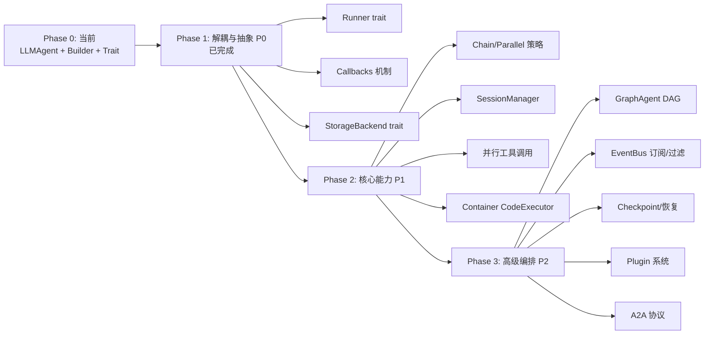
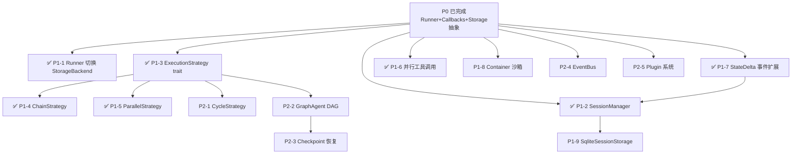

# nucleus-rs 架构演进总纲（2026-04-28 汇总）

> 汇编来源：
>
> - `2026-04-28-trpc-agent-go-technical-analysis.md`（tRPC-Agent-Go 技术剖析）
> - `2026-04-28-trpc-agent-go-comparison-analysis.md`（技术对比分析）
> - `2026-04-28-trpc-agent-go-capability-alignment.md`（能力对齐矩阵）
> - `2026-04-28-framework-difference-analysis.md`（框架差异分析）
> - `2026-04-28-architecture-adjustment-analysis.md`（架构调整分析）
> - `2026-04-28-p0-refactoring-runner-callbacks-storage.md`（P0 阶段重构记录）
>
> 本文是上述 6 份文档的整合视图，面向 nucleus-rs 的演进规划与开发排期。

---

## 目录

1. [tRPC-Agent-Go 技术剖析](#1-trpc-agent-go-技术剖析)
2. [nucleus-rs 当前架构诊断](#2-nucleus-rs-当前架构诊断)
3. [能力对齐矩阵](#3-能力对齐矩阵)
4. [nucleus-rs 独有优势（需保留）](#4-nucleus-rs-独有优势需保留)
5. [架构演进方案](#5-架构演进方案)
6. [P0 阶段已完成工作](#6-p0-阶段已完成工作)
7. [后续开发 TODO 清单](#7-后续开发-todo-清单)

---

## 1. tRPC-Agent-Go 技术剖析

### 1.1 设计理念

tRPC-Agent-Go 采用 **"模块化 + 事件驱动 + 可插拔组件"** 的架构，核心原则：

| 原则 | 实现方式 |
|------|----------|
| 接口契约 | 所有核心组件通过 Go interface 定义（Agent/Model/Tool/Memory/Session/CodeExecutor） |
| 事件驱动解耦 | 组件间通过 Event 通道通信，Runner 事件循环统一处理 |
| 可插拔替换 | 每个组件均可替换为自定义实现 |
| Callback 扩展 | 生命周期关键节点支持 Before/After 回调 |
| Plugin 框架 | PluginManager 运行时加载插件，拦截事件和修改行为 |

### 1.2 架构全景

```
Runner (事件循环 + 会话/记忆/插件)
  │
  ├── Agent（LLM/Chain/Parallel/Cycle/Graph 五种模式）
  │     ├── Model（GenerateContent + IterModel 优化）
  │     ├── Tool（Tool / CallableTool / StreamableTool / ToolSet）
  │     ├── SubAgents
  │     ├── Callbacks（Agent/Model/Tool 三层）
  │     └── Plugins
  │
  ├── Session（StateMap + Events + Tracks + Summaries）
  ├── Memory（长期 + 个性化 + 向量召回）
  ├── Graph（BSP/DAG 双引擎 + Checkpoint + Cache + Retry + Interrupt）
  └── CodeExecutor（Local / Container / Jupyter）
```

### 1.3 关键机制亮点

| # | 亮点 | 说明 |
|---|------|------|
| 1 | **Runner 抽象** | 执行逻辑与 Agent 逻辑解耦，Runner 管理事件循环、会话、记忆 |
| 2 | **三层 Callback 体系** | Agent/Model/Tool 三级回调，结构化参数与返回值、Panic 恢复、CustomResponse 拦截 |
| 3 | **Graph 双引擎** | BSP（超步同步，确定性强）+ DAG（依赖就绪即调度，低延迟） |
| 4 | **StateDelta 增量** | 事件携带 `map[string][]byte` 增量，Session 增量合并 |
| 5 | **Plugin 框架** | 运行时插件加载，事件/工具/Agent 全生命周期拦截 |
| 6 | **CodeExecutor 双模式** | Local（便捷）+ Container（Docker 沙箱，默认无网络、非特权） |
| 7 | **Checkpoint 恢复** | Graph 执行状态持久化 + 断点续跑 |
| 8 | **FilterKey 层级过滤** | 子 Agent 只看到自己分支的事件 |
| 9 | **IterModel 优化** | `Seq[T]` 回调模式减少 goroutine/channel 调度开销 |
| 10 | **双层错误模型** | 函数级 error（系统故障） + Response 级 Error（API 错误） |

### 1.4 Agent 五种模式

| 模式 | 适用场景 | 核心特点 |
|------|----------|----------|
| LLMAgent | 通用对话 / 工具调用 | ReAct 循环：推理→工具→推理→...→完成 |
| ChainAgent | 流水线任务 | 多 Agent 按序执行，输出串联 |
| ParallelAgent | 多视角并行 | goroutine 并发，结果汇总 |
| CycleAgent | 自我优化循环 | 迭代直到收敛 / 最大轮次 |
| GraphAgent | 复杂工作流 | DAG 执行引擎，条件分支 + 并行 + 回溯 |

---

## 2. nucleus-rs 当前架构诊断

### 2.1 现有架构概览

```
┌──────────────────────────────────────┐
│          agent-platform              │  ← 配置装配层（DB 依赖）
│  ├── provider (DB 加载配置)           │
│  ├── memory   (DB 记忆存取)           │
│  ├── knowledge (DB 知识检索)          │
│  └── observability (DB 运行记录)      │
├──────────────────────────────────────┤
│          agent-base                  │  ← 运行时核心
│  ├── runtime/AgentRuntime            │  ← 执行循环 + 工厂（耦合）
│  ├── planner                         │  ← 结构化决策协议
│  ├── skill / rule / command          │  ← 规则引擎
│  ├── tool / mcp / sub_agent          │  ← 工具 & 子智能体
│  └── memory / observability          │  ← trait 定义 + noop 实现
└──────────────────────────────────────┘
```

### 2.2 核心问题

| # | 问题 | 严重程度 | 影响 |
|---|------|---------|------|
| 1 | Runner 与 AgentRuntime 耦合 | 🔴 P0 | 无法替换执行策略，无法运行中操控 |
| 2 | 无 Callbacks / Lifecycle Hooks | 🔴 P0 | 无扩展点，横切关注点需改核心代码 |
| 3 | 框架与存储层耦合 | 🔴 P0 | `agent-platform` 紧耦合 SeaORM/MySQL |
| 4 | 仅有 LLM 单循环执行模式 | 🟠 P1 | 无法表达 Chain/Parallel/Cycle/Graph |
| 5 | Session 管理简单（字符串透传） | 🟠 P1 | 无分层状态、无事件分页、无摘要 |
| 6 | 串行工具调用 | 🟡 P2 | LLM 返回多 tool_call 时效率低 |
| 7 | 无 Graph / DAG 支持 | 🟡 P2 | 缺少复杂工作流编排 |
| 8 | RunCommandTool 无沙箱 | 🟡 P2 | 代码执行安全隔离缺失 |
| 9 | MCP 每次 `build()` 重连 | 🟡 P3 | 连接池 / 复用缺失 |
| 10 | 无重试 / 断路器 | 🟡 P3 | 外部依赖容错不足 |

---

## 3. 能力对齐矩阵

### 3.1 完整矩阵

| # | 能力 | tRPC-Agent-Go | nucleus-rs | 差距等级 | 优先级 |
|---|------|:---:|:---:|:---:|:---:|
| 1 | Agent (LLM) | ✅ | ✅ | - | - |
| 2 | Agent (Chain) | ✅ | ✅（已完成 P1） | - | - |
| 3 | Agent (Parallel) | ✅ | ✅（已完成 P1） | - | - |
| 4 | Agent (Cycle) | ✅ | ❌ | 中 | P2 |
| 5 | Agent (Graph) | ✅ | ❌ | 高 | P1 |
| 6 | Multi-Agent | ✅ | 🔶 | 中 | P1 |
| 7 | Event 订阅/过滤 | ✅ | 🔶 | 中 | P2 |
| 8 | Runner | ✅ | ✅（已完成 P0） | - | - |
| 9 | Model | ✅ | ✅ | - | - |
| 10 | Tools | ✅ | ✅ | - | - |
| 11 | Session 结构化 | ✅ | ✅（已完成 P1，三级状态 + InMemorySessionManager） | - | - |
| 12 | Memory 向量召回 | ✅ | 🔶 | 低 | P2 |
| 13 | Callbacks | ✅ | ✅（已完成 P0） | - | - |
| 14 | Planner | ✅ | ✅ | - | - |
| 15 | Skill | 🔶 | ✅ | nucleus 优 | - |
| 16 | Artifacts | ❌ | ❌ | - | P3 |
| 17 | Debug 交互式 | ✅ | 🔶 | 低 | P3 |
| 18 | A2A | ✅ | ❌ | 高 | P2 |
| 19 | Ecosystem | ✅ | 🔶 | 中 | P2 |
| 20 | AG-UI | ❌ | ❌ | - | P3 |
| 21 | Evaluation | ❌ | ❌ | - | P3 |
| 22 | HTTP Service | ✅ | ✅ | - | - |
| 23 | Observability | ✅ | ✅ | - | - |
| 24 | Knowledge | ✅ | ✅ | - | - |
| 25 | Custom-Agent | ✅ | ✅ | - | - |
| 26 | Plugin 系统 | ❌ | 🔶（MCP 代理） | - | P2 |
| 27 | Team | ❌ | ❌ | - | P3 |
| 28 | CLI | ✅ | ❌ | 中 | P2 |
| 29 | CodeExecutor (Container) | ✅ | 🔶（仅 Local） | 中 | P1 |
| 30 | Storage 多后端 | ✅ | ✅（已完成 P0 抽象） | - | P1 扩展实现 |

### 3.2 差距统计

```
已对齐（✅ vs ✅）             ：14 项（含 P0 Runner/Callbacks/Storage，P1 Chain/Parallel/Session）
部分对齐（✅ vs 🔶）           ：6 项   Multi-Agent / Event / Memory / Debug / Ecosystem / CodeExecutor
未对齐（✅ vs ❌）              ：4 项   Cycle / Graph / A2A / CLI
双方均未实现                    ：5 项   Artifacts / AG-UI / Evaluation / Team / Dify
nucleus-rs 独有优势             ：3 项   Skill（两阶段+白名单）/ Tools（白名单+双源）/ Planner（结构化协议）
```

---

## 4. nucleus-rs 独有优势（需保留）

| # | 优势 | 详情 |
|---|------|------|
| 1 | **PlannerDecision 结构化协议** | 所有动作走结构化枚举（CallTool / QueryKnowledge / RecallMemory / UpdatePlan / Finalize），禁止解析自由文本 |
| 2 | **ModelAdapter + blanket impl** | 任何 `rig::CompletionModel` 自动适配，零成本抽象，编译期保证类型安全 |
| 3 | **Builder 双层 API** | 底层 `RuntimeServices` 注入 + 链式 builder 便捷配置 |
| 4 | **Skill 两阶段加载** | 启动时注入摘要，触发时按需加载完整内容，节省 token |
| 5 | **Tool / Skill 白名单策略** | `ToolWhitelistPolicy` / `SkillWhitelistPolicy` 精细访问控制 |
| 6 | **双源加载** | 本地文件扫描（.codebuddy/）+ 动态注入（DB/HTTP） |
| 7 | **Command 系统** | 用户/宿主显式触发的指令式交互能力，tRPC 无此概念 |
| 8 | **Noop 默认实现** | 所有可选依赖均有 Noop 实现，测试友好 |
| 9 | **Skill/Rule/Command 三层规则引擎** | 细粒度行为控制：Skill=能力包、Rule=约束规则、Command=用户自定义 |
| 10 | **Rust 所有权与内存安全** | 编译期防内存泄漏、数据竞争 |
| 11 | **事件模型完整** | `AgentStreamEvent` 覆盖完整生命周期，含子智能体透传 |

这些优势应在后续演进中**继续保持和强化**。

---

## 5. 架构演进方案

### 5.1 总体路线



### 5.2 分阶段目标

| 阶段 | 产出 | 预估工时 |
|------|------|----------|
| **Phase 1 (P0)** | Runner / Callbacks / StorageBackend 抽象 | 3-4 周（**已完成**） |
| **Phase 2 (P1)** | Chain/Parallel 策略、SessionManager、并行工具调用、Container 沙箱、StateDelta 事件扩展 | 2-3 周（**进行中**：P1-1/2/3/4/5/6/7 已完成，剩余 P1-8/9） |
| **Phase 3 (P2)** | GraphAgent DAG、Cycle 策略、EventBus、Plugin、MCP 连接池、向量召回实现、A2A 预留、CLI 工具 | 3-4 周 |
| **Phase 4 (P3)** | Artifacts、Debug、AG-UI、Evaluation、Team、Dify | 远期规划 |

**总预估**：8-11 周（含测试与文档）

---

## 6. P0 阶段已完成工作

> 完成时间：2026-04-28
> 涉及 crate：`agent-base`

### 6.1 Runner 抽象层

三层 trait 设计：

```text
Runner              ← 基础：run() 启动执行循环
  └─ ManagedRunner  ← 管理：cancel() / run_status()
       └─ SteerableRunner ← 操控：enqueue_user_message() 运行中注入
```

新增文件：

| 文件 | 说明 |
|------|------|
| `runtime/runner/mod.rs` | trait 定义 + 重导出 |
| `runtime/runner/default_runner.rs` | `DefaultRunner`（从 `AgentRuntime::run()` 提取） |
| `runtime/runner/run_status.rs` | `RunStatus` 状态机枚举 |

变更：`AgentRuntime::run_inner()` 委托到 `DefaultRunner`，`AgentRuntime` 退化为配置 + 工厂。

### 6.2 Callbacks 机制

6 个回调点：

| 回调 | 触发时机 | 能力 |
|------|----------|------|
| `before_agent` | Agent 执行前 | 短路执行、替换初始输入 |
| `after_agent` | Agent 执行后 | 替换最终回答 |
| `before_model` | LLM 调用前 | 短路决策、替换请求 |
| `after_model` | LLM 调用后 | 替换决策结果 |
| `before_tool` | 工具执行前 | 短路执行、替换工具结果 |
| `after_tool` | 工具执行后 | 审计、告警 |

新增文件：

| 文件 | 说明 |
|------|------|
| `runtime/runner/callback/mod.rs` | 回调参数/结果结构体 + 回调 trait |
| `runtime/runner/callback/registry.rs` | `CallbackRegistry` + `fire_xxx` 方法 |

Builder 新增 API：`on_before_agent()` / `on_after_agent()` / `on_before_model()` / `on_after_model()` / `on_before_tool()` / `on_after_tool()`。

### 6.3 存储层抽象

`StorageBackend` trait 统一聚合记忆、知识、运行记录、审计日志：

| 方法 | 委托的原 trait |
|------|---------------|
| `write_memory()` / `write_memory_batch()` | `AgentMemoryWriter` |
| `recall_memory()` | `AgentMemoryRetriever` |
| `query_knowledge()` | `AgentKnowledgeRetriever` |
| `create_run_record()` / `finish_run_record()` | `AgentRunRecorder` |
| `log_tool_audit()` | `AgentToolAuditLogger` |

新增文件：

| 文件 | 说明 |
|------|------|
| `runtime/storage/mod.rs` | 模块声明与重导出 |
| `runtime/storage/backend.rs` | `StorageBackend` trait + 请求结构体 + `NoopStorageBackend` |
| `runtime/storage/delegating.rs` | `DelegatingStorageBackend`（委托到现有 trait 实现） |

### 6.4 其他变更

- `RuntimeServices` 新增 `sub_agent_scheduler` 字段
- `AgentDefinition` 新增 `max_delegation_depth`（`#[serde(default)]` = 3）
- `DefaultRunner.execute_step()` 处理 `DelegateSubAgent` / `FanOutSubAgents` 决策
- `lib.rs` 新增 `storage` 模块与 `CallbackRegistry` / `StorageBackend` 重导出

### 6.5 使用示例

```rust
// 注册 before_tool 回调
struct DenyDangerousTool;

#[async_trait]
impl BeforeToolCallback for DenyDangerousTool {
    async fn call(&self, args: BeforeToolArgs) -> AgentResult<BeforeToolResult> {
        if args.tool_code.starts_with("dangerous_") {
            Ok(BeforeToolResult {
                custom_result: Some(json!({"error": "工具被安全策略拒绝"})),
            })
        } else {
            Ok(BeforeToolResult { custom_result: None })
        }
    }
}

let runtime = AgentRuntimeBuilder::new(config, model)
    .on_before_tool(DenyDangerousTool)
    .build()
    .await?;
```

---

## 7. 后续开发 TODO 清单

> 优先级说明：🔴 P1（近期）｜🟠 P2（中期）｜🟡 P3（远期）
> 工时估算基于 1 人全职投入。

### 7.1 P1 — 核心能力增强（预计 2-3 周）

#### ✅ TODO-P1-1：`DefaultRunner` 切换到 `StorageBackend`（已完成）

- 📌 背景：P0 仅完成 trait 抽象，`DefaultRunner` 仍使用 `RuntimeServices` 的独立 trait
- ✏️ 目标：统一通过 `StorageBackend` 访问存储，完成解耦闭环
- 🗂️ 涉及文件：`runtime/runner/default_runner.rs`、`runtime/services.rs`
- ⏱️ 工时：1-2d
- ✅ 验收：`DefaultRunner` 持有 `storage: Arc<dyn StorageBackend>`，默认通过 `DelegatingStorageBackend::from_runtime_services` 构造；支持 `with_storage()` 替换为自定义实现

#### ✅ TODO-P1-2：`SessionManager` trait + 三级状态管理（已完成）

- 📌 背景：当前 `session_id` 仅为字符串透传，无结构化会话对象
- ✏️ 目标：引入 `SessionState` + `SessionStatus`（Active/Idle/Archived）+ `SessionManager` trait
- 🗂️ 涉及文件：`runtime/session.rs`
- ⏱️ 工时：3-5d
- ✅ 验收：`SessionManager` trait 包含 `create` / `get` / `update_status` / `increment_message_count` / `list_by_agent` / `delete`；内置 `InMemorySessionManager` 含完整单元测试（状态机、归档终态、消息计数累加等）

#### ✅ TODO-P1-3：`ExecutionStrategy` trait + `LlmLoopStrategy`（已完成）

- 📌 背景：`DefaultRunner` 的 while 循环仍是硬编码，无法替换
- ✏️ 目标：抽象 `ExecutionStrategy` trait，将现有循环提取为 `LlmLoopStrategy`
- 🗂️ 涉及文件：`runtime/strategies/{mod.rs,strategy.rs,context.rs,llm_loop.rs}`
- ⏱️ 工时：3-5d
- ✅ 验收：`ExecutionStrategy` trait 含 `name()` / `execute(ctx, run_id, session_id, user_input)`；`StrategyOutcome` 承载最终回答与步骤统计；`StrategyContext` 共享依赖

#### ✅ TODO-P1-4：`ChainStrategy` 实现（已完成）

- 📌 背景：缺少链式 Agent 编排
- ✏️ 目标：按序执行多个子策略，前者输出作为后者输入
- 🗂️ 涉及文件：`runtime/strategies/chain.rs`
- ⏱️ 工时：3-5d
- ✅ 验收：支持 `Vec<SharedStrategy>` 配置；事件流统一通过 `ctx.publisher` 发布；子策略输出串联

#### ✅ TODO-P1-5：`ParallelStrategy` 实现（已完成）

- 📌 背景：缺少并行 Agent 编排
- ✏️ 目标：多子策略并发执行，结果合并
- 🗂️ 涉及文件：`runtime/strategies/parallel.rs`
- ⏱️ 工时：3-5d
- ✅ 验收：使用 `futures::join_all` 并发；结果按 `StrategyOutcome` 聚合

#### ✅ TODO-P1-6：并行工具调用（已完成）

- 📌 背景：LLM 返回多个 tool_call 时串行执行，效率低
- ✏️ 目标：`DefaultRunner` 检测多个独立 tool_call，使用 `futures::join_all` + `Semaphore` 并行执行
- 🗂️ 涉及文件：`runtime/runner/default_runner.rs`
- ⏱️ 工时：2-3d
- ✅ 验收：通过 `max_parallel_tools` + `tokio::sync::Semaphore` 控制并发；错误聚合语义（单工具失败不中止其余执行，最终返回首个错误）；失败工具的 `local_messages`（含 `ToolCallFinished success=false`）按原始顺序合并进消息历史

#### ✅ TODO-P1-7：`AgentStreamEvent` 扩展 `StateDelta`（已完成）

- 📌 背景：无状态增量机制，多 Agent 嵌套场景需全量同步
- ✏️ 目标：引入 `StateDelta = HashMap<String, serde_json::Value>` 类型；事件携带 `delta` 字段；实现 `apply_delta` 原地合并
- 🗂️ 涉及文件：`event.rs`
- ⏱️ 工时：1-2d
- ✅ 验收：语义对齐 tRPC-Agent-Go StateDelta 协议；`apply_delta` 单元测试覆盖新增、更新、`null` 删除三种情况

#### TODO-P1-8：`RunCommandTool` Container 沙箱模式

- 📌 背景：当前仅 Local 执行，无安全隔离
- ✏️ 目标：引入 `ExecutionMode` 枚举（Local / Container），Container 模式使用 Docker SDK，默认无网络、非特权、自动清理
- 🗂️ 涉及文件：`agent-base/src/tool/run_command.rs`
- ⏱️ 工时：3-5d
- ✅ 验收：通过 `Executio​nMode::Container { image }` 构造；集成测试验证隔离效果；`bollard` crate 集成

#### TODO-P1-9：内置 `SqliteSessionStorage`（零外部依赖）

- 📌 背景：当前仅 MySQL 实现，部署门槛高
- ✏️ 目标：新增基于 `rusqlite` / `sqlx::sqlite` 的内置实现
- 🗂️ 涉及文件：新 crate `agent-storage-sqlite` 或 `agent-base/src/runtime/storage/sqlite.rs`（feature gate）
- ⏱️ 工时：3-5d
- ✅ 验收：支持会话 CRUD、事件追加、状态三级持久化；CLI / 桌面场景开箱即用

### 7.2 P2 — 高级编排能力（预计 3-4 周）

#### TODO-P2-1：`CycleStrategy` 实现

- 📌 背景：缺少循环迭代模式
- ✏️ 目标：循环执行 Agent 直到收敛或达到最大轮次
- 🗂️ 涉及文件：`runtime/strategies/cycle.rs`（新增）
- ⏱️ 工时：3-5d
- ✅ 验收：支持自定义 `ConvergenceCheck` trait；`max_iterations` 兜底

#### TODO-P2-2：`GraphAgent` DAG 执行引擎

- 📌 背景：缺少复杂工作流编排
- ✏️ 目标：基于 `petgraph` 构建 DAG，支持条件分支、并行节点、子图嵌入
- 🗂️ 涉及文件：`agent-base/src/graph/`（新增模块）
- ⏱️ 工时：5-8d
- ✅ 验收：`StateGraph` builder API（`add_node` / `add_edge` / `add_conditional_edge`）；BSP 与 DAG 双引擎可选；示例：分析→规划→执行→审查

#### TODO-P2-3：Graph Checkpoint + 恢复

- 📌 背景：长任务中断后无法恢复
- ✏️ 目标：`CheckpointSaver` trait 持久化执行状态，支持从断点恢复
- 🗂️ 涉及文件：`agent-base/src/graph/checkpoint.rs`（新增）
- ⏱️ 工时：3-5d
- ✅ 验收：支持存档/恢复；与 `StorageBackend` 集成

#### TODO-P2-4：`EventBus` 事件订阅/过滤

- 📌 背景：当前事件发布是单向推送，无订阅能力
- ✏️ 目标：`EventBus` trait，组件可订阅特定事件类型；支持 `FilterKey` 层级过滤
- 🗂️ 涉及文件：`agent-base/src/event/bus.rs`（新增）
- ⏱️ 工时：3-5d
- ✅ 验收：支持 `publish` / `subscribe(filter)`；子 Agent 事件通过 `FilterKey` 正确过滤

#### TODO-P2-5：`Plugin` 系统

- 📌 背景：扩展能力目前依赖 Callbacks，缺少独立插件生命周期管理
- ✏️ 目标：`Plugin` trait + `PluginRegistry`，覆盖 Agent/Model/Tool/Event 4 类钩子；插件可实现 `Closer` 支持优雅关闭
- 🗂️ 涉及文件：`agent-base/src/plugin/`（新增）
- ⏱️ 工时：3-5d
- ✅ 验收：插件可通过 Builder 注册；插件内部可注册多种回调

#### TODO-P2-6：向量召回实现补全

- 📌 背景：`AgentMemoryRetriever` trait 已定义，具体向量检索待完善
- ✏️ 目标：实现基于向量相似度的记忆召回（可选依赖 `fastembed` / 外部向量库）
- 🗂️ 涉及文件：`agent-platform/src/memory/`
- ⏱️ 工时：5-8d
- ✅ 验收：支持 top-k 语义检索；feature gate `with-fastembed` 控制

#### TODO-P2-7：MCP 连接池 / 复用

- 📌 背景：每次 `build()` 重新连接 MCP，浪费资源
- ✏️ 目标：`McpConnectionPool` 跨运行复用连接，支持空闲超时回收
- 🗂️ 涉及文件：`agent-base/src/mcp/pool.rs`（新增）
- ⏱️ 工时：2-3d
- ✅ 验收：支持连接复用；测试验证连接数降低

#### TODO-P2-8：重试 / 断路器中间件

- 📌 背景：LLM / MCP 外部依赖失败时无容错
- ✏️ 目标：为 `ModelAdapter::completion()` 与 MCP 调用引入指数退避重试 + 断路器
- 🗂️ 涉及文件：`agent-base/src/middleware/`（新增）
- ⏱️ 工时：2-3d
- ✅ 验收：支持按错误类型配置重试；断路器状态机测试

#### TODO-P2-9：`AgentCommunicationProtocol` trait（A2A 预留）

- 📌 背景：未来可能对接 A2A 生态
- ✏️ 目标：抽象 Agent-to-Agent 通信协议 trait，预留扩展点
- 🗂️ 涉及文件：`agent-base/src/a2a/`（新增）
- ⏱️ 工时：2-3d
- ✅ 验收：trait 定义完备；预留 Agent 发现 / 通信接口

#### TODO-P2-10：`nucleus-cli` 脚手架工具

- 📌 背景：缺少独立 CLI，开发体验弱于 tRPC
- ✏️ 目标：新增 `nucleus-cli` crate，支持项目脚手架生成、Agent 本地调试、配置管理
- 🗂️ 涉及文件：新 crate `nucleus-cli`
- ⏱️ 工时：5-8d
- ✅ 验收：`nucleus-cli new <project>` / `nucleus-cli run <agent>` / `nucleus-cli debug`

### 7.3 P3 — 远期规划

| TODO ID | 功能 | 参考 | 工时估算 |
|---------|------|------|----------|
| TODO-P3-1 | `ArtifactsManager` trait（产物管理：文档 / 代码 / 图表 + 版本） | — | 5-8d |
| TODO-P3-2 | 基于 `AgentStreamEvent` 的交互式 Debug（断点 / 单步 / 回放） | tRPC Debug | 5-8d |
| TODO-P3-3 | AG-UI 兼容层（Event 协议扩展） | AG-UI spec | 3-5d |
| TODO-P3-4 | `AgentEvaluator` trait（回答质量 / 工具准确率 / 任务完成率） | — | 5-8d |
| TODO-P3-5 | `Team` 抽象（固定角色团队协作） | — | 3-5d |
| TODO-P3-6 | Dify 平台集成 | Dify API | 3-5d |
| TODO-P3-7 | `IterModel` 优化（借鉴 tRPC 的 Seq 回调模式） | tRPC IterModel | 2-3d |

### 7.4 交叉依赖与调度建议



**推荐执行顺序**：

1. ~~**Week 1**：P1-1 → P1-3（完成 Runner / Strategy 抽象闭环）~~ ✅ 已完成
2. ~~**Week 2**：P1-4 + P1-5（Chain / Parallel）+ P1-6（并行工具调用）~~ ✅ 已完成
3. **Week 3（当前）**：~~P1-2 + P1-7~~ ✅ + **P1-9（SQLite）** 🔄 待办
4. **Week 4**：P1-8（Container 沙箱）+ P2-4（EventBus）
5. **Week 5-6**：P2-2 + P2-3（Graph + Checkpoint）+ P2-1（Cycle）
6. **Week 7-8**：P2-5 ~ P2-10（Plugin / 向量召回 / MCP 池 / 重试 / A2A 预留 / CLI）
7. **Week 9+**：P3 远期项目按需推进

### 7.5 调整原则

1. **渐进式重构**：每一步都可编译、可测试、可发布
2. **向后兼容**：`AgentRuntime::run()` 签名保持兼容，内部委托给 Runner
3. **保持独有优势**：PlannerDecision 结构化协议、ModelAdapter 类型安全、Skill 两阶段加载、Tool/Skill 白名单策略等必须保留
4. **默认实现优先**：Callback / Storage / Hook 均提供 Noop 默认实现
5. **Feature flag 控制**：新能力通过 feature 控制（`graph-agent` / `event-bus` / `with-fastembed` / `with-container`），默认构建最小化
6. **测试覆盖**：每个新 trait 必须有对应单元测试；关键编排场景提供集成测试

---

## 附录：关键设计要点速查

### A. 必须保留的 nucleus-rs 设计

- `PlannerDecision` 枚举（禁止解析自由文本）
- `ModelAdapter` blanket impl（零成本抽象）
- Builder 双层 API
- Noop 默认实现
- Skill 两阶段加载
- Tool / Skill 白名单
- Command 系统
- 本地文件双源加载（.codebuddy/）

### B. 从 tRPC-Agent-Go 借鉴的设计

- Runner 事件循环模式（✅ 已完成）
- 三层 Callback 体系（✅ 已完成）
- 六个生命周期钩子（✅ 已完成）
- StorageBackend 统一存储抽象（✅ 已完成）
- ExecutionStrategy + Chain/Parallel 策略（✅ 已完成）
- SessionManager 三级状态（✅ 已完成）
- 并行工具调用（✅ 已完成）
- StateDelta 增量状态（✅ 已完成）
- Graph BSP/DAG 双引擎（TODO-P2-2）
- CodeExecutor Container 沙箱（TODO-P1-8）
- FilterKey 层级事件过滤（TODO-P2-4 配套）
- Checkpoint / Resume（TODO-P2-3）
- Plugin 框架（TODO-P2-5）

### C. 关键文件路径索引

| 类别 | 路径 |
|------|------|
| Runner | `crates/core/agent-base/src/runtime/runner/` |
| Callbacks | `crates/core/agent-base/src/runtime/runner/callback/` |
| Storage | `crates/core/agent-base/src/runtime/storage/` |
| Strategies | `crates/core/agent-base/src/runtime/strategies/`（✅ 已建） |
| Session | `crates/core/agent-base/src/runtime/session.rs`（✅ 已建） |
| Graph（待建） | `crates/core/agent-base/src/graph/` |
| Event Bus（待建） | `crates/core/agent-base/src/event/bus.rs` |
| Plugin（待建） | `crates/core/agent-base/src/plugin/` |
| A2A（待建） | `crates/core/agent-base/src/a2a/` |
| CLI（待建） | `crates/cli/nucleus-cli/` |
