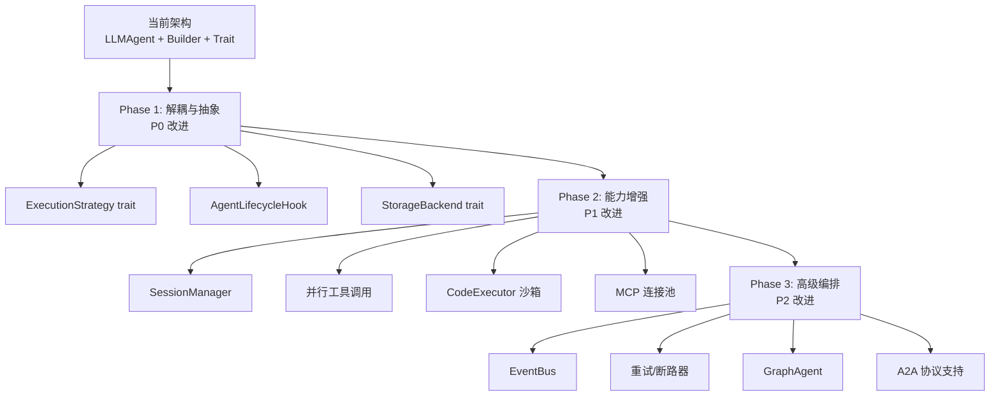

# tRPC-Agent-Go vs nucleus-rs 技术对比分析

> 分析日期：2026-04-28
> 目标：系统性分析 tRPC-Agent-Go 开源项目的设计理念与实现方案，与 nucleus-rs Agent 框架进行对比，借鉴优秀设计，推动 Rust Agent 框架向更通用、更成熟的方向发展。

---

## 1. 主体框架对比

### 1.1 架构设计理念

| 维度 | tRPC-Agent-Go | nucleus-rs |
|------|---------------|------------|
| **设计哲学** | 模块化 + 事件驱动 + 可插拔组件 | 分层架构 + 结构化协议 + Builder 装配 |
| **核心范式** | 多样化 Agent 模式（LLM/Chain/Parallel/Cycle/Graph） | 单一 LLMAgent + 子智能体委派 |
| **组件耦合度** | 事件驱动解耦，callback 插入自定义逻辑 | Trait 抽象解耦，Noop 默认实现 |
| **扩展方式** | 实现接口 + 注册组件 | 实现 Trait + 注入 Registry |

#### tRPC-Agent-Go 架构特点

tRPC-Agent-Go 采用**模块化 + 事件驱动**的架构，核心组件包括：

```
Agent  ←→  Runner  ←→  Session  ←→  Memory
  │           │
  ├── Model   ├── Tool
  ├── Planner ├── Knowledge
  └── ...     └── CodeExecutor
```

- **Agent** 是核心执行单元，处理用户输入并生成响应
- **Runner** 是 Agent 的执行器，管理执行流程，串联 Session/Memory/Service 等能力
- **组件间通过事件驱动机制解耦通信**，支持 callback 插入自定义逻辑
- 所有组件均可**插拔替换**，通过接口定义契约

#### nucleus-rs 架构特点

nucleus-rs 采用**分层 + 结构化协议**的架构：

```
service-hub/agent-service        ← 业务入口层
  └── agent-platform             ← 数据装配层（Provider + DB 实现）
        ├── provider             ← AgentDefinitionProvider trait + DbAgentDefinitionProvider
        ├── memory               ← DbAgentMemoryWriter / DbAgentMemoryRetriever
        ├── knowledge            ← AgentKnowledgeAdapter
        └── observability        ← DbAgentRunRecorder / DbAgentToolAuditLogger
              └── agent-runtime     ← 运行时基座（零 DB 依赖）
                    ├── runtime  ← AgentRuntime + AgentRuntimeBuilder
                    ├── planner  ← PlannerDecision + ModelAdapter
                    ├── tool     ← ToolRegistry + 内置工具
                    ├── mcp      ← McpRegistry + MCP 内省工具
                    ├── rule     ← RuleRegistry
                    ├── skill    ← SkillRegistry + UseSkillTool
                    ├── command  ← CommandRegistry + UseCommandTool
                    ├── sub_agent← SubAgentRegistry + DelegateSubAgentTool
                    ├── memory   ← AgentMemoryWriter/Retriever trait
                    ├── observability ← AgentRunRecorder/ToolAuditLogger trait
                    └── event    ← AgentStreamEvent 统一事件协议
```

- **所有动作走结构化调用协议**（`PlannerDecision`），禁止解析自由文本
- **Builder 模式 + 双层 API**，支持底层注入和便捷配置
- **Noop 默认实现**，所有可选依赖均可替换

### 1.2 核心组件对比

| 核心组件 | tRPC-Agent-Go | nucleus-rs | 对比分析 |
|---------|---------------|------------|----------|
| **Agent 类型** | LLMAgent / ChainAgent / ParallelAgent / CycleAgent / GraphAgent | LLMAgent（通过子智能体委派实现协作） | tRPC 更丰富，nucleus 更聚焦 |
| **执行器** | Runner（独立概念） | AgentRuntime 内置循环 | Runner 抽象更灵活，Runtime 更内聚 |
| **模型适配** | Model 接口 | `ModelAdapter` trait + blanket impl | nucleus 的 blanket impl 更优雅 |
| **工具系统** | Function / MCP / DuckDuckGo | ToolRegistry + MCP Registry + 内置工具 | nucleus 白名单策略更精细 |
| **会话管理** | Session（独立组件） | session_id 字符串透传 | tRPC 更结构化 |
| **记忆系统** | Memory（长期 + 个性化） | 流水记忆 + 精炼记忆 + 向量召回 | 设计理念相似，nucleus 向量召回待完善 |
| **知识检索** | Knowledge（RAG） | AgentKnowledgeRetriever trait | 均支持 RAG，nucleus 通过 trait 抽象 |
| **Planner** | 独立 Planner 组件 | PlannerDecision 枚举 + ModelAdapter | nucleus 的结构化协议更严格 |
| **代码执行** | CodeExecutor（Local/Container） | RunCommandTool | tRPC 更完善，支持沙箱隔离 |
| **事件系统** | 事件驱动 + callback | AgentStreamEvent 枚举 + Publisher trait | tRPC 事件驱动更通用，nucleus 流式更直接 |

### 1.3 技术栈对比

| 维度 | tRPC-Agent-Go | nucleus-rs |
|------|---------------|------------|
| **语言** | Go | Rust |
| **异步模型** | goroutine + channel | tokio async runtime |
| **LLM 集成** | 直接调用 OpenAI SDK | rig-core（类型安全的 LLM 抽象） |
| **MCP 协议** | tRPC-MCP-Go | rmcp crate |
| **ORM** | 可能 GORM / sqlx | SeaORM |
| **RPC 框架** | tRPC-Go（原生） | 无（HTTP/Axum） |
| **错误处理** | error 接口 | thiserror + anyhow |
| **类型安全** | 接口 + 结构体 | Trait + Enum + 泛型 + blanket impl |

---

## 2. 功能模块差异分析

### 2.1 通信协议模块

#### tRPC-Agent-Go

- 基于腾讯 tRPC 生态，天然支持 RPC 通信
- 已有 tRPC-A2A-Go（Agent-to-Agent 协议）和 tRPC-MCP-Go（MCP 协议）开源组件
- 事件驱动机制：组件间通过事件总线通信，callback 可插入自定义逻辑

#### nucleus-rs

- `AgentStreamEvent` 枚举定义了完整的流式事件协议（16 种事件类型）
- `AgentEventPublisher` trait 抽象事件发布，支持 Channel / Forwarding / Noop 实现
- 子智能体事件透传机制：`SubAgentEvent` 变体包装子智能体内部事件
- SSE 流式推送：通过 `mpsc::channel` + Axum SSE 适配

**改进建议**：

1. **引入事件总线机制**：当前事件发布是单向推送，缺少事件订阅/过滤能力。可引入 `EventBus` trait，支持组件订阅特定事件类型并执行自定义逻辑（类似 tRPC 的 callback 机制）
2. **A2A 协议支持**：tRPC 有独立的 A2A 框架，我们可考虑在 `agent-runtime` 中抽象 `AgentCommunicationProtocol` trait，为后续 A2A 集成预留扩展点

### 2.2 任务调度机制

#### tRPC-Agent-Go

- **ChainAgent**：链式执行，多步骤任务按序分解
- **ParallelAgent**：并行处理，多专家同时协作
- **CycleAgent**：循环迭代，自我优化直到满足终止条件
- **GraphAgent**：图工作流，兼容现有编排系统（DAG 执行）
- Runner 组件统一管理执行流程

#### nucleus-rs

- **AgentRuntime** 内置 while 循环，最大轮次控制
- `PlannerDecision` 枚举定义 5 种动作：CallTool / QueryKnowledge / RecallMemory / UpdatePlan / Finalize
- 子智能体通过 `DelegateSubAgentTool` 委派，`max_delegation_depth` 控制递归深度
- 无独立调度器概念

**改进建议**：

1. **引入 Agent 模式抽象**：当前只有 LLMAgent 模式，建议抽象 `AgentMode` trait 或枚举：

```rust
/// Agent 执行模式
pub enum AgentMode {
    /// 单 Agent 循环推理（当前模式）
    Llm,
    /// 链式执行：多个步骤按序执行
    Chain { steps: Vec<ChainStep> },
    /// 并行执行：多个专家同时处理
    Parallel { agents: Vec<AgentConfig> },
    /// 循环迭代：自我优化直到收敛
    Cycle { max_iterations: u32, convergence_check: Box<dyn ConvergenceCheck> },
}
```

1. **引入 Runner 抽象**：将 `AgentRuntime::run()` 中的 while 循环提取为独立的 `Runner` trait，使调度逻辑可替换：

```rust
/// Agent 执行器 trait
#[async_trait]
pub trait AgentRunner: Send + Sync + 'static {
    async fn execute(&self, runtime: &AgentRuntime, context: RunContext) -> AgentResult<RunOutcome>;
}
```

1. **Graph 工作流支持**：可考虑引入 DAG 执行引擎，支持复杂的多步骤编排

### 2.3 资源管理策略

#### tRPC-Agent-Go

- Session 组件管理用户会话状态和事件
- Memory 组件管理长期记忆和个性化信息
- 组件可插拔替换，框架提供默认实现

#### nucleus-rs

- `RuntimeServices` 聚合所有可选运行时依赖
- Noop 默认实现 + trait 注入替换
- 数据库连接通过 `Arc<DatabaseConnection>` 共享
- `AgentDefinitionProvider` trait 抽象配置来源

**改进建议**：

1. **框架与数据层分离**：当前 `agent-platform` 紧密依赖 SeaORM + MySQL，建议引入 `StorageBackend` trait：

```rust
/// 存储后端抽象
#[async_trait]
pub trait StorageBackend: Send + Sync + 'static {
    async fn get_agent_config(&self, agent_id: i64, user_id: i32) -> Result<Option<AgentConfig>>;
    async fn write_memory(&self, entry: MemoryEntry) -> Result<()>;
    async fn recall_memory(&self, query: &str, top_k: u32) -> Result<Vec<MemoryEntry>>;
    // ...
}

/// 内置 SQLite 实现
pub struct SqliteBackend { /* ... */ }

/// MySQL/PostgreSQL 实现（通过 SeaORM）
pub struct SeaOrmBackend { /* ... */ }
```

1. **内置 SQLite 支持**：提供开箱即用的 SQLite 实现，降低部署门槛，同时允许外部替换

2. **会话管理增强**：当前 session_id 仅为字符串透传，建议引入 `SessionManager` trait 管理会话生命周期、状态持久化和事件历史

### 2.4 系统扩展性支持

#### tRPC-Agent-Go

- 所有组件可插拔，通过接口定义契约
- callback 机制插入自定义逻辑
- 事件驱动实现组件间解耦通信
- 多种 Agent 模式覆盖不同编排需求

#### nucleus-rs

- **Trait 抽象**：所有核心依赖通过 trait 定义（ModelAdapter、AgentMemoryWriter、AgentEventPublisher 等）
- **Registry 模式**：ToolRegistry / McpRegistry / RuleRegistry / SkillRegistry / CommandRegistry / SubAgentRegistry
- **Builder 双层 API**：底层注入 + 便捷配置
- **白名单策略**：ToolWhitelistPolicy / SkillWhitelistPolicy
- **双源加载**：本地文件扫描 + 动态注入

**nucleus-rs 的扩展性优势**：

1. Builder 双层 API 设计灵活，可适应不同使用场景
2. Registry 模式统一管理各类能力组件
3. 白名单策略提供精细的访问控制
4. Noop 默认实现简化测试

**改进建议**：

1. **引入 Callback / Hook 机制**：当前缺少执行过程中的拦截点，建议在关键生命周期节点添加 hook：

```rust
/// 运行时生命周期钩子
#[async_trait]
pub trait AgentLifecycleHook: Send + Sync + 'static {
    /// 运行开始前
    async fn on_run_started(&self, context: &RunContext) -> AgentResult<()>;
    /// 每步推理前
    async fn on_step_started(&self, step: u32, context: &StepContext) -> AgentResult<()>;
    /// 工具调用前（可用于权限校验、参数修改）
    async fn on_tool_calling(&self, tool_code: &str, args: &str) -> AgentResult<ToolCallDecision>;
    /// 工具调用后
    async fn on_tool_called(&self, result: &ToolCallResult) -> AgentResult<()>;
    /// 运行结束前
    async fn on_run_finished(&self, outcome: &RunOutcome) -> AgentResult<()>;
}
```

1. **Middleware 管道**：参考 tRPC 的 callback 机制，引入中间件管道模式：

```rust
/// 中间件 trait
#[async_trait]
pub trait AgentMiddleware: Send + Sync + 'static {
    async fn process(&self, request: AgentRequest, next: Next) -> AgentResult<AgentResponse>;
}
```

### 2.5 性能表现

#### tRPC-Agent-Go

- Go goroutine 轻量级并发，适合高吞吐场景
- tRPC 框架原生高性能 RPC
- ParallelAgent 原生支持并行处理

#### nucleus-rs

- Rust 零成本抽象，编译期优化
- tokio 异步运行时，高并发低延迟
- `Arc<ToolSet>` 不可变共享，无锁读取
- `mpsc::channel` 高效事件流

**改进建议**：

1. **并行工具调用**：当前工具调用是串行的，建议支持并行工具调用（LLM 一次返回多个 tool_call 时并行执行）
2. **流式推理优化**：当前 `ReasoningDelta` 事件已是增量推送，但可考虑引入背压控制
3. **连接池管理**：MCP 连接可引入连接池复用，避免每次运行重新建立

### 2.6 错误处理与容错机制

#### tRPC-Agent-Go

- Go 标准错误处理（error 接口）
- 组件可替换，故障隔离
- CycleAgent 支持自我修复

#### nucleus-rs

- `thiserror` 定义库级别错误枚举（`Error`），覆盖 18 种错误变体
- `AgentResult<T>` 类型别名统一错误传播
- `?` 操作符传播错误
- Noop 默认实现避免可选依赖导致运行时崩溃
- 子智能体委派失败时跳过并记录日志（`debug!`），不中断父运行

**nucleus-rs 错误处理优势**：

1. 类型安全的错误枚举，编译期保证错误处理完整
2. `thiserror` 的 `#[error(transparent)]` 透明传递底层错误
3. 分层错误策略（库级 thiserror + 应用级 anyhow）

**改进建议**：

1. **重试机制**：为 MCP 连接、LLM 调用等外部依赖引入指数退避重试
2. **断路器模式**：对频繁失败的外部服务引入断路器，避免雪崩
3. **优雅降级**：工具调用失败时可配置降级策略（跳过/重试/报错）

---

## 3. 设计理念与适用场景

### 3.1 设计哲学对比

| 维度 | tRPC-Agent-Go | nucleus-rs |
|------|---------------|------------|
| **目标用户** | Go 企业开发者 | Rust 高性能场景开发者 |
| **设计优先级** | 灵活性 > 性能 > 类型安全 | 类型安全 > 性能 > 灵活性 |
| **核心理念** | 组件可插拔 + 多模式编排 | 结构化协议 + 编译期保证 |
| **扩展方式** | 实现接口 + 注册 | 实现 Trait + Builder 注入 |
| **部署模式** | 微服务 + RPC | 单体/微服务均可 |
| **生态策略** | tRPC 生态闭环（A2A + MCP + Agent） | Rust crate 模块化 |

### 3.2 适用场景分析

#### tRPC-Agent-Go 适合的场景

- 企业内部微服务架构，已有 tRPC 基础设施
- 需要多种 Agent 编排模式（链式/并行/图工作流）
- Go 语言技术栈，追求开发效率
- 需要与 A2A 协议互操作

#### nucleus-rs 适合的场景

- 高性能、低延迟要求的 Agent 服务
- 需要编译期类型安全保证的关键系统
- Rust 技术栈，追求极致性能和内存安全
- 需要 fine-grained 访问控制（白名单策略）
- CLI / 本地开发工具场景（.codebuddy 目录）

---

## 4. 可借鉴的设计模式与改进建议

### 4.1 高优先级改进（P0）

#### 4.1.1 引入 Agent 执行模式抽象

**问题**：当前仅有 LLM 单循环模式，无法表达链式/并行/图工作流等编排需求。

**建议**：在 `agent-runtime` 中抽象 `ExecutionStrategy` trait，与 `AgentRuntime` 解耦：

```rust
/// 执行策略 trait
#[async_trait]
pub trait ExecutionStrategy: Send + Sync + 'static {
    /// 执行名称
    fn name(&self) -> &'static str;
    /// 执行 Agent 运行
    async fn execute(&self, runtime: &AgentRuntime, ctx: RunContext) -> AgentResult<RunOutcome>;
}

/// 默认 LLM 循环策略（当前实现）
pub struct LlmLoopStrategy;

/// 链式执行策略
pub struct ChainStrategy {
    pub steps: Vec<ChainStep>,
}

/// 并行执行策略
pub struct ParallelStrategy {
    pub max_concurrency: usize,
}
```

**涉及模块**：`agent-runtime/src/runtime/`

#### 4.1.2 引入生命周期 Hook / Callback 机制

**问题**：当前运行时缺少拦截点，无法在工具调用前后插入自定义逻辑（如权限校验、审计增强、参数变换）。

**建议**：在 `AgentRuntime` 中添加 `hooks: Vec<Arc<dyn AgentLifecycleHook>>` 字段，在关键节点调用：

```rust
pub struct AgentRuntime {
    // ... existing fields
    hooks: Vec<Arc<dyn AgentLifecycleHook>>,
}
```

**涉及模块**：`agent-runtime/src/runtime/`、`agent-runtime/src/hooks.rs`（新增）

#### 4.1.3 框架与数据层分离

**问题**：`agent-platform` 紧密依赖 SeaORM + MySQL，无法替换存储后端。

**建议**：

1. 在 `agent-runtime` 中定义 `StorageBackend` trait
2. 在 `agent-platform` 中提供 SeaORM 实现
3. 新增 `agent-storage-sqlite` crate 提供 SQLite 开箱即用实现
4. `AgentRuntimeBuilder` 支持 `with_storage_backend()` 注入

**涉及模块**：`agent-runtime`（新增 trait）、`agent-platform`（适配实现）、新 crate

### 4.2 中优先级改进（P1）

#### 4.2.1 会话管理增强

**问题**：session_id 仅为字符串，缺少结构化会话管理。

**建议**：引入 `SessionManager` trait，管理会话生命周期、状态持久化和历史事件回放：

```rust
#[async_trait]
pub trait SessionManager: Send + Sync + 'static {
    async fn create_session(&self, agent_id: i64, user_id: i32) -> AgentResult<Session>;
    async fn get_session(&self, session_id: &str) -> AgentResult<Option<Session>>;
    async fn list_events(&self, session_id: &str, limit: u32) -> AgentResult<Vec<AgentStreamEvent>>;
    async fn close_session(&self, session_id: &str) -> AgentResult<()>;
}
```

**涉及模块**：`agent-runtime/src/session.rs`（新增）、`agent-platform`（DB 实现）

#### 4.2.2 并行工具调用

**问题**：当前工具调用串行执行，LLM 返回多个 tool_call 时未并行处理。

**建议**：在 `AgentRuntime::run()` 中检测多个 tool_call，使用 `tokio::join!` 或 `futures::join_all` 并行执行独立工具调用。

**涉及模块**：`agent-runtime/src/runtime/agent_runtime.rs`

#### 4.2.3 CodeExecutor 沙箱执行

**问题**：当前 `RunCommandTool` 直接执行命令，无沙箱隔离。

**建议**：参考 tRPC 的 CodeExecutor，引入容器化执行模式：

```rust
pub enum ExecutionMode {
    /// 本地直接执行（当前模式）
    Local,
    /// Docker 容器执行
    Container { image: String },
    /// WebAssembly 沙箱执行
    Wasm { module: Vec<u8> },
}
```

**涉及模块**：`agent-runtime/src/tool/run_command.rs`

#### 4.2.4 MCP 连接池与复用

**问题**：每次 `build()` 都重新连接 MCP 服务，浪费资源。

**建议**：引入 `McpConnectionPool`，跨运行复用 MCP 连接：

```rust
pub struct McpConnectionPool {
    connections: DashMap<String, Arc<McpConnection>>,
    max_idle_time: Duration,
}
```

**涉及模块**：`agent-runtime/src/mcp/`

### 4.3 低优先级改进（P2）

#### 4.3.1 事件总线

**问题**：当前事件发布是单向推送，缺少事件订阅/过滤能力。

**建议**：引入 `EventBus` trait，支持组件订阅特定事件类型：

```rust
#[async_trait]
pub trait EventBus: Send + Sync + 'static {
    async fn publish(&self, event: AgentStreamEvent);
    async fn subscribe(&self, filter: EventFilter) -> EventStream;
}
```

#### 4.3.2 重试与断路器

**问题**：外部依赖（MCP/LLM）调用失败时无重试机制。

**建议**：为 `ModelAdapter::completion()` 和 `McpRegistry::connect_all()` 引入指数退避重试，对频繁失败的服务引入断路器。

#### 4.3.3 Graph 工作流引擎

**问题**：无法表达 DAG 依赖关系的多步骤编排。

**建议**：引入 `GraphAgent` 模式，基于 DAG 执行引擎，支持条件分支和并行节点。

---

## 5. 架构演进路线图



### Phase 1：解耦与抽象（预计 2-3 周）

- 抽象 `ExecutionStrategy` trait，将 while 循环提取为 `LlmLoopStrategy`
- 添加 `AgentLifecycleHook` 机制
- 定义 `StorageBackend` trait，`agent-platform` 适配为 `SeaOrmBackend`
- 新增 `agent-storage-sqlite` crate（可选）

### Phase 2：能力增强（预计 2-3 周）

- 实现 `SessionManager` trait 和 DB 实现
- 支持并行工具调用
- `RunCommandTool` 引入容器化执行模式
- `McpConnectionPool` 连接复用

### Phase 3：高级编排（预计 3-4 周）

- `EventBus` 事件总线
- 重试/断路器中间件
- `GraphAgent` DAG 工作流
- A2A 协议预留接口

---

## 6. 涉及的组件与模块

| 改进项 | 涉及模块 | 变更类型 |
|--------|----------|----------|
| ExecutionStrategy | `agent-runtime/src/runtime/` | 新增 trait + 重构 |
| AgentLifecycleHook | `agent-runtime/src/hooks.rs`（新增） | 新增 |
| StorageBackend | `agent-runtime/src/storage.rs`（新增）、`agent-platform/` | 新增 trait + 适配 |
| agent-storage-sqlite | 新 crate | 新增 |
| SessionManager | `agent-runtime/src/session.rs`（新增）、`agent-platform/` | 新增 |
| 并行工具调用 | `agent-runtime/src/runtime/agent_runtime.rs` | 修改 |
| CodeExecutor | `agent-runtime/src/tool/run_command.rs` | 修改 |
| MCP 连接池 | `agent-runtime/src/mcp/` | 修改 |
| EventBus | `agent-runtime/src/event_bus.rs`（新增） | 新增 |
| GraphAgent | `agent-runtime/src/runtime/strategies/`（新增） | 新增 |

---

## 7. 兼容性说明

1. **向后兼容**：所有改进均以新增 trait / 新增字段方式引入，不修改现有公共 API 的签名
2. **默认行为不变**：`ExecutionStrategy` 默认使用 `LlmLoopStrategy`，与当前 `AgentRuntime::run()` 行为一致
3. **渐进式采用**：`AgentLifecycleHook` 默认为空列表，不启用任何钩子
4. **StorageBackend 可选**：不使用 `StorageBackend` 时，仍可手动构建 `AgentRuntime`
5. **Feature flag 控制**：新增功能通过 feature flag 控制（如 `graph-agent`、`event-bus`），保持默认构建最小化

---

## 8. 总结

### nucleus-rs 的核心优势（应保持）

1. **结构化调用协议**：`PlannerDecision` 枚举禁止自由文本解析，运行时可靠性更高
2. **类型安全的 LLM 集成**：`ModelAdapter` + blanket impl，零成本抽象
3. **Builder 双层 API**：灵活性与便捷性兼顾
4. **Noop 默认实现**：所有可选依赖可替换，测试友好
5. **白名单策略**：精细的访问控制
6. **Rust 性能与安全**：零成本抽象 + 内存安全 + 编译期保证

### 应从 tRPC-Agent-Go 借鉴的关键设计

1. **多样化 Agent 模式**：Chain/Parallel/Cycle/Graph 编排模式
2. **事件驱动 + Callback**：组件间解耦通信，可插入自定义逻辑
3. **Runner 抽象**：将执行流程管理与 Agent 核心逻辑分离
4. **Session 管理**：结构化的会话生命周期管理
5. **CodeExecutor**：沙箱隔离的代码执行能力
6. **框架与存储分离**：可插拔的存储后端
