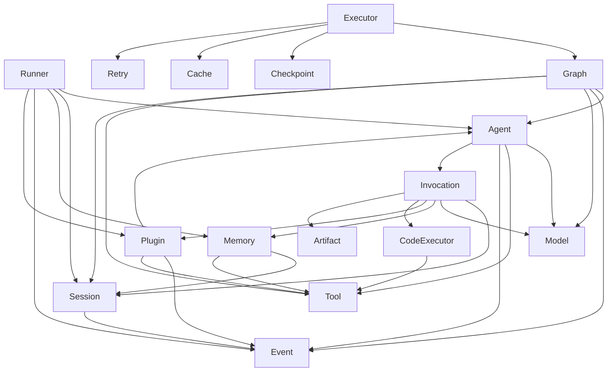

# tRPC-Agent-Go 系统性技术分析

> 分析日期：2026-04-28
> 分析对象：tRPC-Agent-Go 开源项目（Tencent）
> 目标：基于完整源代码，系统性分析架构设计、核心机制、功能模块与技术特性，提炼可借鉴的设计模式与最佳实践。

---

## 一、整体架构分析

### 1.1 架构设计理念

tRPC-Agent-Go 采用 **"模块化 + 事件驱动 + 可插拔组件"** 的架构理念，核心设计原则：

| 原则 | 实现方式 |
|------|----------|
| **接口契约** | 所有核心组件通过 Go interface 定义契约（Agent、Model、Tool、Memory、Session、CodeExecutor） |
| **事件驱动解耦** | 组件间通过 Event 通道通信，Runner 事件循环统一处理 |
| **可插拔替换** | 每个组件均可替换为自定义实现（如 local/container CodeExecutor） |
| **Callback 扩展** | 生命周期关键节点支持 Before/After 回调，插入自定义逻辑 |
| **Plugin 框架** | PluginManager 接口支持运行时插件加载，拦截事件和修改行为 |

#### 架构全景图

```
                          ┌──────────────────────────────────────────────┐
                          │              Runner (执行器)                  │
                          │  ┌─────────────────────────────────────┐    │
                          │  │         Event Loop                  │    │
                          │  │  ┌───────┐  ┌───────┐  ┌────────┐ │    │
                          │  │  │ Agent │→ │ Event │→ │Session │ │    │
                          │  │  │ .Run()│  │ Chan  │  │Service │ │    │
                          │  │  └───────┘  └───┬───┘  └────────┘ │    │
                          │  │                 │                    │    │
                          │  │     ┌───────────┼──────────┐       │    │
                          │  │     ▼           ▼          ▼       │    │
                          │  │  Callbacks   Plugins   Memory      │    │
                          │  └─────────────────────────────────────┘    │
                          └──────────────────────────────────────────────┘
                                           │
              ┌────────────────────────────┼────────────────────────────┐
              │                            │                            │
     ┌────────▼────────┐        ┌─────────▼─────────┐       ┌────────▼────────┐
     │     Agent        │        │    Session         │       │    Memory        │
     │  ┌────────────┐  │        │  ┌──────────────┐ │       │  ┌────────────┐  │
     │  │ LLMAgent   │  │        │  │ StateMap     │ │       │  │ Service    │  │
     │  │ ChainAgent │  │        │  │ Events[]     │ │       │  │ (fact/     │  │
     │  │ Parallel   │  │        │  │ Tracks       │ │       │  │  episode)  │  │
     │  │ CycleAgent │  │        │  │ Summaries    │ │       │  │ Tools      │  │
     │  │ GraphAgent │  │        │  └──────────────┘ │       │  └────────────┘  │
     │  └────────────┘  │        └───────────────────┘       └──────────────────┘
     │  ┌────────────┐  │
     │  │ Model      │  │        ┌───────────────────┐       ┌──────────────────┐
     │  │ Tools[]    │  │        │    Graph           │       │  CodeExecutor    │
     │  │ SubAgents[]│  │        │  ┌──────────────┐ │       │  ┌────────────┐  │
     │  │ Callbacks  │  │        │  │ Nodes[]      │ │       │  │ Local      │  │
     │  │ Plugins    │  │        │  │ Edges[]      │ │       │  │ Container  │  │
     │  └────────────┘  │        │  │ CondEdges[]  │ │       │  │ Jupyter    │  │
     └──────────────────┘        │  │ Executor     │ │       │  └────────────┘  │
                                  │  │ (BSP/DAG)   │ │       └──────────────────┘
                                  │  │ Checkpoint  │ │
                                  │  │ Cache       │ │       ┌──────────────────┐
                                  │  │ Retry       │ │       │    Plugin         │
                                  │  │ Interrupt   │ │       │  ┌────────────┐  │
                                  │  └──────────────┘ │       │  │ EventHook  │  │
                                  └───────────────────┘       │  │ ToolHook   │  │
                                                              │  │ AgentHook  │  │
                                                              │  └────────────┘  │
                                                              └──────────────────┘
```

### 1.2 核心组件组织结构

项目采用扁平化的 Go package 组织结构，每个核心组件独立一个包：

```
trpc-agent-go/
├── agent/              # Agent 核心接口 + Invocation + Callbacks + Plugins
│   ├── agent.go        # Agent 接口定义（Run/Tools/Info/SubAgents）
│   ├── invocation.go   # Invocation 运行上下文（状态/会话/模型/记忆/插件）
│   ├── callbacks.go    # Before/After 回调系统
│   ├── plugins.go      # PluginManager 插件管理器接口
│   └── trace/          # 执行追踪
├── runner/             # Runner 执行器（事件循环 + 会话管理 + 记忆写入）
│   └── runner.go       # Runner/ManagedRunner/SteerableRunner 接口 + 实现
├── model/              # LLM 模型适配层
│   ├── model.go        # Model/IterModel 接口定义
│   └── callbacks.go    # 模型回调（Before/After Model Generate）
├── tool/               # 工具系统
│   ├── tool.go         # Tool/CallableTool/StreamableTool 接口
│   └── callbacks.go    # 工具回调（Before/After Tool Call）
├── session/            # 会话管理
│   └── session.go      # Session 结构体 + Service 接口 + 状态管理
├── memory/             # 记忆系统
│   └── memory.go       # Service 接口（Add/Update/Delete/Search/Tools）
├── event/              # 事件系统
│   └── event.go        # Event 结构体 + 过滤/序列化/选项模式
├── graph/              # 图执行引擎
│   ├── graph.go        # Graph/Node/Edge/ConditionalEdge + ExecutionContext
│   ├── executor.go     # Executor（BSP/DAG 执行引擎 + 超时/重试/检查点）
│   ├── state_graph.go  # StateGraph 构建器（AddNode/AddEdge/AddConditionalEdge）
│   ├── execution_engine.go  # 执行引擎枚举（BSP/DAG）
│   ├── checkpoint.go   # 检查点管理（持久化 + 恢复）
│   ├── cache.go        # 节点缓存策略
│   ├── retry.go        # 节点重试策略
│   ├── interrupt.go    # 中断/恢复机制
│   ├── resume.go       # 运行恢复
│   └── internal/channel/  # Pregel 通道管理器
├── codeexecutor/       # 代码执行器
│   ├── codeexecutor.go # CodeExecutor 接口定义
│   ├── local/          # 本地执行器
│   ├── container/      # Docker 容器执行器
│   ├── jupyter/        # Jupyter 执行器
│   └── workspace.go    # 工作空间管理
├── plugin/             # 插件管理
│   └── manager.go      # PluginManager 实现 + 事件/工具/Agent Hook
├── knowledge/          # 知识检索
└── artifact/           # 产物管理
```

### 1.3 依赖关系



### 1.4 技术栈选择

| 维度 | 技术选择 | 设计考量 |
|------|----------|----------|
| 语言 | Go | goroutine 轻量并发，适合高吞吐 RPC 场景 |
| 通信协议 | tRPC-Go | 腾讯内部微服务生态原生支持，高性能 RPC |
| 流式通信 | Go channel | 原生支持背压，事件流天然适配 |
| 并发模型 | goroutine + sync | goroutine 轻量级，sync.Mutex/RWMutex 保护共享状态 |
| 容器化 | Docker SDK | 代码沙箱执行，安全隔离 |
| 可观测性 | OpenTelemetry | 分布式追踪标准化 |
| 错误处理 | 双层错误模型 | 函数级 error + Response 级 Error 分离 |
| 选项模式 | Functional Options | Go 惯用模式，灵活配置 |

---

## 二、核心框架机制

### 2.1 通信协议层设计

#### 2.1.1 事件驱动模型

tRPC-Agent-Go 的核心通信机制是 **Event Channel**（事件通道），Agent 的 `Run()` 方法返回 `<-chan *event.Event`，所有组件间通信都通过事件流完成。

```go
// Agent 接口 — 核心入口
type Agent interface {
    Run(ctx context.Context, invocation *Invocation) (<-chan *event.Event, error)
    Tools() []tool.Tool
    Info() Info
    SubAgents() []Agent
    FindSubAgent(name string) Agent
}
```

**Event 结构体**承载了完整的运行时信息：

```go
type Event struct {
    *model.Response                              // 嵌入 LLM 响应（含 Choices/Error/Done）
    RequestID          string                     // 请求 ID
    InvocationID       string                     // 调用 ID
    ParentInvocationID string                     // 父调用 ID（多 Agent 链路追踪）
    Author             string                     // 事件作者（agent 名/graph-executor）
    ID                 string                     // 事件唯一 ID（UUID）
    Timestamp          time.Time                  // 时间戳
    Branch             string                     // 分支路径（多 Agent 执行链）
    Tag                string                     // 事件标签（分号分隔，如 "code_execution_code"）
    RequiresCompletion bool                       // 是否需要完成信号
    LongRunningToolIDs map[string]struct{}        // 长时运行工具 ID 集合
    StateDelta         map[string][]byte          // 状态增量更新
    Extensions         map[string]json.RawMessage // 扩展元数据（命名空间化）
    StructuredOutput   any                        // 结构化输出（内存态，不序列化）
    ExecutionTrace     *trace.Trace               // 执行追踪（内存态）
    Actions            *EventActions              // 流级控制提示（如跳过摘要）
    FilterKey          string                     // 层级过滤键
    Version            int                        // 版本号（向前兼容）
}
```

**设计亮点**：

1. **StateDelta 机制**：事件携带状态增量（`map[string][]byte`），Session 可增量合并，避免全量状态同步
2. **FilterKey 层级过滤**：支持层级事件过滤（`parent/child/grandchild` 格式），子 Agent 只看到自己分支的事件
3. **Branch 追踪**：多 Agent 模式下记录执行链，方便调试和可视化
4. **Extensions 扩展**：命名空间化的 JSON 元数据，支持第三方扩展
5. **Actions 控制提示**：EventActions 提供流级控制（如 `SkipSummarization`），影响 Runner 行为但不污染 Response

#### 2.1.2 Runner 事件循环

Runner 是整个框架的核心调度器，采用 **事件循环** 模式统一处理所有 Agent 事件：

```go
// Runner 接口
type Runner interface {
    Run(ctx context.Context, userID, sessionID string, message model.Message, opts ...agent.RunOption) (<-chan *event.Event, error)
}

// ManagedRunner — 带生命周期管理
type ManagedRunner interface {
    Runner
    Close() error
}

// SteerableRunner — 带控制能力
type SteerableRunner interface {
    ManagedRunner
    QueueUserMessage(ctx context.Context, userID, sessionID string, message model.Message, opts ...agent.RunOption) error
    CancelRun(ctx context.Context, userID, sessionID string) error
}
```

**事件循环核心流程**：

```
1. Runner.Run() 创建 Invocation，初始化 Session
2. 调用 BeforeAgent Callbacks（可跳过 Agent 执行）
3. Agent.Run() → eventCh（Agent 事件流）
4. 进入事件循环：
   for agentEvent := range eventCh {
       a. 应用 Plugin 过滤/修改事件
       b. 捕获 Graph 完成状态（StateDelta/Choices）
       c. 将事件写入 Session（AppendEvent）
       d. 将事件发送到 processedEventCh（输出通道）
       e. 处理用户消息队列（QueueUserMessage）
   }
5. 调用 AfterAgent Callbacks（可替换 Agent 响应）
6. 发送 Runner Completion 事件
7. 触发异步任务：自动记忆提取、Session 入库
```

**关键设计**：

- **Completion 去重**：Runner 在 `emitRunnerCompletion()` 中实现复杂的去重逻辑，确保 Graph 完成事件不会与 Agent 响应重复
- **Fallback 状态**：`eventLoopContext` 维护 `fallbackStateDelta` 和 `fallbackChoices`，当 Graph 完成事件被抑制时提供回退
- **用户消息重写**：`UserMessageRewriter` 支持在执行前修改用户消息，实现消息预处理（如多模态内容提取）
- **会话历史播种**：`seedSessionHistory()` 支持在空会话中注入初始消息

### 2.2 任务调度与执行引擎

#### 2.2.1 Agent 模式体系

tRPC-Agent-Go 提供 5 种 Agent 模式，覆盖从简单到复杂的全场景编排：

| 模式 | 接口 | 适用场景 | 核心特点 |
|------|------|----------|----------|
| **LLMAgent** | `Agent.Run()` | 通用对话/工具调用 | ReAct 循环：推理→工具→推理→...→完成 |
| **ChainAgent** | Agent 组合 | 流水线处理（分析→设计→编码→测试） | 多 Agent 按序执行，输出串联 |
| **ParallelAgent** | Agent 组合 | 多视角并行（安全+性能+代码审查） | 多 Agent 并发执行，结果汇总 |
| **CycleAgent** | Agent 组合 | 自我优化循环（写→测→修→再测） | 迭代直到收敛/最大轮次 |
| **GraphAgent** | Graph + Executor | 复杂工作流（条件分支+并行+回溯） | DAG 执行引擎，支持 BSP/DAG 两种调度 |

所有 Agent 模式都实现统一的 `Agent` 接口，Runner 不感知具体模式，只消费事件流。

#### 2.2.2 Graph 执行引擎

Graph 是 tRPC-Agent-Go 最复杂的组件，基于 **Pregel-style BSP（Bulk Synchronous Parallel）** 模型：

**核心概念**：

```go
// Node — 图节点（函数/LLM/工具/Agent）
type Node struct {
    ID          string
    Name        string
    Description string
    Function    NodeFunc                   // (ctx, state) -> (any, error)
    Type        NodeType                   // Function/LLM/Tool/Agent
    // LLM 节点配置
    instruction string
    llmModel    model.Model
    baseTools   map[string]tool.Tool
    // Pregel 扩展
    triggers    []string                   // 触发通道
    channels    []string                   // 读取通道
    writers     []channelWriteEntry        // 写入通道
    // 中断/缓存/重试
    interruptBefore bool
    interruptAfter  bool
    cachePolicy     *CachePolicy
    retryPolicies   []RetryPolicy
    // 回调
    callbacks       *NodeCallbacks
    modelCallbacks  *model.Callbacks
    toolCallbacks   *tool.Callbacks
}

// Edge — 静态边
type Edge struct {
    From string
    To   string
}

// ConditionalEdge — 条件边
type ConditionalEdge struct {
    From      string
    Condition UniversalCondFunc           // (ctx, state) -> (ConditionResult, error)
    PathMap   map[string]string           // 条件结果 → 目标节点
}

// Graph — 不可变运行时图
type Graph struct {
    schema           *StateSchema
    nodes            map[string]*Node
    edges            map[string][]*Edge
    conditionalEdges map[string]*ConditionalEdge
    entryPoint       string
    channelManager   *channel.Manager
    triggerToNodes   map[string][]string
    cache            Cache
    cachePolicy      *CachePolicy
}
```

**执行引擎**：

```go
// ExecutionEngine — 两种调度模式
type ExecutionEngine string

const (
    ExecutionEngineBSP ExecutionEngine = "bsp"  // Pregel 式超步同步
    ExecutionEngineDAG ExecutionEngine = "dag"  // 依赖就绪即调度
)

// Executor — 图执行器
type Executor struct {
    graph                 *Graph
    channelBufferSize     int
    maxSteps              int                     // 默认 100
    maxConcurrency        int                     // 默认 GOMAXPROCS
    executionEngine       ExecutionEngine
    stepTimeout           time.Duration
    nodeTimeout           time.Duration
    checkpointSaveTimeout time.Duration
    checkpointSaver       CheckpointSaver
    checkpointManager     *CheckpointManager
    defaultRetry          []RetryPolicy
}
```

**BSP 执行流程**：

```
每个超步（Superstep）：
1. 确定当前步骤要执行的节点集合
2. 并发执行所有就绪节点（maxConcurrency 控制）
3. 等待所有节点完成（全局屏障）
4. 合并状态更新（StateDelta）
5. 根据边/条件边确定下一步节点
6. 检查是否到达终止条件（End 节点 / maxSteps）
7. 保存检查点（可选）
```

**DAG 执行流程**：

```
1. 拓扑排序确定节点依赖
2. 依赖就绪的节点立即调度（无全局屏障）
3. 更细粒度的并发控制
4. 更低的端到端延迟
```

**设计亮点**：

1. **双引擎可选**：BSP 保证确定性，DAG 降低延迟
2. **检查点与恢复**：`CheckpointSaver` 接口支持持久化执行状态，运行中断后可恢复
3. **节点级缓存**：`CachePolicy` 支持节点结果缓存，相同输入跳过执行
4. **节点级重试**：`RetryPolicy` 支持按错误类型重试，避免瞬时故障
5. **中断与恢复**：`interruptBefore/interruptAfter` 支持在节点前后暂停执行，等待外部信号后恢复
6. **Pregel 通道模型**：channel.Manager 管理节点间数据流，支持 last/value/topic 等通道语义

### 2.3 资源管理与生命周期控制

#### 2.3.1 Session 管理

Session 是 tRPC-Agent-Go 中最核心的状态管理单元：

```go
type Session struct {
    ID        string                    // 会话 ID
    AppName   string                    // 应用名
    UserID    string                    // 用户 ID
    State     StateMap                  // 会话状态（map[string][]byte，增量合并）
    Events    []event.Event             // 会话事件列表
    Tracks    map[Track]*TrackEvents    // 分轨事件（按功能分类）
    Summaries map[string]*Summary       // 摘要（按过滤键分组）
    UpdatedAt time.Time
    CreatedAt time.Time
    Hash      int                       // 哈希槽（异步任务分发用）
    ServiceMeta map[string]string       // 服务层元数据（不持久化）
}
```

**Session Service 接口**：

```go
type Service interface {
    CreateSession(ctx context.Context, appName, userID, sessionID string) (*Session, error)
    GetSession(ctx context.Context, appName, userID, sessionID string) (*Session, error)
    AppendEvent(ctx context.Context, sess *Session, event *event.Event) error
    // ... ListSessions / DeleteSession / Search 等
}
```

**关键特性**：

1. **StateMap 增量合并**：状态以 `map[string][]byte` 存储，事件通过 `StateDelta` 增量更新
2. **Track 分轨**：事件可按 Track 分类（如对话/工具/记忆），支持按轨查询
3. **Summary 摘要**：支持按过滤键生成摘要，减少 token 消耗
4. **Hash 槽**：预计算哈希值，用于异步任务的确定性分发（如记忆提取）
5. **Event 分页**：支持事件分页查询，避免大量历史事件一次性加载
6. **Ingest 入库**：`IngestSession()` 支持将会话数据推送至外部系统（如 mem0）

#### 2.3.2 Invocation 上下文

Invocation 是每次 Agent 调用的完整上下文：

```go
type Invocation struct {
    Agent              Agent                      // 当前 Agent
    AgentName          string                     // Agent 名称
    InvocationID       string                     // 调用唯一 ID
    Branch             string                     // 分支路径
    EndInvocation      bool                       // 是否结束
    Session            *session.Session           // 会话
    SessionService     session.Service            // 会话服务
    Model              model.Model                // LLM 模型
    Message            model.Message              // 用户消息
    RunOptions         RunOptions                 // 运行选项
    TransferInfo       *TransferInfo              // Agent 转移信息
    Plugins            PluginManager              // 插件管理器
    StructuredOutput   *model.StructuredOutput    // 结构化输出
    MemoryService      memory.Service             // 记忆服务
    ArtifactService    artifact.Service           // 产物服务
    MaxLLMCalls        int                        // LLM 调用上限
    MaxToolIterations  int                        // 工具迭代上限
    // 内部状态
    noticeChannels     map[string]chan any        // 通知通道
    eventFilterKey     string                     // 事件过滤键
    parent             *Invocation                // 父调用（多 Agent 链路）
    traceCapture       *tracecapture.Capture      // 执行追踪
    state              map[string]any             // 调用级状态
}
```

**关键设计**：

- **调用链追踪**：`parent` 字段支持多 Agent 调用链回溯
- **资源限制**：`MaxLLMCalls` 和 `MaxToolIterations` 防止无限循环
- **Notice 通道**：支持事件写入通知（如工具完成后通知等待者）
- **State 延迟初始化**：`state` 字段延迟创建，减少空调用开销
- **Clone 方法**：支持深拷贝，子 Agent 调用继承父级上下文

#### 2.3.3 CodeExecutor 生命周期

```go
type CodeExecutor interface {
    ExecuteCode(context.Context, CodeExecutionInput) (CodeExecutionResult, error)
    CodeBlockDelimiter() CodeBlockDelimiter
}

// 执行模式：
// 1. Local — 本地直接执行（Python/Bash）
// 2. Container — Docker 容器执行（安全隔离，无网络）
// 3. Jupyter — Jupyter 内核执行

// Workspace 管理：
type Workspace interface {
    PutFiles(ctx context.Context, files []PutFile) error
    RunProgram(ctx context.Context, spec RunProgramSpec) (RunResult, error)
    Collect(ctx context.Context, patterns []string) ([]File, error)
}
```

**Container 执行器**的安全设计：

```go
// Docker 容器执行器默认配置
hostConfig: container.HostConfig{
    AutoRemove:  true,        // 容器停止后自动清理
    Privileged:  false,       // 非特权模式
    NetworkMode: "none",      // 无网络访问
}
```

### 2.4 插件系统与扩展性

#### 2.4.1 PluginManager 接口

```go
type PluginManager interface {
    // 事件相关
    OnEvent(ctx context.Context, invocation *Invocation, e *event.Event) (*event.Event, error)

    // 工具相关
    OnToolCall(ctx context.Context, invocation *Invocation, toolName string, args map[string]any) (map[string]any, error)
    OnToolResponse(ctx context.Context, invocation *Invocation, toolName string, response any) (any, error)

    // Agent 相关
    OnAgentStart(ctx context.Context, invocation *Invocation) error
    OnAgentEnd(ctx context.Context, invocation *Invocation) error
}
```

**插件实现**（`plugin/manager.go`）：

- 支持注册多个插件，按顺序执行
- 每个插件可在事件流中过滤/修改/拦截事件
- 工具调用前后可修改参数和响应
- Agent 生命周期钩子

#### 2.4.2 Callback 机制

Callback 是 tRPC-Agent-Go 最精细的扩展点，提供类型安全的生命周期回调：

```go
// Agent 回调
type BeforeAgentCallbackStructured = func(
    ctx context.Context,
    args *BeforeAgentArgs,
) (*BeforeAgentResult, error)

type AfterAgentCallbackStructured = func(
    ctx context.Context,
    args *AfterAgentArgs,
) (*AfterAgentResult, error)

// 回调结果
type BeforeAgentResult struct {
    Context        context.Context    // 可修改上下文（传递给后续回调）
    CustomResponse *model.Response    // 非 nil 则跳过 Agent 执行
}

type AfterAgentResult struct {
    Context        context.Context    // 可修改上下文
    CustomResponse *model.Response    // 非 nil 则替换 Agent 响应
}

// Callbacks 配置
type Callbacks struct {
    BeforeAgent []BeforeAgentCallbackStructured
    AfterAgent  []AfterAgentCallbackStructured
    continueOnError   bool    // 错误时是否继续执行后续回调
    continueOnResponse bool   // 遇到 CustomResponse 时是否继续
}
```

**三层回调体系**：

| 层级 | 回调类型 | 拦截点 |
|------|----------|--------|
| **Agent 级** | BeforeAgent / AfterAgent | Agent 执行前后 |
| **Model 级** | BeforeModelGenerate / AfterModelGenerate | LLM 调用前后 |
| **Tool 级** | BeforeToolCall / AfterToolCall | 工具调用前后 |

**设计亮点**：

1. **结构化参数/返回值**：`BeforeAgentArgs/BeforeAgentResult` 提供类型安全的参数传递（对比旧版的 `func(ctx, *Invocation) (*Response, error)`）
2. **向后兼容**：旧版回调签名自动包装为新版，通过 `RegisterBeforeAgent(cb any)` 统一注册
3. **Panic 恢复**：`recoverAgentCallbackPanic()` 捕获回调中的 panic，防止崩溃传播
4. **Context 传递**：回调可修改 `context.Context`，支持跨回调的状态传递（如注入 trace ID）
5. **CustomResponse 拦截**：BeforeAgent 返回 CustomResponse 可跳过 Agent 执行；AfterAgent 返回 CustomResponse 可替换响应
6. **continueOnError/continueOnResponse**：精细控制回调链的执行策略

---

## 三、功能模块详解

### 3.1 Agent 核心运行时

#### LLMAgent 运行机制

LLMAgent 是最基础的 Agent 模式，实现 **ReAct（Reason + Act）** 循环：

```
用户消息 → LLM 推理 → 工具调用？ → 是 → 执行工具 → LLM 推理 → ...
                                    → 否 → 返回最终响应
```

**核心流程**：

1. 构建 Prompt（System + History + Current Message + Tool Declarations）
2. 调用 `Model.GenerateContent()` 生成 LLM 响应
3. 解析响应：
   - 包含 `tool_calls` → 执行工具，将结果追加到历史，回到步骤 2
   - 纯文本响应 → 返回最终答案
4. 每步生成 Event 流式推送

**安全控制**：

- `MaxLLMCalls`：限制 LLM 调用次数，防止无限循环
- `MaxToolIterations`：限制工具调用轮次
- `StopError`：特殊错误类型，Agent 可主动停止执行

### 3.2 多智能体协作与编排

#### 3.2.1 Chain 编排

```
[Agent A] → [Agent B] → [Agent C]
  输出1 ──→  输入2  ──→  输入3
```

- 按 Agent 列表顺序执行
- 前一 Agent 的输出作为后一 Agent 的输入
- 适合流水线式任务（如：需求分析 → 方案设计 → 代码实现 → 测试验证）

#### 3.2.2 Parallel 编排

```
         ┌→ [Agent A] ─→ 结果A ─┐
用户消息 ─┤→ [Agent B] ─→ 结果B ─├→ 合并结果
         └→ [Agent C] ─→ 结果C ─┘
```

- 多 Agent 并发执行
- 使用 goroutine 并行运行
- 结果汇总后返回

#### 3.2.3 Cycle 编排

```
┌→ [Agent] ─→ 结果 ─→ 收敛检查 ─┐
│                                │
└──────── 否（未收敛）─────────────┘
                │
                是（收敛/最大轮次）
                ↓
             最终结果
```

- Agent 循环执行自身或指定 Agent
- 收敛检查函数判断是否满足终止条件
- 最大迭代次数兜底

#### 3.2.4 Graph 编排

最灵活的编排模式，支持：

- **条件分支**：`ConditionalEdge` 根据状态动态路由
- **并行节点**：同一超步内多个节点并发执行
- **子图嵌入**：Agent 节点可嵌套子图
- **中断恢复**：`interruptBefore/interruptAfter` 暂停执行
- **状态持久化**：Checkpoint 保存/恢复

**StateGraph 构建器 API**：

```go
sg := graph.NewStateGraph(schema)
sg.AddNode("analyze", analyzeFunc)
sg.AddNode("plan", planFunc)
sg.AddNode("execute", executeFunc)
sg.AddNode("review", reviewFunc)

sg.AddEdge(graph.Start, "analyze")
sg.AddEdge("analyze", "plan")
sg.AddConditionalEdge("plan", condFunc, pathMap)
sg.AddEdge("execute", "review")
sg.AddEdge("review", graph.End)

g, err := sg.Compile()
executor, err := graph.NewExecutor(g,
    graph.WithMaxSteps(50),
    graph.WithExecutionEngine(graph.ExecutionEngineDAG),
    graph.WithCheckpointSaver(saver),
)
```

### 3.3 工具调用与外部服务集成

#### 3.3.1 Tool 接口体系

```go
// 基础工具接口
type Tool interface {
    Declaration() *Declaration           // 工具声明（名称/描述/参数 Schema）
}

// 可调用工具
type CallableTool interface {
    Tool
    Call(ctx context.Context, input string) (string, error)
}

// 流式工具
type StreamableTool interface {
    CallableTool
    CallStreaming(ctx context.Context, input string) (<-chan *event.Event, error)
}

// 工具集
type ToolSet interface {
    Tools(ctx context.Context) []Tool    // 动态获取工具列表（如 MCP 工具集）
}
```

**设计特点**：

1. **三层接口递进**：Tool → CallableTool → StreamableTool，按需实现
2. **ToolSet 动态加载**：支持运行时动态获取工具（如 MCP 工具集、插件工具）
3. **Declaration Schema**：JSON Schema 描述参数，LLM 据此生成调用参数

#### 3.3.2 工具回调

```go
// 工具级回调
type BeforeToolCallCallback = func(ctx context.Context, args *BeforeToolCallArgs) (*BeforeToolCallResult, error)
type AfterToolCallCallback  = func(ctx context.Context, args *AfterToolCallArgs) (*AfterToolCallResult, error)

// BeforeToolCallArgs
type BeforeToolCallArgs struct {
    Invocation *Invocation
    ToolName   string
    Args       map[string]any
}

// BeforeToolCallResult — 可修改参数或跳过调用
type BeforeToolCallResult struct {
    Context   context.Context
    Args      map[string]any      // 修改后的参数
    Skip      bool                // 是否跳过调用
    Response  any                 // 自定义响应（跳过时使用）
}
```

#### 3.3.3 MCP 集成

通过 `tRPC-MCP-Go` 实现 MCP 协议：

- MCP 服务注册为 ToolSet
- 支持工具内省（自动发现 MCP 工具）
- 工具调用通过 MCP 协议与外部服务通信

### 3.4 模型适配与推理服务

#### 3.4.1 Model 接口

```go
// Model — 基础模型接口
type Model interface {
    GenerateContent(ctx context.Context, request *Request) (<-chan *Response, error)
    Info() Info
}

// IterModel — 迭代器模型接口（减少 goroutine 开销）
type IterModel interface {
    Model
    GenerateContentIter(ctx context.Context, request *Request) (Seq[*Response], error)
}
```

**双层错误处理**：

```go
// 函数级错误：系统故障（网络/参数错误）
responseChan, err := model.GenerateContent(ctx, request)
if err != nil {
    return fmt.Errorf("failed to generate content: %w", err)
}

// 响应级错误：API 错误（限流/内容过滤/模型错误）
for response := range responseChan {
    if response.Error != nil {
        return fmt.Errorf("API error: %s", response.Error.Message)
    }
    // 处理成功响应...
}
```

**设计亮点**：

- **IterModel 优化**：`Seq[T]` 回调模式替代 channel，减少 goroutine 和 channel 调度开销
- **流式 + 非流式统一**：通过 `Response.Done` 标识流结束
- **结构化输出**：`StructuredOutput` 支持指定输出 Schema

#### 3.4.2 模型回调

```go
// 模型级回调
type BeforeModelGenerateCallback = func(ctx context.Context, args *BeforeModelGenerateArgs) (*BeforeModelGenerateResult, error)
type AfterModelGenerateCallback  = func(ctx context.Context, args *AfterModelGenerateArgs) (*AfterModelGenerateResult, error)
```

### 3.5 会话管理与状态持久化

#### 3.5.1 Session 状态管理

**StateMap 增量合并**：

```go
type StateMap map[string][]byte

// 合并策略
func mergeStateDelta(dst, src map[string][]byte) map[string][]byte {
    for k, v := range src {
        if v == nil {
            dst[k] = nil       // nil 表示删除
            continue
        }
        vv := make([]byte, len(v))
        copy(vv, v)
        dst[k] = vv            // 深拷贝，避免引用共享
    }
    return dst
}
```

**特殊状态键**：

```go
const (
    StateKeyUserInput    = "user_input"
    StateKeyLastResponse = "last_response"
    StateKeyLastResponseID = "last_response_id"
    StateKeyCommand      = "command"
    MetadataKeyNode      = "__node__"
    MetadataKeyCompletion = "__completion__"
    // ...
)
```

#### 3.5.2 事件分页与过滤

```go
// 事件过滤（层级过滤）
func (e *Event) Filter(filterKey string) bool {
    if filterKey == "" || eFilterKey == "" { return true }
    filterKey += FilterKeyDelimiter
    eFilterKey = eFilterKey + FilterKeyDelimiter
    return strings.HasPrefix(filterKey, eFilterKey) ||
           strings.HasPrefix(eFilterKey, filterKey)
}
```

### 3.6 事件系统与回调机制

#### 3.6.1 事件创建与选项模式

```go
// 创建事件
e := event.New(invocationID, author,
    event.WithResponse(response),
    event.WithBranch("agent-a/agent-b"),
    event.WithTag("code_execution_result"),
    event.WithStateDelta(delta),
)

// 错误事件
errEvent := event.NewErrorEvent(invocationID, author, "graph_execution_error", "node timeout")
```

**Functional Options 模式**是 Go 中的惯用设计，tRPC-Agent-Go 在整个项目中广泛应用：

```go
// Executor 配置
executor, _ := graph.NewExecutor(g,
    graph.WithMaxSteps(50),
    graph.WithMaxConcurrency(4),
    graph.WithExecutionEngine(graph.ExecutionEngineDAG),
    graph.WithStepTimeout(30*time.Second),
    graph.WithCheckpointSaver(saver),
    graph.WithDefaultRetryPolicy(retryPolicy),
)

// CodeExecutor 配置
executor := local.New(
    local.WithWorkDir("/workspace"),
    local.WithTimeout(30*time.Second),
    local.WithCleanTempFiles(true),
    local.WithWorkspaceMode(WorkspaceModeIsolated),
)
```

#### 3.6.2 执行追踪

```go
type Trace struct {
    RootAgentName    string
    RootInvocationID string
    SessionID        string
    StartedAt        time.Time
    EndedAt          time.Time
    Status           TraceStatus         // Completed/Failed/Incomplete
    Steps            []Step
}

type Step struct {
    StepID             string
    InvocationID       string
    ParentInvocationID string
    AgentName          string
    Branch             string
    NodeID             string
    StartedAt          time.Time
    EndedAt            time.Time
    PredecessorStepIDs []string
    Input              *Snapshot
    Output             *Snapshot
    Error              string
}
```

---

## 四、技术特性评估

### 4.1 性能表现与资源利用

| 特性 | 实现 | 评估 |
|------|------|------|
| **并发模型** | goroutine + channel | 轻量级，适合高并发场景 |
| **事件流** | Go channel（带缓冲） | 默认 256 缓冲，背压控制 |
| **Graph 并行度** | maxConcurrency（默认 GOMAXPROCS） | 自动适配 CPU 核数 |
| **IterModel** | Seq 回调模式 | 减少 goroutine/channel 开销 |
| **节点缓存** | CachePolicy + Cache 接口 | 相同输入跳过执行 |
| **状态增量** | StateDelta（map[string][]byte） | 避免全量状态同步 |
| **Session 哈希** | 预计算 FNV 哈希 | 确定性异步任务分发 |

### 4.2 错误处理与容错

**双层错误模型**：

```
┌─────────────────────────────────────────────┐
│ 函数级错误（error）                          │
│  - 系统级故障：网络错误、参数无效            │
│  - 阻止通信创建                             │
│  - 通过 error 返回值传播                     │
├─────────────────────────────────────────────┤
│ 响应级错误（Response.Error）                 │
│  - API 级错误：限流、内容过滤、模型错误      │
│  - 通信成功但 API 返回错误                   │
│  - 通过事件流传递，不中断执行                │
└─────────────────────────────────────────────┘
```

**特殊错误类型**：

| 错误类型 | 用途 |
|----------|------|
| `StopError` | Agent 主动停止执行 |
| `WaitNoticeTimeoutError` | 等待通知超时 |
| `ErrorTypeStopAgentError` | Runner 识别的停止信号 |
| `ErrorTypeGraphExecution` | Graph 执行错误 |
| `ErrorTypeConditionalEdge` | 条件边求值错误 |
| `ErrorTypeNodeExecution` | 节点执行错误 |
| `ErrorTypeTimeout` | 执行超时 |

**容错机制**：

1. **节点重试**：`RetryPolicy` 支持按错误类型配置重试策略
2. **Panic 恢复**：Callback panic 被捕获，不会导致进程崩溃
3. **Completion Fallback**：Graph 完成事件被抑制时，Runner 使用 fallback 状态
4. **错误事件内容保证**：`ensureErrorEventContent()` 确保错误事件有有效内容
5. **Container 自动清理**：`AutoRemove: true` 防止容器泄漏

### 4.3 可观测性支持

| 维度 | 实现 |
|------|------|
| **分布式追踪** | OpenTelemetry 集成 |
| **执行追踪** | `trace.Trace` + `trace.Step`，记录完整调用链 |
| **日志** | `log` 包（结构化日志） |
| **状态追踪** | `ExecutionTrace` 附着在事件上 |
| **Event 分支** | `Branch` 字段记录多 Agent 执行路径 |
| **通知通道** | `noticeChannels` 支持事件写入通知 |

### 4.4 部署方案与运维

| 特性 | 支持情况 |
|------|----------|
| **tRPC 微服务** | 原生支持，高性能 RPC |
| **HTTP 服务** | 通过 tRPC-Go HTTP 协议 |
| **gRPC 支持** | 通过 tRPC-Go gRPC 协议 |
| **容器化部署** | 支持 Docker 部署 |
| **代码沙箱** | Docker 容器隔离执行 |
| **检查点恢复** | Graph 执行中断后可恢复 |
| **会话持久化** | 支持 PostgreSQL / MySQL / 内存 |
| **记忆持久化** | 支持 Mem0 / 自定义后端 |

---

## 五、技术亮点与可借鉴的设计模式

### 5.1 技术亮点

| # | 亮点 | 说明 | 可借鉴度 |
|---|------|------|:---:|
| 1 | **Runner 抽象** | 执行逻辑与 Agent 逻辑解耦，Runner 统一管理事件循环、会话、记忆 | ⭐⭐⭐ |
| 2 | **Callback 三层体系** | Agent/Model/Tool 三级回调，精细拦截每个关键节点 | ⭐⭐⭐ |
| 3 | **Graph 双引擎** | BSP/DAG 可选，兼顾确定性和低延迟 | ⭐⭐⭐ |
| 4 | **StateDelta 增量** | 事件携带状态增量，Session 增量合并，避免全量同步 | ⭐⭐⭐ |
| 5 | **Plugin 插件** | 运行时插件加载，事件/工具/Agent 全生命周期拦截 | ⭐⭐ |
| 6 | **CodeExecutor 双模式** | Local/Container 可选，安全隔离 | ⭐⭐ |
| 7 | **Checkpoint 恢复** | Graph 执行状态持久化，中断后可恢复 | ⭐⭐ |
| 8 | **Functional Options** | Go 惯用配置模式，灵活且向前兼容 | ⭐⭐ |
| 9 | **FilterKey 层级过滤** | 事件层级过滤，子 Agent 只看自己分支 | ⭐⭐ |
| 10 | **IterModel 优化** | Seq 回调模式减少 goroutine 开销 | ⭐ |

### 5.2 可借鉴的设计模式

#### 模式一：Runner 事件循环模式

**问题**：Agent 执行逻辑与运行管理逻辑耦合，难以替换执行策略。

**tRPC 方案**：Runner 独立于 Agent，通过事件循环统一处理所有 Agent 事件。

**nucleus-rs 借鉴**：

```rust
/// Agent 执行器 trait — 将运行循环与 Agent 逻辑解耦
#[async_trait]
pub trait AgentRunner: Send + Sync + 'static {
    /// 执行 Agent 运行，返回事件流
    async fn run(
        &self,
        agent: &AgentRuntime,
        ctx: RunContext,
    ) -> AgentResult<Pin<Box<dyn Stream<Item = AgentStreamEvent> + Send>>>;
}
```

#### 模式二：Callback 链式执行模式

**问题**：运行时缺少拦截点，无法在关键节点插入自定义逻辑。

**tRPC 方案**：Before/After 回调链，支持 CustomResponse 拦截、Context 传递、Panic 恢复。

**nucleus-rs 借鉴**：

```rust
/// 生命周期钩子 trait
#[async_trait]
pub trait AgentLifecycleHook: Send + Sync + 'static {
    /// Agent 运行前（返回 CustomResponse 可跳过执行）
    async fn on_before_run(&self, ctx: &mut RunContext) -> HookDecision;

    /// Agent 运行后（可替换响应）
    async fn on_after_run(&self, ctx: &mut RunContext, outcome: &RunOutcome) -> HookDecision;

    /// 工具调用前（可修改参数或跳过）
    async fn on_before_tool_call(&self, tool_code: &str, args: &mut serde_json::Value) -> HookDecision;

    /// 工具调用后
    async fn on_after_tool_call(&self, tool_code: &str, result: &ToolCallResult);
}

/// Hook 决策
pub enum HookDecision {
    /// 继续执行
    Continue,
    /// 跳过（附带自定义响应）
    Skip { response: Option<serde_json::Value> },
    /// 终止（附带错误）
    Abort { error: AgentError },
}
```

#### 模式三：StateDelta 增量状态

**问题**：全量状态同步开销大，特别是多 Agent 嵌套场景。

**tRPC 方案**：事件携带 `StateDelta map[string][]byte`，Session 增量合并。

**nucleus-rs 借鉴**：在 `AgentStreamEvent` 中添加 `state_delta` 字段，Session 支持增量合并。

#### 模式四：Graph 双引擎调度

**问题**：单一执行引擎无法兼顾确定性和低延迟。

**tRPC 方案**：BSP（超步同步）和 DAG（依赖就绪即调度）两种引擎可选。

**nucleus-rs 借鉴**：

```rust
/// 图执行引擎
pub enum GraphExecutionEngine {
    /// Pregel 式超步同步（确定性更强）
    Bsp { max_steps: u32, step_timeout: Option<Duration> },
    /// 依赖就绪即调度（延迟更低）
    Dag { max_concurrency: usize },
}
```

#### 模式五：CodeExecutor 安全沙箱

**问题**：代码执行需要安全隔离。

**tRPC 方案**：Local（便捷）和 Container（安全）两种模式，Docker 容器默认无网络、非特权。

**nucleus-rs 借鉴**：

```rust
/// 代码执行模式
pub enum ExecutionMode {
    /// 本地直接执行（开发/测试用）
    Local { work_dir: PathBuf, timeout: Duration },
    /// 容器沙箱执行（生产用）
    Container { image: String, network_disabled: bool },
    /// WASM 沙箱执行（未来）
    Wasm { module: Vec<u8> },
}
```

---

## 六、与 nucleus-rs 的关键差异总结

| 维度 | tRPC-Agent-Go | nucleus-rs | 差异分析 |
|------|:---:|:---:|------|
| **架构范式** | 事件驱动 + Runner | 分层 + Builder | tRPC 更解耦，nucleus 更内聚 |
| **Agent 模式** | 5 种（LLM/Chain/Parallel/Cycle/Graph） | 1 种（LLM + 子智能体委派） | tRPC 更丰富 |
| **执行器** | Runner 独立组件 | AgentRuntime 内置循环 | tRPC 更灵活 |
| **Callback** | 三层（Agent/Model/Tool） | 无 | **核心差距** |
| **Session** | 结构化组件（StateMap/Events/Tracks/Summary） | session_id 字符串 | **核心差距** |
| **Graph** | BSP/DAG 双引擎 + Checkpoint | 无 | **核心差距** |
| **CodeExecutor** | Local/Container/Jupyter | RunCommandTool（仅本地） | tRPC 更安全 |
| **Model** | channel/Seq 双模式 | blanket impl | nucleus 更优雅 |
| **Planner** | 自由文本推理 | PlannerDecision 枚举 | **nucleus 优势** |
| **Tool 白名单** | 无 | ToolWhitelistPolicy | **nucleus 优势** |
| **Skill 两阶段** | 无 | 摘要注入 + 按需加载 | **nucleus 优势** |
| **Noop 默认** | 无 | 所有可选依赖 | **nucleus 优势** |
| **错误处理** | error + Response.Error 双层 | thiserror 枚举 + anyhow | 各有优势 |

---

## 七、nucleus-rs 改进路线建议

### P0 — 核心架构差距（2-3 周）

| 改进项 | 借鉴来源 | 预估工时 |
|--------|----------|----------|
| 抽象 `AgentRunner` trait，提取 while 循环为 `LlmLoopRunner` | Runner 事件循环 | 3-5d |
| 引入 `AgentLifecycleHook` trait，Agent/Tool 两级回调 | Callback 三层体系 | 3-5d |
| 定义 `StorageBackend` trait，agent-platform 适配为 SeaOrmBackend | Session Service | 3-5d |

### P1 — 重要功能差距（2-3 周）

| 改进项 | 借鉴来源 | 预估工时 |
|--------|----------|----------|
| 引入 `SessionManager` trait，管理会话生命周期 | Session 组件 | 3-5d |
| 实现并行工具调用 | ParallelAgent | 2-3d |
| RunCommandTool 增加 Container 执行模式 | CodeExecutor | 3-5d |
| AgentStreamEvent 增加 StateDelta 字段 | Event.StateDelta | 1-2d |

### P2 — 高级编排能力（3-4 周）

| 改进项 | 借鉴来源 | 预估工时 |
|--------|----------|----------|
| GraphAgent DAG 执行引擎 | Graph Executor (BSP/DAG) | 5-8d |
| ChainStrategy / ParallelStrategy | ChainAgent / ParallelAgent | 3-5d |
| EventBus 事件订阅/过滤 | Event.Filter + FilterKey | 3-5d |
| Graph Checkpoint 恢复 | Checkpoint + Resume | 3-5d |

### P3 — 远期增强

| 改进项 | 借鉴来源 |
|--------|----------|
| A2A 协议预留接口 | tRPC-A2A-Go |
| AG-UI 兼容层 | Event 体系 |
| Agent Evaluator | — |
| CLI 脚手架工具 | tRPC Agent CLI |
| 插件系统（PluginManager） | Plugin 框架 |
